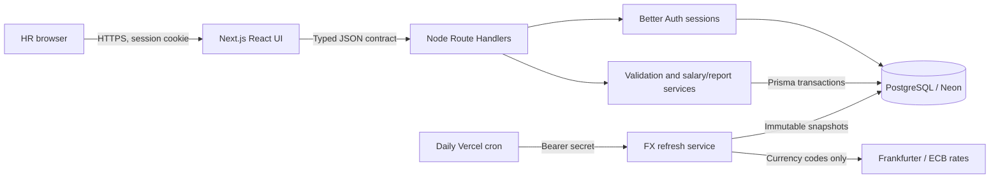

# Architecture and decisions

A single deployable Next.js application keeps UI/API same-origin and avoids a second server host, CORS configuration and distributed transactions. PostgreSQL persists across serverless restarts; a local SQLite file on Vercel would not provide the required durable shared storage. Prisma 7 uses its PostgreSQL driver adapter and explicit migrations. Runtime connection pooling and direct migration URLs are separated.

Provisioned HR users all have the same organizational access. Better Auth owns credential hashing/session lifecycle; each application route checks a session server-side. The UI gate is convenience, not the security boundary. No public sign-up or arbitrary role choice. Mutation routes validate origin, content type and payload; error/log output excludes credentials and salary records.

The employee table holds current annual gross base pay. A salary change checks an integer version and writes the new value plus immutable before/after history in one transaction. Metadata updates also increment version; a stale browser gets HTTP 409 and must reload. Archiving preserves evidence. Database uniqueness/amount/currency checks complement runtime validation.

Import is create-only. Preview is informative, with a hash linking confirmation to the inspected input. The commit parses and validates again, checks current uniqueness and inserts atomically. A unique constraint protects the race after preview. CSV exports escape formula-like strings; exports/report queries share filtering semantics with the directory.

Reporting reads only required columns for the full filtered employee set, then deterministic Decimal functions compute statistics for this bounded 10,000-employee dataset. Directory requests are paginated in SQL with stable ordering. Native-currency groups prevent misleading totals. Start with a single bounded scan; measure before adopting materialized views or background queues.

FX is a separate deterministic conversion layer using persisted rate snapshots; it never changes authoritative salary. See analytics-rules.md for freshness, precision and missing-data decisions. Daily provider I/O is not a dependency of unit tests or ordinary native-currency reporting.

Remaining scaling considerations: connection concurrency in serverless functions, cold starts, import transaction duration and larger than 10,000 report sets need measurements. This assessment is not a payroll engine; taxes, payment execution and country employment-law decisions are outside scope.
