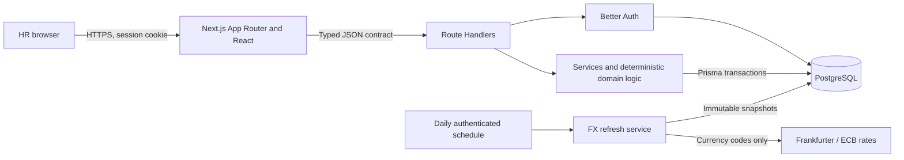

# Architecture and decisions

## F12: Unknown-route recovery, 2026-10-15

Use the existing root `src/app/not-found.tsx` boundary for unmatched top-level and nested URLs. Keep the missing address visible and Next.js's genuine 404/noindex behavior; do not redirect to a normal `/404` page or enable the experimental global-not-found mode for this single-root-layout app. The page is static presentation with scoped CSS, decorative local SVG and recovery links to existing routes. It performs no employee/session queries and does not change API errors or authentication gates. Reuse the public welcome palette and typography; validate status, link recovery, keyboard access and mobile overflow in the browser.

This document records the current system boundaries and the decisions that are expensive or easy to misinterpret. Product acceptance belongs in [PROJECT_SPEC.md](../PROJECT_SPEC.md), execution evidence in [validation.md](validation.md), and current work status in [tasks/todo.md](../tasks/todo.md).

## Current system

One Next.js deployment keeps the browser and API same-origin. Route Handlers enforce session, origin, content-type and body-size boundaries; services coordinate transactions; domain functions own deterministic validation, money, CSV, tenure, reporting and FX rules. PostgreSQL constraints and triggers complement application checks. Prisma uses pooled runtime connections and a separate direct migration connection.

Browser pages compose feature components. TanStack Query owns server state, URL parameters own applied filters, sorting and pagination, and local component state owns unsubmitted drafts. The typed client and [shared contracts](../src/shared/contracts.ts) define the browser/API boundary. Monetary values cross that boundary as decimal strings; an imported employee with no supplied salary uses `null`, never zero.

The employee row holds current annual contractual base pay and a version. Salary assignment or change checks that version and writes the new value and immutable before/after history in one transaction. Metadata updates also increment the version. Archive and restore change lifecycle status without deleting the employee or salary history.

CSV import is create-only. Preview validates content and returns a hash; confirmation submits the reviewed content and hash, then parses, validates and checks uniqueness again before one serializable transaction. Export uses the same employee filters and stable ordering as the directory and protects formula-like cells. Exact import rules are in [csv-data-guide.md](csv-data-guide.md).

Reporting reads the full filtered population and uses deterministic Decimal calculations. Native currencies remain separate. Approximate USD results use one complete, persisted rate snapshot and never change authoritative salaries. Exact statistics, cohort and freshness rules are in [analytics-rules.md](analytics-rules.md).

## Identity, registration and public routes

**Decision, 2026-10-14:** public registration creates one HR account and an authenticated session with immediate access to the existing shared workspace. There is one access level and one organization in the approved assessment scope. Invitation, administrator approval, email verification, role selection and tenant creation do not gate access. This access model is unsuitable for confidential multi-company use until a separate membership and isolation design is approved.

Registration accepts name, work email and a raw 5–128-character password. Name and email are trimmed, email is normalized to lowercase, and the password is preserved exactly. Better Auth owns password hashing, session issuance and revocation. Automatic sign-in is required because disabling it can obscure duplicate-account outcomes and would not satisfy immediate access. After signup, the browser confirms `/api/session` before entering the workspace. If account creation succeeds without a usable session, the UI offers sign-in recovery and does not repeat account creation automatically. Protected APIs always enforce the session independently of page routing.

**Decision, 2026-10-15:** `/` is session-aware. A confirmed anonymous visitor sees the product introduction; an authenticated visitor sees the workspace overview. A failed session check keeps its error/retry state rather than treating the visitor as anonymous. `/welcome` is always public, while anonymous protected deep links redirect to `/login`.

The public link contract is stable:

| Control | Destination |
|---|---|
| Skip to content | `#home-content`, focusing the main landmark |
| ComCentral identity | `/` |
| Features and Explore the workspace | `#features` |
| How it works | `#how-it-works` |
| Employee directory, Salary history and Pay insights | `#directory`, `#salary-history`, `#reporting` |
| Create account | `/register` |
| Sign in or Open your workspace | `/login`; an existing session returns to `/` |

One shared welcome component serves anonymous `/` and `/welcome`. It describes employee records, salary history, import and reporting without fabricated metrics, customer claims or payroll/AI-decision features. Native anchor-backed controls preserve browser navigation and the Server Component boundary. Semantic landmarks, a keyboard skip link, visible focus, reduced-motion behavior and 44px actions apply across phone and desktop layouts. Moving the overview to `/dashboard`, copying reference assets, or adding another animation/UI dependency were rejected because they would add routing or presentation complexity without improving the approved workflow.

## Employee, import and reporting decisions

### Pending salary and CSV compatibility — 2026-10-15 (B01–B04, F08)

An omitted or blank import salary creates an employee with `salary=null`. Pending employees remain searchable and count toward headcount, but are excluded from pay summaries, bands, tenure pay statistics and outlier cohorts. Manual employee creation still requires salary. The first later salary assignment records `previousSalary=null`; metadata edits never assign pay.

CSV columns may be reordered. The accepted aliases are `id` → `employeeCode`, `fullName` → `name`, `jobTitle` → `jobRole`, and `hireDate` → `joiningDate`. Unknown fields, missing required fields and canonical/alias collisions are rejected. Import never overwrites salary. The 10,000-row and 2 MiB limits remain fixed; larger source exports must be split at CSV record boundaries without dropping data.

The nullable-salary schema change is forward-only: keep supplied amounts positive, keep salary history immutable, export pending salary as a blank cell, and deploy only application versions that understand pending records after importing them. Rolling application code back to a salary-required model would make persisted pending employees unsafe to read or update.

This superseded an earlier decision that kept source IDs and missing salaries outside the importer. Its rationale is retained in the [documentation history](archive/2026-10-15-documentation-history.md); it is not current implementation guidance.

### Dashboard readiness and salary filtering — 2026-10-15 (F10)

The approved F10 contract explains the complete filtered population:

- salary coverage uses full-population recorded and pending counts, never one directory page;
- salary coverage remains visible when USD conversion is unavailable and never rounds partial coverage to 100%;
- outlier coverage distinguishes evaluated cohorts, groups below the minimum size and zero-IQR groups;
- currency reporting shows actual FX availability, source and freshness without weakening native reporting;
- matching, recorded and pending links preserve employee filters and archive status, reset directory pagination and omit report-only controls.

The optional `salaryStatus=PENDING|RECORDED` filter applies before directory pagination/counting, report calculation and export; omission includes both states and Clear removes it. The approved layout direction does not by itself prove production integration or verification. Current implementation and check results remain in the task and validation ledgers. A bulk salary simulator and saved report snapshots require separate approval; neither may mutate salaries through this reporting slice.

All dashboard values come from authenticated application responses; production components do not embed demonstration metrics. Treating pending pay as zero, deriving coverage from a directory page, inventing a readiness score and creating a second reporting API were rejected.

### Search, pagination and table presentation — 2026-10-15 (F02, F06, F07)

Applied filter, sort and page state lives in the URL; unsubmitted filter values remain local drafts. Apply or Enter commits filters and resets page one. Clear removes filters while retaining page size and sorting. Back/Forward restores applied state. Query keys isolate results, and selected filter values remain visible while choices load or fail.

The directory uses stable server pagination with 25 rows by default. Desktop shows a bounded, keyboard-focusable table with sticky headers and pagination outside the scroll region; phones use readable cards and compact First/Previous/Next/Last controls. View, Edit and Delete actions have readable labels and employee-specific accessible names. Delete archives and preserves history. Virtualizing the 25-row page, silently dropping filters for stale pages, debouncing the explicit search flow and introducing a second data grid were rejected.

### Import UI state — 2026-10-15 (F08)

File reading and preview state belong to the import workflow, not a global store. Selecting another file immediately invalidates the prior preview, and a sequence guard prevents an older read from replacing the newer file. Confirmation uses the immutable text/hash pair that was reviewed; the server still revalidates every commit.

## Security and operational decisions

### Correlated request diagnostics — 2026-10-15 (B06)

The shared Route Handler boundary emits small allowlisted JSON events with route label, status, duration and correlation ID. AsyncLocalStorage carries the ID through overlapping authentication calls. Unknown paths use a fixed label; query strings, employee IDs, credentials and employee/salary payloads are excluded. Exceptions and full request/response objects are never serialized. Logging failure must not alter the response or cookies.

### Browser rendering policy — 2026-10-15 (S02)

Each document receives a new cryptographic CSP nonce before Next.js renders it, and MUI Emotion receives the same nonce. Reading request headers makes document rendering dynamic so the nonce cannot be cached. Production allows neither arbitrary inline scripts nor `eval`; development permits only the narrow exceptions required by installed Next.js development tooling. A hardcoded nonce or blanket production `unsafe-inline` policy was rejected.

### Durable admission control — 2026-10-15 (S03)

Expensive imports, exports and reports use atomic PostgreSQL admission keyed by authenticated user and route family. The database clock avoids instance drift; fixed windows and capped counters prevent rejected traffic from extending a lockout or growing without bound. Per-process counters were rejected because serverless instances do not share them. This is request-volume control, not an in-flight semaphore.

### Database target and synthetic seed safety — 2026-10-15 (B05, P01, V02)

Test, seed and benchmark guards identify the database the installed PostgreSQL driver will actually open, including driver-recognized query overrides and encoded or duplicate parameters. Naming rules and acknowledgements are additional safeguards, not proof that a target is disposable. Credentials never enter target diagnostics.

Synthetic seeding is allowed only when all of these conditions hold before connecting:

- `COMCENTRAL_SEED_TARGET` is explicitly `demo` or `test`;
- the resolved database name ends in the matching `_demo` or `_test` suffix;
- `COMCENTRAL_SEED_DATABASE_ACK` exactly matches that database name; and
- `NODE_ENV` is not `production`.

The seed locks the employee and seed-marker tables, checks the target and inserts exactly 10,000 deterministic employees inside one serializable transaction. A failed batch rolls back everything. Concurrent first runs serialize; an unchanged repeat reports completion; changed or unrelated data causes refusal rather than deletion. Seed integration tests use a dedicated, migrated, initially empty `SEED_TEST_DATABASE_URL`, separate from application and ordinary integration databases.

## Performance and delivery boundaries

**Decision, 2026-10-15 (P01–P03):** retain the bounded in-process report calculation and complete export for the measured 10,000-row workload. Moving percentiles into SQL or adding streaming consistency machinery could change established rounding/order semantics and is justified only by a reproduced resource or latency problem. Historical measurements and their snapshot limits belong in [validation.md](validation.md), not in this decision record; this decision establishes no hosting SLA or bound on total stored employees.

Local development uses Next.js on explicit port 3000 so an occupied port fails visibly and authentication keeps one known origin. Fast Refresh owns source reloads; environment changes require a restart, and Prisma schema changes require reviewed generation/migration steps. A custom watcher, automatic production rebuild loop and alternate-port fallback were rejected.

The repository keeps one-page scope in [requirements.md](requirements.md), detailed acceptance in [PROJECT_SPEC.md](../PROJECT_SPEC.md), current work in [tasks/todo.md](../tasks/todo.md), execution evidence in [validation.md](validation.md), and significant decisions here. Instruction files do not duplicate changing completion checklists. Deployment configuration, migrations, secrets, scheduling and rollback follow the [deployment runbook](deployment.md).
