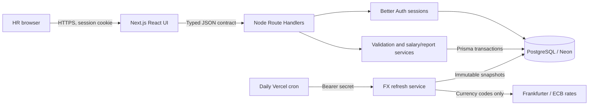

# Architecture and decisions

## Salary-pending CSV records, 2026-10-15 (B01/B02/B03/B04/F08)

After inspection of the actual download, the user approved source id as employeeCode, missing salaries as pending records, France, Brazil/BRL and interns. The user explicitly retained the 10,000-row batch limit. This supersedes the mandatory-salary/source-id decision below. The source has 10,001 records; prepare an exact-value 10,000-row file and a separate one-row remainder rather than silently dropping data or raising the limit.

Represent unsupplied pay as nullable employee.salary, with ACTIVE/ARCHIVED status unchanged. This keeps employment lifecycle independent from compensation completeness. Manual employee creation still requires salary; only imports allow omitted/blank pay. Reject nonblank invalid amounts. Employee and preview response salaries become string|null, Insights adds salaryPendingCount, and first-assignment history has previousSalary=null. Metadata edits never assign pay. HR supplies the first salary through the existing reason/version-protected atomic salary endpoint. Preserve immutable history, positive supplied amounts and stale/archive protections.

All pending employees remain searchable and included in headcount. Exclude them before summaries, bands, tenure pay statistics and outlier cohorts; show the excluded count explicitly. Export null salaries as blank cells. Do not use zero, fabricated salaries or an inferred exchange rate. Reject arbitrary column mapping and bulk salary overwrites; preview hashes and confirmation revalidation remain unchanged.

Apply a forward migration, without modifying the previously applied initial migration. Add enum values and supported countries, relax only the current/previous unsupplied salary fields, and retain positive new salary and audit triggers. Existing eight-currency immutable FX snapshots retain their original checksum semantics; current USD reporting requires complete BRL coverage and reports unavailable until a provider refresh supplies it. Native reporting remains available. Deployment rollback must retain a version that understands nullable salary; do not revert to salary-required code after importing drafts.

## Earlier CSV header compatibility, 2026-10-15 (B01/F08; superseded as above)

The original import rejected any header spelling or order that differed from the template. A source export used fullName/jobTitle/hireDate, an internal id, and no salary. Accept reordered required fields and the three unambiguous name/role/date aliases by resolving a Map of allowed names before building row objects. Reject unknown names, repeated canonical fields (including alias collisions), and missing fields with specific errors. Header spelling stays case-sensitive; arbitrary mapping is outside this slice.

Keep employeeCode and salary mandatory. A source database id is not automatically an HR code, and absence of pay data is not a reason to invent a salary or weaken database constraints. HR must explicitly choose codes and supply annual major-unit amounts. The canonical template/export and JSON EmployeeInput contract stay unchanged; preview and commit already share the parser. Raw-content hashing, confirmation revalidation, decimal validation, limits and atomic transactions remain in place. No schema migration or endpoint change is required.

A single deployable Next.js application keeps UI/API same-origin and avoids a second server host, CORS configuration and distributed transactions. PostgreSQL persists across serverless restarts; a local SQLite file on Vercel would not provide the required durable shared storage. Prisma 7 uses its PostgreSQL driver adapter and explicit migrations. Runtime connection pooling and direct migration URLs are separated.

All HR users have the same organizational access. Better Auth owns credential hashing/session lifecycle; each business-data route checks a session server-side. The UI gate is convenience, not the security boundary. Mutation routes validate origin, content type and payload; error/log output excludes credentials and salary records.

Registration decision, 2026-10-14: public account creation with immediate authenticated access replaces the provisioned-only requirement. A new user registers with name, work email, and password, then enters the existing shared HR workspace with the same employee and salary access as every other HR user. No invitation, administrator approval, email-verification gate, role selection, or separate organization is involved. The frontend and backend now implement this approved scope, including public signup and automatic session creation. Passwords use 5-128 characters following the user decision on the same date. The provisioning script remains available for setup. Isolated PostgreSQL and real browser signup/logout/login checks are recorded in [validation.md](validation.md).

The employee table holds current annual gross base pay. A salary change checks an integer version and writes the new value plus immutable before/after history in one transaction. Metadata updates also increment version; a stale browser gets HTTP 409 and must reload. Archiving preserves evidence. Database uniqueness/amount/currency checks complement runtime validation.

Import is create-only. Preview is informative, with a hash linking confirmation to the inspected input. The commit parses and validates again, checks current uniqueness and inserts atomically. A unique constraint protects the race after preview. CSV exports escape formula-like strings; exports/report queries share filtering semantics with the directory.

Reporting reads only required columns for the full filtered employee set, then deterministic Decimal functions compute statistics for this bounded 10,000-employee dataset. Directory requests are paginated in SQL with stable ordering. Native-currency groups prevent misleading totals. Start with a single bounded scan; measure before adopting materialized views or background queues.

FX is a separate deterministic conversion layer using persisted rate snapshots; it never changes authoritative salary. See analytics-rules.md for freshness, precision and missing-data decisions. Daily provider I/O is not a dependency of unit tests or ordinary native-currency reporting.

Remaining scaling considerations: connection concurrency in serverless functions, cold starts, import transaction duration and larger than 10,000 report sets need measurements. This assessment is not a payroll engine; taxes, payment execution and country employment-law decisions are outside scope.

## Audit adoption decision, 2026-10-14

Retain the single Next.js deployment and Better Auth sessions. PayScope's Express/Turbo separation is useful for independently deployed services, but ComCentral currently benefits from a same-origin browser/API and fewer operational boundaries. Adding a second server would not fix our identified UI, observability or measurement gaps.

Adopt mobile employee cards, accessible reporting visuals, correlated diagnostics and concrete production-start/workload verification in bounded tasks. Preserve our archive/history, version checks, atomic imports and dated FX semantics. Optimize exports/analytics only after a reproducible baseline identifies a resource or latency need; retain exact-data acceptance fixtures during optimization.

Maintain the one-page brief for scope, PROJECT_SPEC.md for detailed acceptance, the task checklist for progress and validation.md for current execution. CLAUDE.md links to AGENTS.md instead of duplicating it. This avoids the conflicting completion checklists and stale agent-file assumptions observed in the reference repository. AI-use entries record actual corrections and evidence, not a claim that generated code is inherently reliable.

## Request diagnostics decision, 2026-10-15 (B06)

Use a small allowlisted JSON logger at the shared Route Handler boundary. It answers which route failed, its status/duration, and how an authentication warning relates to the same request. AsyncLocalStorage propagates the correlation ID through overlapping authentication calls. Unknown paths are reduced to a fixed label and employee IDs/query strings are never logged. Response header IDs are diagnostic, not trusted identity.

Do not serialize exceptions or whole request/response objects and then attempt to redact arbitrary nested fields. Allowlisting prevents new payload fields from silently entering logs. Preserve the response and cookies even when stdout/stderr fails. A separate telemetry SDK or external service is deferred until deployment monitoring requires one; stdout capture provides the current single-application baseline, with retention/alerts tracked in D03.

## Browser rendering policy, 2026-10-15 (S02)

Follow the installed Next.js 16 CSP guide: generate a fresh cryptographic nonce in `src/proxy.ts`, pass the policy into rendering, and pass the same nonce to MUI's Emotion cache. Reading request headers makes document rendering dynamic; static document caching is deliberately traded for per-response script/style authorization. API responses retain their separate no-store and content-type protections. Production permits neither arbitrary inline scripts nor eval. The narrow `style-src-attr` allowance supports MUI positioning/transitions and React style properties; it does not permit unnonced style elements or scripts. HTTPS documents also upgrade insecure subresources; local HTTP verification remains usable.

Reject a blanket `unsafe-inline` script policy and a hardcoded/reused nonce. The browser test injects an unnonced script into the HTML parser and proves it is blocked while the application's matching scripts work. DevTools-created scripts are not an appropriate attack fixture because strict-dynamic trust propagates to non-parser-inserted scripts ([CSP specification](https://www.w3.org/TR/CSP/)). Built local browser evidence is recorded separately from pending preview HTTPS/cookie verification.

## Import presentation boundaries, 2026-10-15 (F08)

Keep mutation submission in the workflow component, file-reading/preview invalidation in a focused hook, and exact result rendering in small table components. A successful preview stores an immutable text/hash pair; confirmation uses that reviewed pair. Replacing a file invalidates it immediately and a sequence identifier prevents an older file read from replacing a newer selection. Avoid a global store or additional state library: this state belongs to one import screen and the backend revalidates every commit.

## Explicit search and durable admission, 2026-10-15 (F07, S03)

Retain explicit Apply filters/Enter submission rather than introduce a debounce. This lets HR compose several filters before one request and keeps history/bookmarked URLs predictable. Typing changes only a draft; submission and Clear reset pagination. URL changes remount the draft, including Back/Forward. Query keys isolate responses and prior-query placeholder rows are removed so the screen does not pair a new filter URL with old records.

Use atomic PostgreSQL admission keyed by authenticated user and route family, rather than per-process counters that reset across serverless instances. Namespaced keys reuse the existing durable rate-limit table without a migration or new service. The database clock avoids instance clock drift; a fixed window and capped counter keep rejected traffic from extending the lockout or growing counts. Existing Better Auth pruning retains rows for its longest configured 15-minute window, longer than these 60-second windows. This is bounded request volume, not an in-flight semaphore. Keep the single-workspace/public signup access decision explicit; stronger organization-level admission belongs to a separately approved membership model.

## Database target identity, 2026-10-15 (B05, P01, V02)

Safety checks must describe the database the installed driver will actually open. Review of `pg-connection-string` found that query parameters can replace the authority host/port or supply a nested connection string. Test, seed and benchmark preflights now reject those driver-recognized overrides, including URL-encoded and duplicate keys, before connecting (`a217afe`). Integration and benchmark comparisons also decode authority hostnames consistently with the driver. TLS and schema options remain supported; credentials never enter target diagnostics.

Do not replace this with a hostname-only URL check or parse a supplied URL through a driver helper that may load certificate files during validation. Naming and acknowledgment checks remain additional operator safeguards; they do not prove that an arbitrary database is disposable.

## Public home and workspace entry, 2026-10-15 (F09)

The user requested a homepage at the normal entry URL. AppShell reuses its existing resolved session: anonymous `/` renders shared public content and authenticated `/` retains the overview. Loading and failed checks retain loading/retry; protected deep links still redirect anonymous visitors to login. `/welcome` remains independently public and server-rendered. This avoids moving the dashboard, rewriting bookmarks or adding a second session source. The presentation uses native anchor-backed MUI controls so it works across the Server/Client Component boundary. Layout, content and rejected presentation alternatives are recorded in [homepage-design.md](homepage-design.md). API authorization remains the independent data boundary.

## Measured report/export scope, 2026-10-15 (P01-P03)

The 10,000-row built-app baseline at `2a7e3d4` completed all measured reads and the large import without errors. Warm p95 report/export times were about 0.53/0.51 seconds, concurrency-two p95 about 1.08/0.92 seconds, and observed whole-process RSS peaked at 459.15 MiB. Retain the current implementation for this workload rather than introducing SQL percentile/rounding differences or streaming consistency complexity without measured need. The initial budgets and limitations are in [performance.md](performance.md); larger accumulated data, hosted memory pressure or greater concurrency can activate P02/P03. This decision does not establish a hosting SLA or bound total stored employees.

## Public welcome presentation and development styles, 2026-10-15 (F09/S02)

Keep one shared welcome component for anonymous `/` and public `/welcome`. A connected-record illustration and numbered editorial feature rows explain employee records, salary history and reports without fabricated metrics. Scoped CSS expresses the original visual direction; native links and Material UI controls retain browser navigation, accessibility and the Server Component boundary. Keep all header links visible on mobile. Reject copying reference-repository assets or adding another animation/UI dependency for this presentation. The complete link contract is in [homepage-design.md](homepage-design.md).

Browser inspection traced development-only style policy violations to Next DevTools' injected style elements, while MUI's Emotion styles already had their nonce. Follow the installed Next.js [development CSP example](https://nextjs.org/docs/app/guides/content-security-policy#development-vs-production-considerations): allow inline style elements only when `NODE_ENV` is exactly `development`. Production retains nonce-only style elements; scripts retain nonce/strict-dynamic in both modes, with development-only eval. Do not disable CSP assertions, relax production, or suppress the errors in browser tests. Regression assertions distinguish the two environments explicitly.
