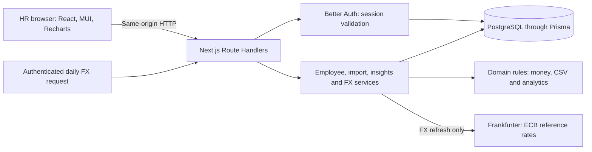

# How ComCentral is structured

ComCentral is one Next.js application backed by PostgreSQL. HR managers maintain employee records, record annual base-pay changes and inspect filtered reports. The browser manages forms and charts; the server validates requests, calculates results and commits database changes.

This document explains the system and its design choices. [Requirements](requirements.md) define scope, the [API contract](api-contract.md) defines HTTP behavior, and [validation](validation.md) records actual checks.

## System overview

The UI and API share one deployment and origin. The browser sends its session cookie with API requests and never connects directly to PostgreSQL or the rate provider.

AI assists development and review. Runtime reports use deterministic server functions; no AI service recommends or changes compensation.

## Code responsibilities

The layers separate presentation, request handling, business rules and persistence:

| Layer | Location | Responsibility |
|---|---|---|
| Pages | [src/app](../src/app) | Public entry, account pages, workspace routes and the root not-found boundary |
| Feature UI | [src/components](../src/components), [API client](../src/lib/api-client.ts) | Forms, tables, charts, server-state queries and typed HTTP requests |
| Shared boundary | [contracts.ts](../src/shared/contracts.ts), [validation.ts](../src/shared/validation.ts) | Input/response types, supported values and runtime schemas |
| Request boundary | [API routes](../src/app/api), [http.ts](../src/server/http.ts), [auth.ts](../src/server/auth.ts) | Session checks, request validation, mutation safeguards and errors |
| Services | [src/server/services](../src/server/services) | Queries, concurrency checks and database transactions |
| Domain rules | [src/server/domain](../src/server/domain) | Decimal arithmetic, CSV parsing, analytics, tenure and FX validation |
| Storage | [Prisma schema](../prisma/schema.prisma), [migrations](../prisma/migrations) | Tables, relationships, indexes and SQL constraints/triggers |

Components call the API client rather than importing server modules. Route Handlers call services; services combine domain functions with Prisma queries and transactions.

## Main request flows

Each workflow uses those boundaries to preserve the same records and rules across screens.

### Find and edit employees

The directory reads applied filters, sorting and pagination from the URL. The client requests a page, and the server validates the session and query before filtering, counting and sorting records. A stable identifier resolves sort ties. Metadata edits submit the employee version so a stale request cannot overwrite a newer change.

Directory, export and insights reuse `employeeWhere` in [employees.ts](../src/server/services/employees.ts). Reports and exports use the complete matching population, not the visible page.

### Change salary with history

The salary endpoint accepts the amount, currency, reason and opening employee version. One transaction checks the version and active status, updates pay, increments the version and inserts before/after history with the actor and timestamp. Failure leaves both current pay and history unchanged.

The editor preserves its draft during background refreshes. A conflict requires an explicit reload before a revised submission. Metadata edits cannot bypass the salary workflow.

### Preview and confirm CSV imports

Preview parses the file, checks validation and duplicates, and returns a hash of the reviewed text. Confirmation sends that text and hash. [imports.ts](../src/server/services/imports.ts) checks them, revalidates the rows and inserts the batch in one serializable transaction.

Import creates employees without overwriting existing records. Missing salary becomes pending pay; a paid import also receives its initial salary-history entry. Selecting a different file invalidates the earlier preview. Exact aliases and limits belong in the [CSV guide](csv-data-guide.md).

### Calculate and display reports

[insights.ts](../src/server/services/insights.ts) loads all matching employees and the stored FX context, then calls the analytics domain functions. Pending employees count toward headcount but not pay statistics. Native currencies remain separate; approximate USD reporting requires a complete usable rate snapshot.

Recharts renders the response. Numeric conversion is limited to chart geometry; labels, tooltips and accessible tables retain exact values. Selecting a native currency for pay charts does not narrow full-population readiness, headcount or outlier data. Calculation definitions belong in [analytics-rules.md](analytics-rules.md).

## Data model and invariants

PostgreSQL stores current records and the evidence needed to explain changes. Application checks and database constraints protect these records together:

| Data | Purpose |
|---|---|
| `User`, `Account`, `Session`, `Verification` | Better Auth identity, credentials and session records |
| `Employee` | Unique code/email, current metadata and salary, lifecycle status and optimistic version |
| `SalaryHistory` | Immutable before/after pay, reason, actor and timestamp linked to the employee |
| `FxSnapshot`, `FxRefreshAttempt` | Immutable dated rate contents and refresh success/failure observations |
| `RateLimit` | Shared counters for authentication and expensive request admission |
| `SeedMarker` | Identifies the deterministic synthetic population and guards repeat seeding |

Money uses database decimals and decimal strings across the API. Missing imported salary is `null`, never an invented zero. Manual creation requires salary; the first later assignment to a pending employee records a null previous salary. Delete archives an employee while preserving history; restore reverses that lifecycle change.

## Browser state and access

TanStack Query owns fetched server state. URL parameters own applied filters, sorting and pagination. Local form state owns unsubmitted drafts. Apply or Enter commits directory filters and resets page one; browser history restores applied state.

Public registration creates an HR account and session with immediate access to one shared workspace. This is the approved assessment model, with no invitation, approval or email-verification gate. It does not establish private-company membership; additional roles and tenant isolation require a separate design.

Better Auth stores sessions in PostgreSQL and uses HTTP-only cookies, with secure cookies in production. Public signup accepts 5-128-character passwords; optional operator provisioning requires 12-128 characters and creates credentials without a browser session. The UI confirms the session after signup/login; protected APIs enforce authorization independently of navigation.

Anonymous `/` shows the introduction; authenticated `/` shows Overview. `/welcome` remains public. Protected deep links direct anonymous visitors to login. The root not-found boundary returns a real 404 without querying employee data.

## Security and reliability boundaries

Shared request infrastructure applies these safeguards before or around business operations:

- Mutation requests check origin, content type and bounded input.
- PostgreSQL-backed authentication and import/report/export limits work across instances. They limit request volume, not in-flight concurrency.
- [proxy.ts](../src/proxy.ts) supplies a per-document Content Security Policy nonce to Next.js and MUI. Production scripts/style elements use the nonce; inline style attributes remain allowed for UI positioning. Development has separate tooling allowances.
- [request-logging.ts](../src/server/request-logging.ts) emits correlated diagnostics without credentials or employee/salary payloads. Logging failure cannot replace the original response.
- Test, seed and benchmark guards reject unsafe database targets. Names and acknowledgements supplement connection checks; they do not prove ownership or disposability.

## Design choices and trade-offs

These choices support the approved workflows without adding unneeded infrastructure:

| Choice | Reason and alternative considered |
|---|---|
| One Next.js deployment | Keeps UI/API same-origin. A separate API deployment adds configuration without an approved independent scaling need. |
| Services and domain functions | Separates transactions from deterministic rules. Add repository abstractions or packages only for demonstrated duplication. |
| Decimal money and pending pay | Prevents floating-point drift and invented salaries. Chart coordinates never become calculation inputs. |
| Versioned writes and immutable history | Rejects lost updates and preserves pay-change reasons. Unconditional updates and physical deletion would lose that protection. |
| Confirmed, create-only CSV transactions | Prevents partial imports and salary replacement. Source aliases and nullable pay support the approved migration input without inventing data. |
| Stored FX snapshots | Makes source, date, completeness and failure visible. Guessed rates and silent fallback were rejected; employee data never reaches the provider. |
| In-process reporting | Retains exact rules for the measured 10,000-employee workload. SQL aggregation and streaming export depend on reproduced resource/latency problems, not speculative scale. |

## Runtime and delivery

Vercel runs Next.js; Neon hosts PostgreSQL. [prisma.ts](../src/server/db/prisma.ts) reuses a client within an instance and bounds its connection pool. Runtime uses `DATABASE_URL`; reviewed migrations use a separate direct connection outside the application build. Local development uses explicit port 3000 and Fast Refresh.

The authenticated daily FX route stores validated snapshots and records handled refresh failures. Cron configuration does not prove a scheduled invocation occurred. Unusable rates leave native reporting available and converted totals unavailable. The [deployment runbook](deployment.md) defines operational procedures.

Unit/component checks exercise isolated behavior; database integration uses separate disposable targets; production-build browser checks exercise the running app. Architecture describes the implementation, not a release approval. Use [validation.md](validation.md) for revision-specific results and [tasks/todo.md](../tasks/todo.md) for remaining work.
