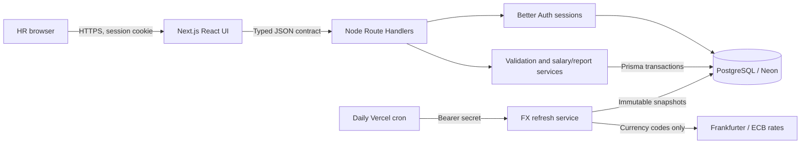
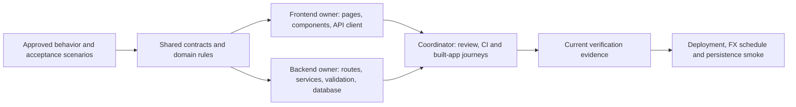
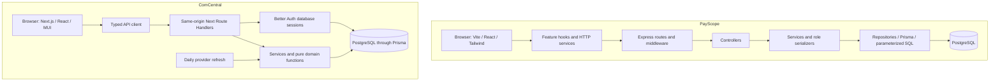

# Documentation history - 15 October 2026
This is a frozen audit record, not setup instructions or a current status board. The retained originals include superseded access/import choices and contradictory deployment observations; later decisions in [architecture](../architecture.md) and the current [validation ledger](../validation.md) take precedence. Current work lives only in [tasks/todo.md](../../tasks/todo.md).

Consolidation preserved original task IDs, acceptance criteria, rejected alternatives, review corrections and dated command results before removing duplicate guides. Original relative links are retained literally inside code blocks so retired instructions cannot become live navigation. Use the source labels below or Git history when tracing an older claim.

Base repository revision at the first capture: `1dbb3efa5317f1b4cf44f817895028d19e23a607`. Later working-tree evidence was captured before consolidation. Source hashes identify the captured document text, not a fully verified application revision.

## Source index
- [docs/architecture.md](#source-docs-architecture-md)
- [docs/ai-use.md](#source-docs-ai-use-md)
- [docs/validation.md](#source-docs-validation-md)
- [docs/homepage-design.md](#source-docs-homepage-design-md)
- [docs/dashboard-design.md](#source-docs-dashboard-design-md)
- [docs/registration-handoff.md](#source-docs-registration-handoff-md)
- [docs/seed-safety.md](#source-docs-seed-safety-md)
- [docs/demo-script.md](#source-docs-demo-script-md)
- [docs/dependencies.md](#source-docs-dependencies-md)
- [docs/implementation-plan.md](#source-docs-implementation-plan-md)
- [docs/payscope-comparison.md](#source-docs-payscope-comparison-md)
- [docs/reference-review.md](#source-docs-reference-review-md)
- [docs/vercel-deployment-checklist.md](#source-docs-vercel-deployment-checklist-md)
- [docs/vercel-readiness-2026-10-15.md](#source-docs-vercel-readiness-2026-10-15-md)
- [tasks/plan.md](#source-tasks-plan-md)
- [tasks/todo.md](#source-tasks-todo-md)
- [tasks/browser-verification-2026-10-15.md](#source-tasks-browser-verification-2026-10-15-md)
- [tasks/directory-pagination-2026-10-15.md](#source-tasks-directory-pagination-2026-10-15-md)
- [tasks/local-ui-handoff.md](#source-tasks-local-ui-handoff-md)

<a id="source-docs-architecture-md"></a>

## docs/architecture.md

Captured source SHA-256: `6dedbcdacd9ab745729c85ca4a1d9be9bd5a791c9726c8573bca4b4143492441`. Origin: committed baseline; active owned writer changes follow separately.

<details>
<summary>Read the historical source</summary>

````markdown
# Architecture and decisions

## F10: Dashboard data readiness, 2026-10-15

The user approved the interview-focused dashboard improvements. The first slice explains coverage of the full filtered population and opens its matching employees. Recorded/pending counts come from Insights, never a directory page. Salary coverage remains visible when approximate USD reporting is unavailable. Outlier coverage distinguishes evaluated cohorts, groups below the minimum size and zero-IQR groups; flags remain a review aid.

The shared optional `salaryStatus=PENDING|RECORDED` filter selects current null/non-null salaries. Omission includes both. Apply it before directory pagination/counting, report calculation and CSV export. Both filter bars expose it; Clear removes it. Dashboard links preserve applied employee filters and archive status, reset the directory page and omit report-only controls. No schema migration is needed.

Rejected alternatives: treating pending pay as zero, counting a directory page, rounding partial coverage to 100%, inventing a readiness score, or creating a second reporting API. Metric drill-down, a preview-only budget simulator and saved report snapshots remain later slices.

## Directory pagination and filter state, 2026-10-15 (F02/B02)

Keep URL query parameters as the applied filter/pagination/sort state and local state as the unsubmitted filter draft. Copy only actual filter fields into that draft so captured page/sort values cannot overwrite later navigation. Retain explicit Apply/Enter semantics; clearing removes every filter and resets page one while retaining page size and sorting. Individual dropdowns are not cascading, and valid combinations may have no matches.

Add labelled First/Previous/Next/Last controls with disabled boundaries and retain numeric page links. If an old URL points beyond the current page count, explain that matching records still exist and offer first-page recovery preserving filters. Do not change the API response or silently remove criteria. Keep selected dropdown values as fallback options while choices are loading, failed or no longer listed; a blank select must not misrepresent an applied filter. Server validation remains authoritative.

## Salary-pending CSV records, 2026-10-15 (B01/B02/B03/B04/F08)

After inspection of the actual download, the user approved source id as employeeCode, missing salaries as pending records, France, Brazil/BRL and interns. The user explicitly retained the 10,000-row batch limit. This supersedes the mandatory-salary/source-id decision below. The source has 10,001 records; prepare an exact-value 10,000-row file and a separate one-row remainder rather than silently dropping data or raising the limit.

Represent unsupplied pay as nullable employee.salary, with ACTIVE/ARCHIVED status unchanged. This keeps employment lifecycle independent from compensation completeness. Manual employee creation still requires salary; only imports allow omitted/blank pay. Reject nonblank invalid amounts. Employee and preview response salaries become string|null, Insights adds salaryPendingCount, and first-assignment history has previousSalary=null. Metadata edits never assign pay. HR supplies the first salary through the existing reason/version-protected atomic salary endpoint. Preserve immutable history, positive supplied amounts and stale/archive protections.

All pending employees remain searchable and included in headcount. Exclude them before summaries, bands, tenure pay statistics and outlier cohorts; show the excluded count explicitly. Export null salaries as blank cells. Do not use zero, fabricated salaries or an inferred exchange rate. Reject arbitrary column mapping and bulk salary overwrites; preview hashes and confirmation revalidation remain unchanged.

Apply a forward migration, without modifying the previously applied initial migration. Add enum values and supported countries, relax only the current/previous unsupplied salary fields, and retain positive new salary and audit triggers. Existing eight-currency immutable FX snapshots retain their original checksum semantics; current USD reporting requires complete BRL coverage and reports unavailable until a provider refresh supplies it. Native reporting remains available. Deployment rollback must retain a version that understands nullable salary; do not revert to salary-required code after importing drafts.

## Earlier CSV header compatibility, 2026-10-15 (B01/F08; superseded as above)

The original import rejected any header spelling or order that differed from the template. A source export used fullName/jobTitle/hireDate, an internal id, and no salary. Accept reordered required fields and the three unambiguous name/role/date aliases by resolving a Map of allowed names before building row objects. Reject unknown names, repeated canonical fields (including alias collisions), and missing fields with specific errors. Header spelling stays case-sensitive; arbitrary mapping is outside this slice.

Keep employeeCode and salary mandatory. A source database id is not automatically an HR code, and absence of pay data is not a reason to invent a salary or weaken database constraints. HR must explicitly choose codes and supply annual major-unit amounts. The canonical template/export and JSON EmployeeInput contract stay unchanged; preview and commit already share the parser. Raw-content hashing, confirmation revalidation, decimal validation, limits and atomic transactions remain in place. No schema migration or endpoint change is required.



A single deployable Next.js application keeps UI/API same-origin and avoids a second server host, CORS configuration and distributed transactions. PostgreSQL persists across serverless restarts; a local SQLite file on Vercel would not provide the required durable shared storage. Prisma 7 uses its PostgreSQL driver adapter and explicit migrations. Runtime connection pooling and direct migration URLs are separated.

All HR users have the same organizational access. Better Auth owns credential hashing/session lifecycle; each business-data route checks a session server-side. The UI gate is convenience, not the security boundary. Mutation routes validate origin, content type and payload; error/log output excludes credentials and salary records.

Registration decision, 2026-10-14: public account creation with immediate authenticated access replaces the provisioned-only requirement. A new user registers with name, work email, and password, then enters the existing shared HR workspace with the same employee and salary access as every other HR user. No invitation, administrator approval, email-verification gate, role selection, or separate organization is involved. The frontend and backend now implement this approved scope, including public signup and automatic session creation. Passwords use 5-128 characters following the user decision on the same date. The provisioning script remains available for setup. Isolated PostgreSQL and real browser signup/logout/login checks are recorded in [validation.md](validation.md).

The employee table holds current annual gross base pay. A salary change checks an integer version and writes the new value plus immutable before/after history in one transaction. Metadata updates also increment version; a stale browser gets HTTP 409 and must reload. Archiving preserves evidence. Database uniqueness/amount/currency checks complement runtime validation.

Import is create-only. Preview is informative, with a hash linking confirmation to the inspected input. The commit parses and validates again, checks current uniqueness and inserts atomically. A unique constraint protects the race after preview. CSV exports escape formula-like strings; exports/report queries share filtering semantics with the directory.

Reporting reads only required columns for the full filtered employee set, then deterministic Decimal functions compute statistics for this bounded 10,000-employee dataset. Directory requests are paginated in SQL with stable ordering. Native-currency groups prevent misleading totals. Start with a single bounded scan; measure before adopting materialized views or background queues.

FX is a separate deterministic conversion layer using persisted rate snapshots; it never changes authoritative salary. See analytics-rules.md for freshness, precision and missing-data decisions. Daily provider I/O is not a dependency of unit tests or ordinary native-currency reporting.

Remaining scaling considerations: connection concurrency in serverless functions, cold starts, import transaction duration and larger than 10,000 report sets need measurements. This assessment is not a payroll engine; taxes, payment execution and country employment-law decisions are outside scope.

## Audit adoption decision, 2026-10-14

Retain the single Next.js deployment and Better Auth sessions. PayScope's Express/Turbo separation is useful for independently deployed services, but ComCentral currently benefits from a same-origin browser/API and fewer operational boundaries. Adding a second server would not fix our identified UI, observability or measurement gaps.

Adopt mobile employee cards, accessible reporting visuals, correlated diagnostics and concrete production-start/workload verification in bounded tasks. Preserve our archive/history, version checks, atomic imports and dated FX semantics. Optimize exports/analytics only after a reproducible baseline identifies a resource or latency need; retain exact-data acceptance fixtures during optimization.

Maintain the one-page brief for scope, PROJECT_SPEC.md for detailed acceptance, the task checklist for progress and validation.md for current execution. CLAUDE.md links to AGENTS.md instead of duplicating it. This avoids the conflicting completion checklists and stale agent-file assumptions observed in the reference repository. AI-use entries record actual corrections and evidence, not a claim that generated code is inherently reliable.

## Request diagnostics decision, 2026-10-15 (B06)

Use a small allowlisted JSON logger at the shared Route Handler boundary. It answers which route failed, its status/duration, and how an authentication warning relates to the same request. AsyncLocalStorage propagates the correlation ID through overlapping authentication calls. Unknown paths are reduced to a fixed label and employee IDs/query strings are never logged. Response header IDs are diagnostic, not trusted identity.

Do not serialize exceptions or whole request/response objects and then attempt to redact arbitrary nested fields. Allowlisting prevents new payload fields from silently entering logs. Preserve the response and cookies even when stdout/stderr fails. A separate telemetry SDK or external service is deferred until deployment monitoring requires one; stdout capture provides the current single-application baseline, with retention/alerts tracked in D03.

## Browser rendering policy, 2026-10-15 (S02)

Follow the installed Next.js 16 CSP guide: generate a fresh cryptographic nonce in `src/proxy.ts`, pass the policy into rendering, and pass the same nonce to MUI's Emotion cache. Reading request headers makes document rendering dynamic; static document caching is deliberately traded for per-response script/style authorization. API responses retain their separate no-store and content-type protections. Production permits neither arbitrary inline scripts nor eval. The narrow `style-src-attr` allowance supports MUI positioning/transitions and React style properties; it does not permit unnonced style elements or scripts. HTTPS documents also upgrade insecure subresources; local HTTP verification remains usable.

Reject a blanket `unsafe-inline` script policy and a hardcoded/reused nonce. The browser test injects an unnonced script into the HTML parser and proves it is blocked while the application's matching scripts work. DevTools-created scripts are not an appropriate attack fixture because strict-dynamic trust propagates to non-parser-inserted scripts ([CSP specification](https://www.w3.org/TR/CSP/)). Built local browser evidence is recorded separately from pending preview HTTPS/cookie verification.

## Import presentation boundaries, 2026-10-15 (F08)

Keep mutation submission in the workflow component, file-reading/preview invalidation in a focused hook, and exact result rendering in small table components. A successful preview stores an immutable text/hash pair; confirmation uses that reviewed pair. Replacing a file invalidates it immediately and a sequence identifier prevents an older file read from replacing a newer selection. Avoid a global store or additional state library: this state belongs to one import screen and the backend revalidates every commit.

## Explicit search and durable admission, 2026-10-15 (F07, S03)

Retain explicit Apply filters/Enter submission rather than introduce a debounce. This lets HR compose several filters before one request and keeps history/bookmarked URLs predictable. Typing changes only a draft; submission and Clear reset pagination. URL changes remount the draft, including Back/Forward. Query keys isolate responses and prior-query placeholder rows are removed so the screen does not pair a new filter URL with old records.

Use atomic PostgreSQL admission keyed by authenticated user and route family, rather than per-process counters that reset across serverless instances. Namespaced keys reuse the existing durable rate-limit table without a migration or new service. The database clock avoids instance clock drift; a fixed window and capped counter keep rejected traffic from extending the lockout or growing counts. Existing Better Auth pruning retains rows for its longest configured 15-minute window, longer than these 60-second windows. This is bounded request volume, not an in-flight semaphore. Keep the single-workspace/public signup access decision explicit; stronger organization-level admission belongs to a separately approved membership model.

## Database target identity, 2026-10-15 (B05, P01, V02)

Safety checks must describe the database the installed driver will actually open. Review of `pg-connection-string` found that query parameters can replace the authority host/port or supply a nested connection string. Test, seed and benchmark preflights now reject those driver-recognized overrides, including URL-encoded and duplicate keys, before connecting (`a217afe`). Integration and benchmark comparisons also decode authority hostnames consistently with the driver. TLS and schema options remain supported; credentials never enter target diagnostics.

Do not replace this with a hostname-only URL check or parse a supplied URL through a driver helper that may load certificate files during validation. Naming and acknowledgment checks remain additional operator safeguards; they do not prove that an arbitrary database is disposable.

## Public home and workspace entry, 2026-10-15 (F09)

The user requested a homepage at the normal entry URL. AppShell reuses its existing resolved session: anonymous `/` renders shared public content and authenticated `/` retains the overview. Loading and failed checks retain loading/retry; protected deep links still redirect anonymous visitors to login. `/welcome` remains independently public and server-rendered. This avoids moving the dashboard, rewriting bookmarks or adding a second session source. The presentation uses native anchor-backed MUI controls so it works across the Server/Client Component boundary. Layout, content and rejected presentation alternatives are recorded in [homepage-design.md](homepage-design.md). API authorization remains the independent data boundary.

## Measured report/export scope, 2026-10-15 (P01-P03)

The 10,000-row built-app baseline at `2a7e3d4` completed all measured reads and the large import without errors. Warm p95 report/export times were about 0.53/0.51 seconds, concurrency-two p95 about 1.08/0.92 seconds, and observed whole-process RSS peaked at 459.15 MiB. Retain the current implementation for this workload rather than introducing SQL percentile/rounding differences or streaming consistency complexity without measured need. The initial budgets and limitations are in [performance.md](performance.md); larger accumulated data, hosted memory pressure or greater concurrency can activate P02/P03. This decision does not establish a hosting SLA or bound total stored employees.

## Public welcome presentation and development styles, 2026-10-15 (F09/S02)

Keep one shared welcome component for anonymous `/` and public `/welcome`. A connected-record illustration and numbered editorial feature rows explain employee records, salary history and reports without fabricated metrics. Scoped CSS expresses the original visual direction; native links and Material UI controls retain browser navigation, accessibility and the Server Component boundary. Keep all header links visible on mobile. Reject copying reference-repository assets or adding another animation/UI dependency for this presentation. The complete link contract is in [homepage-design.md](homepage-design.md).

Browser inspection traced development-only style policy violations to Next DevTools' injected style elements, while MUI's Emotion styles already had their nonce. Follow the installed Next.js [development CSP example](https://nextjs.org/docs/app/guides/content-security-policy#development-vs-production-considerations): allow inline style elements only when `NODE_ENV` is exactly `development`. Production retains nonce-only style elements; scripts retain nonce/strict-dynamic in both modes, with development-only eval. Do not disable CSP assertions, relax production, or suppress the errors in browser tests. Regression assertions distinguish the two environments explicitly.

## Fixed local development address, 2026-10-15 (F06/V02)

Use the installed Next.js development server with an explicit `--port 3000`. Its Fast Refresh mechanism recompiles saved source; `next start` serves only an existing production build. The explicit port disables Next's automatic fallback to another port and makes an occupied port a visible startup error. Keep one local development process and the matching localhost authentication origin. Reject a custom file watcher, automatic production rebuild loop or repeated alternate ports: Next already owns development reloads. Environment and Prisma schema changes still require the relevant restart/generation/migration; the address stays the same.

## Employee pagination presentation and action icons, 2026-10-15 (F02/F06)

The user identified the pagination layout as the problem and requested action icons. Keep pagination inside the results card: show the returned record range and a labelled page-size selector; use controlled Material UI numbered pages on desktop and compact First/Previous/Next/Last icon controls on phones. Keep the API's one-based page convention, server totals, existing filter/sort navigation and first-page reset when page size changes. Retain valid bookmarked sizes alongside the common 10/25/50/100 options. Do not invent ranges for empty results. This supersedes the four large text-button presentation described above. The pattern follows [Material UI pagination](https://v7.mui.com/material-ui/react-pagination/).

Use Eye/Pencil/Trash icons on existing View/Edit/Delete controls with readable labels and employee-specific accessible names. Delete still archives and preserves history; its confirmation remains on the detail page. Reject unlabeled icon-only data actions and a new deletion behavior for a visual request. During phone inspection the Next development indicator overlapped the page counter; use the documented `devIndicators: false` option, which hides that indicator while Next continues to report compilation/runtime errors.

## Employee table scrolling, 2026-10-15 (F02/F06)

The user explicitly confirmed the Employee directory table should keep 25 records per page with scrolling. Preserve the existing server pagination and default page size; bound the desktop table to the smaller of 65vh and 40rem. Keep pagination outside the scrolling area, use sticky column headers, and expose a named, keyboard-focusable region with a visible focus outline. Scroll padding keeps row controls clear of the fixed header and action column. Mobile retains the existing readable cards. Do not truncate fetched records or replace the native table with a virtualized grid for this request. This follows the installed MUI 7 sticky-header API and [scroll-container keyboard accessibility guidance](https://developer.mozilla.org/en-US/docs/Web/CSS/Reference/Properties/overflow#accessibility).
````

</details>

<a id="source-docs-ai-use-md"></a>

## docs/ai-use.md

Captured source SHA-256: `6bf007d9943e41bc535f9f520ac37a7422e208b64d3d8767f12768f49b12fdde`. Origin: latest working snapshot at consolidation.

<details>
<summary>Read the historical source</summary>

````markdown
# AI collaboration log

## F12: Branded missing-page boundary, 2026-10-15

The user requested a polished 404 placeholder, then clarified that nonexistent routes must render it. The coordinator read the installed Next.js not-found guide and existing welcome design, replaced the minimal root boundary with a responsive static design, and added GET-only browser coverage for unmatched/nested paths, genuine status, noindex, navigation, focus and four widths. No generated image, dependency, data import, API or auth change was needed. Static presentation did not receive redundant markup unit tests; real browser acceptance checks the routing behavior. Concurrent project changes and validation results remain separate in the F12 task and validation ledger.

## F10 readiness implementation, 2026-10-15

Request summary: develop the highest-impact dashboard improvements after comparing PayScope, update the task checklist, then push all project code. The coordinator implemented a full-population data-readiness panel and additive salary-status filtering across directory, reports and export while preserving existing employee/import/UI work.

The incremental implementation, frontend UI, API design, testing and Git workflows guided this slice. The coding-orchestrator assessment was moderate complexity (a shared filter, several consumers and UI state); independent read-only review used the supported strong fallback `gpt-5.6-sol/high` because the preferred balanced model was unavailable. No nested delegation occurred.

Tests first demonstrated the absent filter/component. Review corrected coverage rounding that could show 100% with a pending salary and made shared filter help apply to both directory and reports. The focused follow-up passed 13/13 with unchanged timeouts and one worker; the earlier two-worker attempt had one timeout. Final checks and remaining limitations belong in validation.md. No AI-generated salary recommendation or fabricated production data is introduced.

## Directory navigation and filter verification, 2026-10-15 (F02/B02/V02/C02)

The user requested First/Previous/Next/Last and reported that filters were not working. The coordinator traced URL state, the typed API client, route validation and database filtering; a retained frontend worker reproduced missing controls, a misleading stale-page empty state and blank selections when option values were unavailable. A retained backend reviewer independently confirmed that the filter names, search and combined AND criteria already agreed. No nested delegation or API/schema change was needed.

New frontend regressions failed before implementation, then passed alongside retained Apply/Enter/Clear/history behavior. The coordinator added a guarded isolated database matrix and real desktop/mobile browser acceptance. Independent review corrected browser assertions to match currency-labelled pending pay and to compare Clear against the actual unfiltered test count, avoiding dependence on an empty database. Numeric navigation is retained rather than breaking existing callers. A test-only unsupported exact option was corrected for Testing Library, and an initial Vitest sandbox permission error was retried outside the sandbox. Execution results and shared-tree limitations are recorded in validation.md and the task tracker. Unrelated Edit/import/backend work is preserved and excluded from the scoped feature commit.

## Actual-file draft import correction, 2026-10-15 (B01/B02/B03/B04/F08/C02)

The earlier alias-only fix did not satisfy the user's main workflow because the downloaded file contained id rather than employeeCode, no salary, additional country/employment values and 10,001 records. The coordinator inspected counts, field completeness and allowed-value coverage without printing employee data. The user explicitly approved id mapping and salary-pending imports, supported France/Brazil/BRL/interns, then corrected the proposed higher limit back to 10,000.

Two existing workers implemented independent backend and frontend slices against coordinated shared contracts; no nested delegation. Backend added failing draft/FX/analytics cases before the fix; frontend added six failing pending-pay regressions before implementation. The coordinator integrated actual-file and synthetic built-app Playwright checks. Three old invalid-INTERN fixtures were corrected to use an unsupported value while retaining their rejection assertions, and positive new-country/type filter cases were added. Browser failures were traced to test locators selecting a hidden mobile label and an incorrect salary-field label; corrected visible-row/accessible-name locators passed without weakening assertions or raising timeouts.

The private prepared file saved and fetched every one of its 10,000 records with exact source-field comparison and survived UI reload; the source download remained unchanged. A separate reproducible synthetic journey also adds the first salary and verifies audit history. Final independent backend review found no blocker. Required checks, isolated database use and the configured Neon migration are recorded in validation.md. Downloaded employee data, credentials and local test connection strings are excluded from Git; unrelated concurrent welcome/deployment work is preserved.

This is an evidence record, not a collection of reconstructed prompts. Earlier paragraphs are retrospective summaries of the work and results at those checkpoints. Current test/deployment status lives in [validation.md](validation.md). A reviewer can start with [reviewer-guide.md](reviewer-guide.md) and follow task IDs through the checklist and Git history.

## CSV compatibility follow-up, 2026-10-15 (B01/F08/C02)

The user asked to fix the rejected CSV and verify the complete UI/backend/database flow. The coordinator inspected the real parser, services, API routes, UI and isolated-test guards. Ten new parser regressions first produced eight failures against the old exact-header implementation. A bounded header-alias/ordering change then passed all fourteen parser cases. The user subsequently observed the new specific unsupported-id/missing-code/missing-salary errors, confirming that their running app had the updated validator while their original file still lacked required data.

An independent read-only agent reviewed mapping correctness, field collisions, API/schema dependencies and data-integrity boundaries; it found no blocking issues. The coordinator added missing-field UI coverage, real PostgreSQL persistence/rejection cases and a live browser correction/import/reload journey. No source id or missing salary was guessed. Actual checks and environment failures are recorded in [validation.md](validation.md); the implementation and evidence belong to this CSV slice's incremental commit. Unrelated concurrent work was preserved.

## Audit implementation, 2026-10-14

**User request, summarized:** implement the audit incrementally, update the requirements and Markdown documentation, commit verified slices, and make the engineering judgment and AI contribution understandable to interviewers. The user subsequently confirmed that the independent backend session had stopped and this session may implement backend work too, and authorized continuing routine file/Git work unattended.

**Approach and rationale:** retain the existing Next.js/MUI/Prisma/Better Auth architecture and its data-integrity boundaries. Add a product specification mapping outcomes to acceptance criteria and a short reviewer reading path. Keep CLAUDE.md as a pointer to AGENTS.md so tools share one set of durable rules. Preserve future account/tenant decisions as explicit scope items. This adopts the useful documentation discipline from PayScope without copying its code or creating conflicting specifications.

**Initial delegation:** F01 salary-dialog investigation was scored 6/8, medium risk; independent registration review was scored 5/8 with a high-risk auth override. The routing helper selected gpt-5.6-sol with high reasoning for both, and both were actually dispatched with narrow file ownership/read-only scope respectively. No nested delegation or model escalation. Assessments and exposed model capabilities are in docs/agent-routing/audit-*.json. The coordinator owns integration and commits and checks findings against source.

**Documentation verification:** the updated requirements PDF contains 642 words on one A4 page; source text and page bounds were checked and the rendered page was visually inspected. scripts/render-requirements.py makes that export reproducible. Application verification and the F01 result are recorded when completed, not inferred from these documentation checks.

Current audit corrections: F01 timings separated MUI modal-shell cost from salary workflow behavior, preserving every conflict/reload assertion (`568d808`). Independent auth review found login redirecting before session confirmation; fixed and covered by two initially failing regressions (`d29c4fd`). The proxy-spoofing concern was checked against Vercel's documented overwrite behavior and recorded as a hosting assumption rather than a confirmed Vercel vulnerability (`f6ff9be`). Seed review found preflight checks outside the transaction and a missing unrelated-marker refusal; explicit target guards, table locks and a dedicated test database now verify four database cases (`8db8eed`). B01 added real multi-batch, rollback and race evidence without changing a service that already met those invariants. B03 reproduced acceptance of a checksum-mismatched FX snapshot before implementing read-time verification. These examples record how generated work was challenged and corrected.

## Parallel implementation and release review, 2026-10-15

**User request, summarized:** prioritize the remaining 20 delivery tasks, implement independent slices in parallel, make incremental commits, and report completed/pending counts. The user later selected a 2-3 hour milestone for local release checks and performance evidence. Deployment, the scheduled invocation, alert delivery and recovery evidence remain a later milestone; they are not silently marked complete.

**Execution:** two gpt-5.6-sol/high workers handled frontend and backend ownership while the coordinator reviewed contracts, integration, browser behavior, documentation and Git. Fresh workers replaced stale tool sessions after the session permission profile changed; no request to override the active tool controls was needed. The host's concurrency limit and shared machine favored two bounded workers over a larger group competing on the same tests/builds.

**Corrections that affected delivery:** screenshot inspection found a desktop flex-basis becoming a large vertical gap in the mobile filter column (`70789e7`). An initial CSP attack fixture inserted scripts through DevTools, which can inherit strict-dynamic trust; replacing it with HTML-parser injection verified the intended threat (`721a41d`). Two simultaneous Playwright runs competed for their output directory, so subsequent browser commands run serially. A redundant screenshot timed out after the behavioral assertions; dedicated viewport screenshots retained visual coverage. Request logging changed the integration log schema; the test was updated to verify exact allowed fields and preserved rollback/redaction assertions (`1b1678b`). Readiness review found a zero-argument inferred route type; an explicit request tuple restored the typed request/logging contract (`b36f906`).

**State and security review:** search keeps explicit submission and removes prior-query placeholder rows (`601a042`); CSV confirmation uses the immutable reviewed text/hash (`04db88f`). PostgreSQL admission uses atomic database-clock windows rather than process-local counters (`d20c42f`, `a4b9c3b`). Benchmark review required per-request time bounds, sanitized unexpected database errors, exact export row checks, and cleanup of only owned fixtures. Dependency triage distinguished the uploaded-CSV parser from optional CLI/test peer dependencies instead of applying npm's suggested Prisma major downgrade. Actual dependency changes, measured performance and final gates are recorded in validation.md when executed.

**Evidence discipline:** agent summaries were checked against diffs and actual command output; focused checks did not substitute for the final clean-checkout gate. A diagnostic larger timeout for the search test was not used for acceptance; the unchanged default timeout subsequently passed. No unmeasured productivity percentage, deployed URL, daily-job proof or interview claim is inferred from generated documentation.

**Release corrections:** coordinator review traced a database-target guard discrepancy to the installed driver's query-parameter precedence and percent-decoded hostnames. A bounded gpt-5.6-sol/high worker updated the four entry-point guards and regression cases; coordinator diff review and focused evidence preceded commit `a217afe`. The actual test targets remained isolated. A clean unit run also showed that the earlier AppShell query-scoping change alone was insufficient under host memory pressure. Temporary profiling was removed after diagnosis; the session tests now isolate the unrelated MUI Drawer implementation while retaining all session/cache assertions and real-browser drawer coverage (`0b6e210`). A separate worker reviewed that test boundary. The remaining complete-suite gate is recorded as pending until it actually passes.

**Runtime acceptance:** the first combined browser run caught a welcome-page error that its unit test and production build had not detected: a function-valued Link component crossed the Server/Client Component boundary. The frontend worker changed the three entry links to native anchors without moving the page to the client (`3873b7c`). Coordinator inspection of the installed NextRequest implementation also explained why IP-based loopback origins failed strict mutation checks; only local test/benchmark configuration changed (`976872e`). The corrected combined browser run passed 31/31. These are examples of runtime evidence correcting generated implementation and environment assumptions, rather than treating a successful build as sufficient.

## Homepage refinement and release harness, 2026-10-15

**User request, summarized:** make the homepage the normal entry, think through its layout/content using the prior PayScope comparison, and continue the priority work. A bounded frontend worker implemented session-aware root presentation; the coordinator expanded product content, navigation, salary-history coverage, workflow and shared-access explanation. No reference code, fictional data or unverified production claims were added. Independent review found a keyboard test racing the session-loading state; it now waits for the actual public heading before testing focus. Six focused home/presentation checks and targeted lint passed; built-browser acceptance is recorded separately.

The full release run at `a814f3a` passed 200/203 with three directory timeouts and all AppShell cases passing. The worker isolated the unrelated employee-form module in directory tests (`3cab980`) while preserving the real filter controls, seven behavioral cases, assertions and default timeout. The focused run passed 7/7 in 14.87s; this is bounded test-isolation evidence, not proof that all host resource sensitivity is removed. Full-suite evidence remains required.

**Measurement decision:** the coordinator ran the committed bounded benchmark against separate local seeded/import targets after stopping heavy validation. It produced 63 successful read observations and a verified 10,000-row import, with actual process-memory sampling. The report at `2a7e3d4` was checked before preserving the sanitized aggregate artifact. Proposed regression budgets are explicitly derived after this baseline, and neither provider cold starts nor capacity were measured. P02/P03 were left conditional rather than adding an unneeded rewrite. The complete result is linked from performance.md.

## Earlier implementation and review history

2026-10-14: User authorized parallel frontend/backend implementation. Coordinator applied agent-skills incremental-implementation and test-driven-development, plus coding-orchestrator routing. Shared contract established before workers. PayScope README used only to identify feature coverage; no source code copied. User confirmed validated CSV import and automatic daily FX. Agent outputs require integration checks.

Independent ownership: frontend owns UI/client; backend owns APIs/domain/Prisma; coordinator owns contracts/config/docs/CI/integration. Two workers maximum, no nested delegation. Tests and deployment evidence will be recorded as run, including blockers.

Coordinator review found and corrected: auth error-envelope mismatch, JSON mutation headers, duplicate sidebar spacing, salary read-version guard, streamed payload limits, FX repeat-refresh freshness, malformed-provider fallback, CSV formula/empty-batch handling, stale editor reload, import file-selection races, and isolated database-test design. Frontend and backend workers ran on gpt-5.6-sol with high reasoning, selected at complexity7/8; backend risk high due authorization and salary data integrity. No model escalation. At that review stage, full dependency-backed checks were still pending.

Runtime validation follow-up: dependencies installed by the user. Backend worker fixed three actual TypeScript failures and verified 18 domain tests and Prisma schema validation. Frontend worker and a same-model replacement encountered Windows sandbox setup failures; the coordinator ran the checks while the replacement reviewed the correction strategy. DOM matcher registration was made explicit, URL changes reset filter drafts through keyed components, dialog reopen resets state without erasing in-progress edits on background refetch, and CSV preview/commit receive explicit input snapshots. A failing CSV race test exposed an early readiness message; the message now waits for file reading. Two added regression tests preserve opening versions and unsaved drafts across refetches. Final evidence: 34 tests passed, full lint passed, production build including TypeScript passed. No live DB/deployment/video evidence is inferred from these checks.

Product naming: the user selected ComCentral and authorized a public GitHub repository named comcentral. Updated application labels, metadata and package identity; ACME remains the assessment organization.

2026-10-14, public registration and reference comparison: implemented registration/login navigation, session-confirmed handoff and recovery, normalized input validation, and then the user's five-character password minimum plus independent show/hide controls. Backend ownership remained in the parallel session except the minimal password-policy alignment and matching boundary fixtures. The user requested at least ten review agents for a full PayScope comparison. Ten gpt-5.6-sol/high review assignments ran in batches, with at most three workers plus the coordinator due to the host limit; this explicitly expanded the earlier two-worker review arrangement. The coding-orchestrator assessment was complexity 7/8, medium risk for read-only analysis; narrower reviews used supported strong-tier fallback. No model escalation. All eight reference Markdown documents were read collectively, source findings were cross-checked, and no reference source was copied. See payscope-comparison.md and csv-data-guide.md; current execution evidence is in validation.md.

Reference-review follow-up: the user clarified that the purpose was improving AI-assisted engineering across documentation, architecture, frontend, backend and security. The comparison now maps our existing documents to that workflow and recommends bounded feature briefs, coordinated contracts, independent review and explicit verification stages. No framework migration or additional product scope was implemented. Final checking found a repeated five-second salary-dialog timeout in the complete suite (124 passed, 1 timeout); the same file passed all five focused tests without edits. The report and validation ledger retain this unresolved result rather than presenting earlier green runs as current evidence.

2026-10-15, V02/D01 readiness review (request summary): the user asked whether the current application can deploy to Vercel and what is missing. AI inspected official hosting documentation, the existing Vercel account/project and remote CI, checked only environment-variable presence/metadata, and used read-only Neon queries for migration checksums and aggregate counts. The review found the Other framework preset, absent hosting environment variables, old published main, and concurrent unfinished schema/contract changes. Local build/type/lint/start results and full-suite failures are recorded separately in validation.md and the linked readiness report; focused timeout passes were not substituted for a full pass. No subagents, deployment, migration, seeding, remote configuration change or push were used. The contribution is a readiness assessment and configuration handoff, with final checks deferred to the completed, stable revision.

## Welcome design and browser follow-up, 2026-10-15 (F09/S02/C02)

The user requested an original-looking welcome page and actual working buttons. The coordinator authored a connected-record illustration, numbered feature rows and responsive scoped styles; a retained gpt-5.6-sol frontend worker expanded click-through acceptance and independently reviewed the final accessibility/link semantics. The design uses the existing product palette and actual capabilities, not reference-page assets or invented customer/employee metrics. Routes and public registration scope stay unchanged.

The first development browser run exposed CSP errors. Browser events identified Next DevTools as the source, so the coordinator applied the official development-only style allowance and added a failing-then-passing policy regression. Production policy remains strict. An independent backend worker found no blocking regression and suggested explicit development script-nonce assertions, which the coordinator added. Subsequent shared-tree browser failures coincided with concurrent employee/import/schema edits; the final release checks therefore use an isolated checkout of the committed baseline plus only the owned welcome/policy changes. Actual results and limitations belong in validation.md; no hosted completion is inferred from local results.

## Fixed-port development correction, 2026-10-15 (F06/V02)

The user reported stale UI changes and asked to keep one port. Read-only process inspection confirmed that port 3000 belonged to this checkout's `next start`, while the coordinator's development server used 3002. Installed Next CLI/Fast Refresh documentation and CLI implementation confirmed both reload behavior and explicit-port retry semantics. The coordinator stopped the verified stale production process and its own alternate-port development process, started development on 3000 with a process-only matching authentication origin, pinned the npm development command and clarified README instructions. No environment file, employee record, hosting setting or unrelated process was changed. Verification and incomplete broader checks are recorded separately.

## Pagination layout and employee action icons, 2026-10-15 (F02/F06/C02)

The user clarified that pagination controls/layout looked wrong and requested View/Edit/Delete icons. The coordinator extracted the footer presentation, preserving concurrent salary-status/filter changes and existing navigation behavior, and added Eye/Pencil/Trash symbols with readable labels. Six focused tests cover real ranges, final/empty pages, selected-page navigation, numeric page-size changes, bookmarked sizes and pending-request controls. All six passed with unchanged assertion timeouts; slow environment/module startup accounted for most of the 163.09-second run.

Read-only browser inspection on port 3000 confirmed page-size reset, distinct page-two records, Eye/Pencil icons and overflow-free 1280/768/320px layouts. The probe initially assumed a nested list envelope and spelled the Trash2 CSS class incorrectly; these inspection assumptions were corrected against the actual contract and Lucide implementation. A phone crop exposed a development indicator covering the page counter, prompting the documented indicator setting. No employee records were created, edited or deleted by these inspections. Current combined verification and Git handoff remain separately recorded.

## Browser audit and table scrolling, 2026-10-15 (V02/F02/F06)

The browser-verification session added three persisted feature journeys and an explicit progress tracker, then retained a fixed source snapshot while concurrent sessions edited the workspace. The snapshot exposed an unfinished test/component capture and invalid Testing Library query options. Its development-mode browser baseline returned 34 passes and 17 failures; these are not production-release evidence. Diagnosis also found signup fixtures exceeding production quotas and outdated pagination/salary-history expectations. Corrections reuse the guarded shared HR session, wait for and assert mutation responses, and preserve the initial salary audit expectation without changing production limits or test timeouts.

After the user confirmed the Employee directory, the session added a failing accessibility regression before implementing a bounded focusable scroll area with sticky headers and sort announcements. Four browser cases cover 25 records, native keyboard scrolling, reaching the final row, leaving the table by Tab, pagination and 320/768/1024/1440px layouts. Execution status is tracked separately; adding these cases does not imply they passed.

## Six-minute assessment recording preparation, 2026-10-15 (D04/C02)

Request summary, not a verbatim prompt: the user supplied a deployment URL and private demo login, requested requirements analysis and sequential screen actions with platform voiceover, and selected a 5-6 minute assessment video. The coordinator reviewed the approved requirements, expanded specification, task/evidence records, CSV/analytics definitions and relevant current UI labels. It prepared [a six-minute script](demo-walkthrough-6min.md) and two small synthetic CSV assets, including pending salary and an invalid-email example. Credentials were excluded from every artifact.

The sequence follows employee creation/edit, audited salary changes and stale-version rejection, archive/restore, CSV validation/confirmation, first salary assignment, reporting, conditional FX narration, mobile/keyboard interaction and logout. Fresh/cached/unavailable FX branches and a form-only registration alternative prevent the narration from turning an unobserved result into a deployed success claim. Script preparation does not close D04 or establish a completed video.

Static checks confirmed 14 contiguous scene windows totaling 360 seconds, resolving local links, two rows per CSV with canonical fields, one intended pending salary and exactly one changed email between the valid/invalid files. Browser connections timed out and an attempted parser smoke was blocked by the restricted JavaScript runtime before parsing. No deployed login, database write, live feature test, recording, commit or publication was performed by this preparation. The execution limits are also recorded in validation.md.
````

</details>

<a id="source-docs-validation-md"></a>

## docs/validation.md

Captured source SHA-256: `4259434fc337f887837c0cb24a914fa5a76f524269d90f24baa35fb0c022519b`. Origin: latest working snapshot at consolidation.

<details>
<summary>Read the historical source</summary>

````markdown
# Verification evidence

## Directory pagination and filters, 2026-10-15 (F02/B02/V02/C02)

The verified feature snapshot is commit `2140367` on `fix/directory-pagination-20261015`, based on `c7a0dd2`. It was verified in an isolated checkout because another session was editing and staging the shared tree. Main subsequently advanced to `cf3da2b`, including an extracted responsive pagination component and a shared browser-session helper. The two browser journeys below prove `2140367`, not those later revisions. These results describe local execution, not deployment.

| Check | Actual result |
|---|---|
| Focused directory/filter regressions | 27/27 passed in the shared checkout; new boundary/recovery/selection cases reproduced the original defects before implementation |
| Earlier shared-checkout full unit suite | 280/280 across 36 files passed; subsequent scoped changes were covered by focused checks |
| Isolated database filter matrix | 15/15 passed in 4.94 seconds against disposable local PostgreSQL; individual/combined filters, case-insensitive search, pending salaries, stable pagination and stale URLs |
| Built-app browser journeys | 2/2 passed in 28.0 seconds: real API/database results, all six filters individually and together, First/Previous/Next/Last boundaries, browser history, reload, clear, mobile recovery and no horizontal overflow/unhandled browser errors |
| Isolated normal production build | Prisma generation and Turbopack build passed, including TypeScript compilation and static page generation |
| Final isolated unit/type/lint gates | 255/255 tests across 32 files passed in 144.31 seconds; standalone TypeScript and ESLint both passed |
| Independent review | No blocking defect found; numeric pagination retained for existing journeys, database guards and fixture cleanup reviewed |
| Current-main follow-up | At cf3da2b, 283 tests passed across 36 files; three suites failed to collect because installed pg was empty. Offline repair lacked a cached package; clean installation hit a Windows esbuild lock. Standard lockfile-based restoration succeeded (npm ls and pg/Next loading passed; package/lock files unchanged). A targeted retry passed 11 readiness cases before tinypool disappeared; process inspection confirmed another npm ci (PID 24000) replacing this same node_modules, with pg/Next absent again. Overlapping checks are stopped; final current-workspace gates remain open until dependencies/source are stable. No application correctness failure is inferred from these collection errors |

The owned temporary checkout shares installed dependencies through a junction. Initial cross-drive builds could not resolve those dependencies; a same-drive checkout and temporary common Turbopack root resolved this. The linked Vitest configuration initially resolved the shared setup path incorrectly; explicit isolated setup/root paths were used for verification only. One sandbox integration attempt failed with Vitest realpath EPERM before assertions; approved execution passed. Temporary absolute configuration paths are excluded from the feature commit. No assertions were skipped or weakened.

No configured application records or private downloaded employee files were changed by these checks. Browser fixtures were scoped and removed; the owned disposable database and verification checkout have been removed. Cleanup and final integration status are tracked in [the directory task](../tasks/directory-pagination-2026-10-15.md). Selected dropdowns apply on **Apply filters**, and Enter submits search. Noncascading filter combinations can legitimately match zero employees.

## F10 data readiness: current verification, 2026-10-15

Publication checkpoint: the user explicitly requested committing and pushing all current work promptly, with remaining checks reported rather than waiting for the historical snapshot run. The latest full unit attempt completed with **298 passes and four failures across 302 tests**: three directory cases need current pagination/timing investigation and one insights options-recovery case timed out. Normal production compilation passed in 39.7 seconds, then TypeScript rejected four newly added Testing Library `exact` options in pagination tests; those options are corrected, with the final build still pending. These results are not a green release claim. The standalone approved dashboard/pagination preview passed 320/768/1440px overflow, local pagination, page-size reset and boundary checks without script exceptions.

Current working-tree feature: full-population salary coverage, outlier-evaluation coverage, FX state and links to matching/recorded/pending employees. The shared optional salary-status filter applies consistently to directory, reports and export. This checkpoint is implementation/local evidence, not deployment acceptance. The user separately requested committing and pushing all reviewed project changes.

- Red phase: the new contract tests failed for absent salary-status support and the component suite failed because the readiness component did not yet exist.
- Focused final run: **13/13 passed** with one thread worker, unchanged timeouts. Includes empty/unavailable USD reporting and partial coverage at 10,000 and 200,000 employees. An earlier two-worker run had one timeout and 25 passing cases including query-state tests; it was not a complete pass.
- Full TypeScript: **passed** after correcting five unsupported Testing Library `exact` options in the existing directory tests. String accessible-name matching remains exact by default; no assertion was removed.
- Combined unit attempt: stopped after directory/help-text and timing failures under less than 1 GiB free RAM and competing snapshot checks. The stale help-text assertion is corrected; this is not a full-suite pass. Other component files, including the readiness component, passed during that attempt.
- Initial database attempt: safely refused because `TEST_DATABASE_URL` was absent; four cases were not executed. A separate session has now provisioned new isolated local test databases; migration and persisted checks remain pending.
- Independent review: no remaining production blocker. Corrected rounding that could show 100% with a pending salary and made shared filter help apply to reports. A proposed test-cleanup finding was withdrawn after checking immutable salary-history triggers; those triggers remain enforced.

Full `npm run lint` passed. The full current database integration suite passed **74/74 across 13 files in 111.90 seconds**, including all four readiness list/report/export population cases and all 15 directory-filter cases. Both checked-in migrations were applied to newly provisioned disposable local `integrated_verification_test` and separate `integrated_seed_test` databases. Application database URLs were never used as integration targets; private synthetic connection values were not displayed. The initial missing-configuration refusal is superseded by this isolated pass.

Production build, current browser journeys and final Git publication results remain pending. See tasks/todo.md F10 for the live checklist and docs/dashboard-design.md for the implemented/proposed boundary. Other sessions' captured-snapshot browser failures do not qualify or invalidate this newer integrated source; they retain their explicit snapshot limitation.

## Salary-pending CSV checkpoint, 2026-10-15 (B01/B02/B03/B04/F08/C02)

Implementation commit: `1b4e1a5` (`feat(csv): persist salary-pending imports and assign first salary`). The owned disposable PostgreSQL container and private connection-state files were removed after verification; the prepared CSV delivery files are retained.

Current CSV slice: source id mapping, optional imported salary, FR/BR/BRL/INTERN coverage and initial salary audit are implemented and locally verified. The applied configured-database migration is verified separately below. Tests ran in the shared working tree while unrelated welcome/policy/deployment work continued; this is CSV evidence, not qualification of every concurrent change or a hosted deployment. The preceding alias-only checkpoint `18b14dd` is historical and superseded for the approved draft behavior.

| Execution | Actual result |
|---|---|
| Source-file inspection and parser checks | Download has 10,001 rows and no salary. Original fails only the retained row limit; prepared 10,000-row file and one-row remainder both validate with zero errors and null salary. Source values and original file preserved |
| Focused backend/domain regressions | 40/40 across CSV, validation, FX, analytics and seed cases; new missing-pay cases failed before implementation |
| Focused frontend regressions | 42 distinct cases passed; six pending-pay cases failed before implementation |
| `npm test -- --maxWorkers=1 --no-file-parallelism` | Entire unit/component suite across 31 files passed. Earlier invalid-INTERN fixtures were updated to a truly unsupported value, retaining rejection assertions; new BR/FR/INTERN filter coverage passed |
| `npm run typecheck`, `npm run lint` | Full commands passed; final changed browser test also checked separately |
| `npm run build` | Prisma generation and default Next.js Turbopack production build passed after approved execution outside the Windows sandbox |
| Full isolated PostgreSQL integration suite | 53/53 across 11 files, 36.48s; disposable PostgreSQL 17, separate integration/seed databases, no configured application database used for tests |
| Reproducible built-app CSV Playwright suite | 4/4, 2.9m: real paid alias import, all 10,000 synthetic draft records read back across 100 pages and visible after reload, first salary assignment plus null-before audit, and two intercepted recovery/replacement journeys |
| Actual downloaded-file built-app Playwright check | Prepared private file uploaded/committed through UI; 10,000 saved, 10,000 fetched, every source field matched, 10,000 pending salaries, zero fabricated salaries, visible after reload, zero unhandled browser errors. Original 10,001-row file rejected with zero writes |
| Configured Neon migration (not a test target) | Read-only preflight found zero employees and the applied initial migration. `npm run db:migrate` applied `202610150001_salary_pending_imports`. Read-only follow-up confirmed connection OK, both migrations finished, salary nullable and employee count still zero. No downloaded records imported into this database by verification |
| Requirements artifact | 652 words on one A4 page; complete Markdown extraction and page bounds checked; rendered page visually inspected |
| Independent final review | No runtime/migration blocker: atomic import, null/pay denominator semantics, audit/version/archive constraints and legacy FX verification retained |

Browser corrections: one private run selected a hidden mobile copy of the pending label; the scoped visible-table-row assertion passed. The reproducible test later waited for a nonexistent `Annual salary` label; the actual field is `New annual base salary`. Its exact accessible-name locator passed, with no timeout increase or removed persistence assertions. These were test-locator failures, not incomplete import writes.

Local delivery files are private in `C:\Users\aksha\AppData\Local\Temp\comcentral-draft-import`: `employees-10000.csv` (1,525,918 bytes) and `employees-remaining-1.csv` (250 bytes). They are excluded from Git. Use the first file for the approved 10,000-row import; the extra row is retained separately. Temporary browser servers stop after each run. Deployment, final remote CI and video delivery remain separate open tasks.

## Earlier release checkpoints

Checkpoints through 2026-10-15 with Node 24.18.1, Next.js 16.4.0, Prisma 7.10.0 and TypeScript 5.9.3.

The clean release snapshot `2a7e3d4` passed every local gate: 207 unit/component tests, 45 database tests, 34 browser journeys, benchmark helpers, TypeScript, lint, production build and startup. The subsequent CSV fix `18b14dd` has 218 passing unit/component tests, 47 passing database tests, passing typecheck/lint/build and three distinct focused CSV browser journeys; see its checkpoint below. The 10,000-employee performance baseline is recorded. V02 remains open for current remote CI evidence and final integration of any concurrent work. Older results below retain their revision/date limitations. Nothing is deployed yet.

| Check | Current evidence |
|---|---|
| One-page requirements | CSV follow-up `18b14dd`: 650 words; regenerated one-page A4 PDF, complete Markdown text and page bounds checked, rendered preview visually inspected |
| Public registration | Implemented and verified: real signup persists credentials, establishes a session, opens the shared workspace, and supports logout/login |
| Prisma generation/schema | Client generation and Prisma validate passed |
| Unit/component tests | CSV follow-up: 218/218 across 31 files in 119.97s; serial workers, no skipped cases or timeout increases. The earlier directory/AppShell failures are superseded |
| TypeScript | Full npm run typecheck passed for the CSV slice, including after the final browser-test locator correction |
| Lint | Full npm run lint passed; the final changed browser test also passed targeted ESLint |
| Production build | CSV slice: Prisma generation and default Turbopack production build passed after an approved retry outside the Windows sandbox; includes /imports, /login, /register and /welcome |
| Database integration | CSV follow-up: all 47/47 across 10 files passed in 33.05s on disposable local PostgreSQL 17, with separate integration and seed-test databases |
| Migration and HR provisioning | Initial migration repaired and applied; Prisma status is up to date, read-only schema diff is empty, and the provisioned HR user and credential account are verified |
| Browser journeys | Historical clean baseline: all 34 Chromium journeys passed at `2a7e3d4`. CSV follow-up: three distinct focused journeys passed across two runs against the built app, including one real import/reload journey and two intercepted UI recovery cases; the whole browser suite was not repeated for this slice |
| 10,000-employee seed/performance | P01 passed at clean `2a7e3d4`: 63/63 measured reads, exact 10,000-row population/export and successful 10,000-row import; timings, memory and proposed budgets in performance.md |
| Deployed software | Not deployed |
| Demo video | Script prepared; recording pending verified runtime |

## Welcome refinement checkpoint, 2026-10-15 (F09/S02/V02)

Verification used the isolated release checkout at committed baseline `3bac573` plus exactly six owned welcome/policy source and test files. The active employee/import/shared-contract/schema changes in the main working tree were excluded; this result is not acceptance of those uncommitted changes.

- Normal Prisma generation and Turbopack production build passed.
- All **43/43 production Chromium journeys passed in 1.7 minutes**, including 13 welcome scenarios that follow every rendered control, section anchors, anonymous/signed-in entry and keyboard skip navigation. The full suite also covers real registration, CSV persistence, employee archive/restore, salary audit/conflicts, reporting and production CSP.
- Actual welcome screenshots at 320px, 768px and 1280px were visually inspected. There was no horizontal page overflow, and all visible actions measured at least 44px high.
- Seven focused presentation/session/policy cases passed in 23.77s. The development style-policy regression failed before the fix and passed afterward. Independent frontend and backend-policy reviews found no blocking defect; suggested explicit development nonce assertions were added.
- The final full local unit attempt produced **211 passes and seven five-second timeouts across 31 files in 638.85s**. Loading modules consumed 315.96s. Failed cases were in employee cards (two), CSV workflow, pay summary, welcome presentation and two session-shell files. A supported isolated single-worker thread retry was stopped after both employee-card cases timed out again. Neither attempt is a complete unit pass; no assertion was removed and no timeout was raised.
- Host free memory fell below 1 GiB during the failures. Owned development/verification servers were stopped to free resources; unrelated apps/processes were preserved. Resource contention is observed, but the exact cause of every timeout is not proved. A clean CI run remains required.
- Explicit full TypeScript passed; full ESLint is currently running. Commit and remote CI references will be added after those actions complete.

The first shared-tree development browser attempt also exposed style-policy violations from Next DevTools' unnonced inline styles. Its five failures are superseded for production behavior by the 43/43 built-app pass. After the development-only fix, three of five shared-tree journeys passed and two hit timing/focus failures while other source edits appeared. Those partial runs are not reported as full passes. The isolated built result retains production script/style nonces and does not close S02's deployed HTTPS/cookie requirement.

## CSV compatibility checkpoint, 2026-10-15 (B01/F08/C02)

Implementation commit: `18b14dd` (`fix(csv): support reordered headers and explicit field aliases`). Tests ran in the shared working tree while unrelated welcome-page work continued separately; this evidence verifies the CSV slice and is not a fresh release qualification of those concurrent changes.

| Execution | Result |
|---|---|
| `npm test -- src/server/domain/csv.test.ts`, before the parser fix | Eight of the ten new regressions failed against the exact-header validator; six total cases passed |
| Same focused command after the fix | 14/14 passed, including reordering, all three aliases, BOM, missing fields, duplicates, unknown fields, incorrect row widths and retained original cases |
| `npm test -- src/components/imports/csv-import-workflow.test.tsx` | 5/5 passed, including actionable errors with confirmation blocked and retained race/review behavior |
| `npm test -- --maxWorkers=1 --no-file-parallelism` | 218/218 across 31 files; 119.97s |
| `npm run test:integration -- tests/integration/imports.integration.test.ts` | 7/7 passed against actual PostgreSQL; exact persisted values, missing-salary refusal, multi-batch success, late rollback, changed digest, duplicate race and JPY precision |
| `npm run test:integration -- --silent` | 47/47 across 10 files; 33.05s; no skipped tests after configuring both required isolated database URLs |
| `npm run lint`; `npm run typecheck`; `npm run build` | All passed; final browser-test edits also passed targeted ESLint and another full typecheck |
| Playwright `csv-workflow.spec.ts` | Both intercepted UI cases passed: changed-file review, pending/retry/conflict recovery, mobile width and keyboard confirmation |
| Playwright `csv-import-live.spec.ts` | Passed with real API/database: register synthetic HR, reject the original nine-column shape, replace with reordered aliases and BOM, inspect exact salary, confirm, verify all saved fields and reload the filtered directory |
| `python scripts/render-requirements.py` | One page, 650 words, complete source text and page bounds verified; rendered PNG visually checked |

The real browser journey uses the existing loopback/local `_test` guard, with trace, screenshot and video disabled for credentials. It ran against an owned production-mode Next.js process and fresh migrated PostgreSQL 17 container, never Neon. The full integration suite kept application URLs intact for its target-identity guards; seed tests used a separate empty database. Owned app processes and the disposable database container were stopped after verification, and the temporary connection-state file was removed.

Recovered verification failures: the first broader database run had 43 passes and a seed-suite setup failure because SEED_TEST_DATABASE_URL was missing; configuring its dedicated migrated test database produced the complete 47-pass run. The sandbox denied Next.js path canonicalization and local app startup; approved execution outside it passed. The first new browser test reached a correct preview but expected the employee code in its own text node; the actual cell combines code and email. Scoping the assertion to the matching visible row fixed the test without changing production behavior or removing exact API assertions. The original user CSV still requires actual employeeCode and annual salary data; aliases do not supply missing facts. No API shape or database migration was needed.

## Commands and limitations

V01: the isolated registration/salary integration run passed 15/15 in 7.21s. The password-boundary case rejects four characters without account/cookie creation and accepts five characters through signup/logout/login. An isolated same-drive production snapshot passed build (17 static pages), full lint and TypeScript. Six registration Playwright journeys passed, including actual cookie persistence on the disposable database. Backend commit: `f6ff9be`; frontend/session-confirmation commit: `d29c4fd`; target guards: `8f7c96c`. A cross-drive Windows build snapshot initially failed resolving a junction path; a same-drive snapshot fixed that environment issue without application changes.

B05 (`8db8eed`): ten offline seed guards passed. Four dedicated PostgreSQL tests passed in 9.88s: concurrent/repeat exactly 10,000 rows, later-batch rollback, writer-first refusal and unrelated-marker preservation. B01 (`fa3a65e`): five import persistence cases passed in 3.00s: multi-batch success, late rollback, changed preview digest, deterministic duplicate race and JPY precision refusal. No production import change was necessary.

B03 (`f828883`): a persisted positive-rate snapshot with an incorrect checksum reproduced the defect (1 failed, 3 passed). After read-time checksum verification, all four FX persistence cases passed; seven FX domain and three refresh-authorization cases passed. They cover deduplication/fresh repeat validation, provider-failure persistence, stale/missing/cached states, immutable snapshots, manual session/origin protection and cron credentials. Provider calls were deterministic fixtures. TypeScript and targeted lint passed.

F01, 2026-10-14: instrumentation found approximately 1.9 seconds in MUI dialog rendering plus repeated document-wide accessibility queries and duplicate polling, leaving the stale-version scenario near the unchanged five-second unit limit. The test now scopes/caches controls and waits on visible workflow changes. A semantic labelled dialog test double removes the third-party portal/focus-trap/transition cost; production code and all salary-conflict assertions are unchanged. The focused file passed 5/5 (scenario 3.16s), then the full serial suite passed 125/125 in 130.13s. Full lint and TypeScript passed afterward. Actual dialog focus/keyboard behavior still belongs to the F06 browser journey. Earlier failures below are retained as historical debugging evidence.

B02/B04, 2026-10-15: the combined employee, salary and reporting persistence run passed 11 tests across 3 files on the disposable PostgreSQL database. Cases verify metadata and salary conflicts, history across archive/restore, stable tied pagination, complete exact/formula-safe export, full-population/native reporting, archive filters, bands, outlier cohort rules and anniversary/leap-day tenure. Targeted ESLint and full TypeScript passed. Test-only commits: `789f9e4` and `4fdb1ce`; no production service defect was found.

F03 (`ebfb4ed`): filtered headcount charts and exact tables are implemented. A missing-chart regression failed before implementation; focused component checks passed 2/2, ESLint and TypeScript passed. Built-browser headcount/chart checks subsequently passed at 360, 768 and 1280px; see F02-F05 below.

B06 (`5acc7b7`): five deterministic logging cases pass, including overlapping authentication context, malformed request IDs, denied/unexpected errors, exact cookie/redirect preservation and failed log output. Independent backend review found no required defect. Real S01 auth checks also exercised cookies through the shared wrapper. The earlier registration rollback log assertion expected obsolete literal strings; it was updated to validate the fixed-field JSON schema without weakening rollback/redaction checks.

F02-F05, 2026-10-15: mobile directory sorting/detail checks passed at 360, 768 and 1280px. A real isolated employee journey verified mobile detail, archive and restore with exact salary preserved. All three chart viewport cases passed with equivalent exact tables and no page overflow; phone screenshots were visually reviewed. Screenshot review caught a search input flex-basis that became a 280px vertical gap in mobile column layout; the responsive flex fix is included in F02 (`70789e7`). Chart commits: headcount `ebfb4ed`, pay/bands `c409617`, tenure `e5d3500`. The 20-case run had 18 passes and two harness failures after behavioral assertions: a redundant full-page screenshot exceeded the case deadline, and a concurrent Playwright invocation removed trace output. The redundant screenshot was removed because three dedicated chart screenshots retain visual evidence; browser runs now execute serially. The combined rerun is recorded separately when finished.

S01 (`1b1678b`), 2026-10-15: isolated registration plus session-boundary integration passed 14/14 in 17.12s, with focused ESLint and full TypeScript passing. Controlled expiry and logout reject protected reads and writes with copied cookies; absent/foreign origins, wrong content type and oversized bodies leave records unchanged. Ten failed logins persist the durable throttle and the eleventh is denied. Registration rollback assertions now validate the B06 fixed-field JSON log contract and still prove no account/session survives a failed transaction.

F08 (`04db88f`): CSV file-read/preview ownership and result tables are extracted. Four focused tests passed, including replacement invalidation, out-of-order reads, locked preview, and immutable reviewed content/hash at commit. Focused lint and TypeScript passed. Built-browser preview/confirm verification remains pending.

S02/F06 local browser checkpoint, 2026-10-15: the corrected serial run passed all 14 frontend/security-policy cases in 2.6 minutes. It verifies fresh matching script nonces and rejection of parser-injected inline script, all three directory/chart widths, mobile drawer focus trap/restore, pending salary-save dismissal protection, salary conflict reload, session retry and options retry. Journey fixtures fail on unexpected CSP violations and unhandled browser exceptions. The same-drive snapshot passed `npm run build -- --webpack`; the webpack flag is required because default Turbopack refuses the external node_modules junction used by this isolated Windows snapshot. Nonce-based documents are dynamically rendered. Preview HTTPS/cookie checks remain pending; F06 still needs CSV/outlier coverage and S02 is not marked fully complete.

B07 (`b36f906`), 2026-10-15: 15 focused readiness/route tests passed. The isolated optimized build passed and `npm run test:production` successfully started, checked and stopped the built server. An unreachable loopback PostgreSQL port was rejected with a sanitized diagnostic in 7.11 seconds including startup/shutdown. The worker's initial route type inferred no arguments; coordinator review fixed the generic signature to preserve request-aware tests/logging, and the build's TypeScript gate passed. Missing-database preflight reports the environment variable name only.

S03 (`d20c42f`, `a4b9c3b`): seven isolated PostgreSQL integration cases passed for atomic concurrent admission, expiry recovery, shared import preview/commit quotas, separate report/export quotas, ignored spoofed forwarding headers, and pre-auth refusal without consuming a row. The maximum-row request remains admitted as one request; denied bodies/services are not processed. Full TypeScript and focused ESLint passed. Limits and their volume-versus-concurrency boundary are documented in api-contract.md.

F06/F08: all three additional built-browser cases passed in 8.3s. They verify CSV replacement invalidates the old preview, exact reviewed text/hash reaches commit, preview-error retry and pending/conflict recovery work, and mobile outlier reports retain cohort explanations, exact native values, filter context and a keyboard-operable employee link. Together with the earlier 14-case frontend/security run and real employee/registration journeys this closes the selected frontend accessibility/recovery acceptance. The final combined release gate remains V02.

V02 dependency/setup checkpoint, 2026-10-15: `csv-parse` is pinned to 7.0.3 (`bca6038`) after primary-source advisory/changelog review. Four CSV domain tests and five isolated import integration tests passed after the upgrade. The remaining Prisma CLI/Studio and Vitest/tooling findings have explicit exposure/version-hold notes in [dependencies.md](dependencies.md); no zero-vulnerability claim is made. A fresh detached checkout was created for the release gate. Its first install was cancelled under severe host memory pressure (about 0.5 GiB free of 15.7 GiB); this is not a successful install result. The owned preview and development servers were stopped temporarily, and installation restarted from the lockfile using cached packages. Final clean-install/gate results will follow.

P01/V02 safety correction (`a217afe`): inspection of the installed PostgreSQL URL parser demonstrated that `host`, `port` and `connectionString` query keys can change the connection target. The test/seed/benchmark guards now refuse those overrides and compare decoded authority hosts. Four benchmark-helper tests and 54 database-target guard cases passed; focused lint and diff checks passed. The actual disposable URLs used in prior runs contained no overrides. No application database was used for these checks.

F07 (`601a042`, `466a3d4`): the directory's seven component cases passed, including reversed-response ordering and explicit-submit behavior. Built Chromium acceptance passed in 2.1s for Enter submission, page reset, Clear and Back/Forward with matching URL, input and visible result rows. This closes F07. The broader first release browser run had 24 passes and seven failures in 1.3 minutes: two exposed an actual welcome-page Server/Client Component serialization error; five live-auth cases used a noncanonical loopback origin. Inspection of the installed `NextRequest` implementation demonstrated normalization of `127.0.0.1` to `localhost`; the test/benchmark URLs will use that canonical origin without weakening mutation checks. These failures remain recorded until the corrected combined run passes.

F09/V02 built-browser rerun: all **31/31** Chromium journeys passed in **1.2 minutes**, with no skipped cases. The rebuilt welcome page uses serializable native anchor-backed MUI buttons (`3873b7c`) and remains server-rendered with metadata. Public mobile login/register navigation and signed-in workspace entry both passed; 360px/1280px screenshots were visually inspected. The localhost origin configuration restored the real signup/login, persisted salary/invalid-import and mobile archive/restore checks without any auth-policy change. The benchmark uses the same canonical origin (`976872e`). The normal Turbopack rebuild and production-start smoke also passed. This closes F09 and supersedes the seven failures in the preceding browser run; final unit/integration/performance results remain separate.

V02 clean-checkout checkpoint, 2026-10-15: `npm ci --prefer-offline --no-audit --no-fund` completed, installing 668 packages from the lockfile. Prisma generation, full TypeScript and full ESLint passed. The first serial unit run at `caa4563` produced 179 passes and two AppShell timeouts across 30 files in 258.64s. An instrumented focused run of the same behavior passed 3/3; slow setup/collection and host memory pressure remained visible. The session tests now isolate third-party Drawer portal/transition work and use the sign-out button's accessible label (`0b6e210`), preserving the content, cache, retry and redirect assertions and the five-second limit. Independent review found no lost session coverage; real drawer behavior remains in browser tests. The changed focused file passed 3/3 in the clean checkout. A normal Turbopack production build at `0b6e210` then passed, including login, registration and welcome; the final combined unit/browser/database gates remain pending.

V02 current unit follow-up: the serial release run at `a814f3a` passed 200/203 across 30 files in 208.32s. Three directory cases hit the unchanged five-second limit; AppShell and salary-dialog cases passed. The directory test now isolates its unused employee-form module (`3cab980`). All seven focused cases passed in 14.87s total, with the three previously timing-out scenarios at 1.10s, 1.42s and 1.72s. This focused result does not replace the combined gate.

F09 root refinement: six focused presentation/session-gate cases passed in 16.78s after adding anonymous `/` entry, preserving authenticated `/`, and expanding navigation, capabilities, workflow and shared-access content. Targeted ESLint passed. A separate reviewer identified and corrected a session-loading race in the new keyboard browser scenario. The normal production build passed at `2a7e3d4`, then all 34 Chromium journeys passed in 58.1s with no skips. New coverage verifies anonymous/signed-in root behavior, 320/768/1280px layout, keyboard skip/section navigation and registration links. Actual anonymous root screenshots at 320px and 1280px were visually inspected. The earlier 31/31 result is retained for history.

P01 (`2a7e3d4`), 2026-10-15 04:59 UTC: the isolated production-artifact benchmark completed successfully on local PostgreSQL 17 with exactly 10,000 active synthetic employees. All 63 measured read requests succeeded. Warm p95 was 66.15ms for the directory, 525.35ms for complete native insights and 512.62ms for complete CSV export; concurrency-two p95 was 81.43ms, 1080.71ms and 919.76ms respectively. Process peak RSS was 459.15MiB. A separate 10,000-row import took 459.58ms to preview and 6945.73ms to commit; persisted count and owned-fixture cleanup succeeded. The checkout was clean. [performance.md](performance.md) records the full method, aggregate artifact, proposed local budgets and limits. P02/P03 remain conditional; no hosted/capacity SLA is inferred. This closes P01.

V02 local gate completed at `2a7e3d4`: unit/component 207/207 in 160.81s, benchmark helpers 4/4, full TypeScript and lint, default Turbopack build, 34/34 built-browser journeys and production-start smoke all passed. The initial combined database run had 41 passes and four seed cases blocked by the nonempty seed target. Its guard correctly preserved those existing records. A newly created and migrated local `comcentral_release_seed_test` target enabled the full database rerun: 45/45 across 10 files in 34.60s, no skips. No prior database was emptied. The complete local gate and performance milestone are achieved for this snapshot.

Remote CI remains separate: the latest inspected GitHub run is the older `0000e67` revision, with a failed browser step; it is not evidence for current code. The user confirmed a separate session was editing CSV/imports and then terminated it. Those saved changes are preserved and require their own review plus combined verification before the final release. The current dependency review records 12 unresolved lint/CLI/test-tooling findings (9 high, 2 critical, 1 moderate), with paths, exposure assessment and version holds in [dependencies.md](dependencies.md).

## Earlier verification checkpoints


These dated records describe earlier snapshots. Pending work and limitations in this section are superseded by the current evidence above when a later result is recorded.

Frontend password follow-up, 2026-10-14: the approved 5-128 character policy is aligned in the form, HTTP validation and Better Auth configuration. Login, registration and confirmation now have independent, keyboard-accessible show/hide controls. The frontend session passed TypeScript and lint. An isolated production build generated all 17 pages, and all 5 registration browser journeys passed in Chrome against that build, with API calls intercepted. Those browser checks cover a five-character submission, visibility controls, duplicate recovery, missing-session recovery, existing-session redirects and mobile layout. A separate non-mutating browser check of the user's localhost:3000/register returned HTTP 200 with four inputs, no page errors and no horizontal mobile overflow. At that checkpoint the five-character policy had not yet been rerun in a live-database journey; V01 above now records that execution.

Before F01, the command was `npm test -- --maxWorkers=1 --no-file-parallelism --reporter=dot`: 124 passed and 1 timed out in 141.13s. The timeout is `SalaryChangeDialog > reloads a stale salary only after an explicit action and requires a fresh review`, at the unchanged five-second limit. A preceding full run had the same result. Between those runs, `npm test -- src/components/employees/salary-change-dialog.test.tsx --maxWorkers=1 --no-file-parallelism --reporter=verbose` passed all five cases in 15.69s without source or test changes. This shows execution-sensitive behavior but does not establish its root cause; investigate before treating the full unit gate as passed. All registration/password and eight browser-target guard tests passed in the latest run.

Historical successful runs contained 112 tests before the password follow-up and 117 afterward, before eight browser-target guard tests were added. These counts are not the current full-suite result. The recorded lint, TypeScript, production-build, integration and browser passes remain scoped to the snapshots described above.

The initial unit/lint attempts were terminated at 45 seconds and are not counted as passes. Backend focused tests passed 18/18. Full execution then found a DOM matcher registration problem, a CSV file-read readiness race, and React effect-based form resets. Fixes now preserve unsaved drafts and opening salary versions during background refetch, reset dialogs on reopen, and pass the selected CSV contents explicitly to mutations. Regression tests cover these behaviors.

The npm dependency installation is complete. The original frontend worker and its same-model replacement encountered Windows sandbox setup failures; the coordinator executed the tests and applied fixes after the replacement's analysis. No model escalation occurred.

The configured application database and provisioned HR login were left untouched during registration verification. A separate local PostgreSQL 17 container supplied the isolated test database; migrations and private test-user provisioning succeeded. The test app/container were stopped afterward. Full CSV transaction coverage, persisted analytics/FX checks, safe 10,000-row seeding/performance, live FX-provider validation, deployment and video remain pending. Vitest prints a non-failing deprecation notice for environmentMatchGlobs.

## Registration integration, 2026-10-14

Real database tests verify trimmed/lowercased identity values, unchanged password contents, cookie-based protected access, normalized and concurrent duplicate protection, input/origin/body limits, signup throttling, and session-free CLI provisioning. Temporary rejection constraints on the isolated account/session tables proved failed writes roll back the whole registration transaction. Both constraints were removed in finally blocks. Auth failures are logged without supplied credentials or raw database exceptions.

The test-target guard refuses the application database even if credentials, schema/query options, default ports, or supported pooler aliases differ. Browser writes additionally require a loopback app and matching local database URLs named *_test; live registration has an explicit opt-in. CI enables registration only against its disposable PostgreSQL service. The full live CI workflow at a new commit remains pending publication.

The historical browser login timeout was reproduced: the exact Password label matched zero controls, while the required-label selector matched one. The test now uses the required-label-compatible selector; the complete browser suite passes with original timeouts. The production build's changes to next-env.d.ts were restored to the saved pre-run contents before the final TypeScript check. Existing untracked files and frontend work were preserved; no registration changes were committed or pushed in this verification run.

## Initial migration recovery, 2026-10-14

The failed `202610140001_init` record had PostgreSQL syntax error `42601` and zero applied steps. Read-only catalog inspection found only `_prisma_migrations` and its primary-key index: no application tables, enums, functions, or triggers had been partially created. The migration's employee-code and FX-checksum regex literals were repaired, duplicated SQL was removed, and the displaced trimmed-text and complete-rates constraints were restored without weakening salary-history checks. An independent `gpt-5.6-sol` review and focused regression tests covered the repair.

Following the [Prisma 7 failed-migration recovery procedure](https://www.prisma.io/docs/orm/v7/prisma-migrate/workflows/patching-and-hotfixing#failed-migration), a second preflight confirmed the same empty application schema before `prisma migrate resolve --rolled-back 202610140001_init`. Then `npm run db:migrate` and `npm run db:provision` both succeeded. The original failed record remains in migration history alongside the successful attempt; no tables or data were dropped, reset, or seeded.

Post-recovery read-only checks confirmed all restored check constraints and both immutable-audit triggers. `prisma migrate status` reports the schema is up to date; `prisma migrate diff --from-config-datasource --to-schema prisma/schema.prisma --exit-code` returned no differences. Exactly one matching HR user and credential account exist, and Better Auth's password verifier accepted the configured password against the stored hash. Credentials, password hashes and environment contents were never displayed. Provisioning output was captured and redacted before display.

At the migration-recovery checkpoint, `npm test`, `npm run lint`, `npm run build`, and `npm run typecheck` passed. This historical checkpoint is superseded for the current unit-suite status by the result at the top of this document. Pre-existing untracked files and concurrent frontend edits were preserved. That build's generated `next-env.d.ts` changes were restored to the saved pre-run contents and typechecked again.

## Vercel readiness review, 2026-10-15 (V02/D01/D02/S02)

See [the readiness report](vercel-readiness-2026-10-15.md) for live account/database evidence and exact missing settings. The existing `ankit85s-projects/comcentral` project has Node 24, framework **Other**, no environment variables and no deployments. Published main remains `0000e67`; its latest CI failed the browser step. Local HEAD reached `3bac573` (46 commits ahead), with further concurrent changes. Read-only checks confirmed 10,000 demo employees, an empty preview database, matching applied initial migrations, and zero users/FX snapshots on both dedicated targets. The demo CSV is 1,169,306 bytes. A newly appearing salary-pending migration is not covered by that initial-migration verification.

This review ran typecheck, lint, normal production build and local production-start readiness successfully before subsequent concurrent edits. The first serial unit run had 216 passes and two five-second timeouts; the same two files then passed 9/9 without edits. The full rerun finished with 208 passes and 14 failures across 222 discovered tests in 247.10 seconds as another session changed tests, shared contracts and schema; these runs do not establish a stable release candidate. `npm audit --omit=dev` reported 7 findings (4 high, 2 critical, 1 moderate). Integration/browser suites were not rerun without an isolated test target. No application code, remote configuration, database contents, deployment or Git publication was changed by this review. Finish the active work and rerun the required gates on one fixed revision before claiming current release readiness.

## Fixed-port development verification, 2026-10-15 (F06/V02/C02)

The local source change pins `npm run dev` to `next dev --port 3000`. Ownership inspection identified the former listener as this checkout's `next start`. Only that verified production process and the coordinator-owned port-3002 development process were stopped. The replacement reported Ready at http://localhost:3000 in 1.446 seconds. An intentional second `npm run dev` exited 1 with EADDRINUSE for 3000, proving it does not silently move ports. A read-only fetch of `/welcome` returned HTTP 200 with the current headline and development client. The server also recorded successful authentication requests. Employee data was not changed.

Initial browser inspections were inconclusive: one selector used visible text instead of the controls' employee-specific accessible names, and a corrected retry timed out at login on this memory-constrained host. A subsequent read-only inspection using successful HTTP authentication and the actual accessible names verified 25 View and 25 Edit controls, opening/cancelling the Edit dialog, navigation to a detail page and opening/cancelling its Delete confirmation on port 3000. No employee writes were performed; this does not establish edit/delete/restore persistence. Full TypeScript checking passed on the isolated checkout containing the previously copied application changes. A new full serial unit attempt was stopped while free memory was approximately 548 MiB to preserve the interactive development server; it produced no passing suite result. Current combined application changes still require their own completed release checks. This small startup correction is not evidence of deployment or a qualified release.

## Pagination presentation and action icons, 2026-10-15 (F02/F06/C02)

The focused command `npm test -- src/components/employees/employee-pagination.test.tsx --maxWorkers=1 --no-file-parallelism` passed 6/6 cases. Total 163.09s: assertions 6.495s, environment 78.61s, module collection 52.33s, setup 16.01s. No assertion timeout, test skip or check threshold was changed.

Read-only live inspection on port 3000 verified changing to 10 rows resets page one, page two returns distinct records, Eye/Pencil icons render, and 1280/768/320px document widths have no horizontal overflow. Footer crops are temporary inspection artifacts. The first probe's list-envelope and Trash2-class assumptions were corrected; they were not application defects. The mobile development indicator overlapped the counter; after its documented disable setting, visual reinspection of the final 320px crop confirmed an unobscured counter. The live detail page rendered the Trash2 icon and its Delete confirmation opened and cancelled successfully. The development error-reporting portal remains present; the floating indicator is hidden. No employee data was changed. Earlier isolated typecheck/lint/build results predate this pagination/F10 combination and do not certify it; the integration coordinator owns the final combined checks and Git publication.

## Fixed-snapshot browser audit and table scroll regression, 2026-10-15 (V02/F02/F06)

The browser-verification session captured `bf807e8` plus working-tree changes with source hashes, excluding environment files. Both migrations and HR provisioning passed against separate disposable local PostgreSQL databases. Optimized compilation succeeded, but the production build failed TypeScript validation: five unsupported Testing Library `exact` query options and a test importing a component that had not yet been captured. These issues were reported to the integration session; its newer code is a different verification target.

At the user's direction, browser testing continued on the unchanged snapshot in development mode: **34 passed, 17 failed, 51 total, 1018.3 seconds**, one Chromium worker and zero retries. Known causes include cold compilation timeout, a connection reset during the 10,000-row retrieval, quota-exceeding signup fixtures, outdated pagination expectations and a production-only CSP assertion against development mode. Other failures are not yet resolved. Raw logs, source manifest and HTML report are retained under `C:/Users/aksha/AppData/Local/Temp/comcentral-feature-audit-20261015`. The owned development server was stopped afterward to release RAM; follow-up snapshot gates remain held while the integration session validates current code. This baseline does not establish production correctness.

For the subsequently requested 25-row Employee directory scrolling change, the focused component run first failed as expected because no named focusable scroll region existed: **1 failed, 1 passed, 29.26 seconds**. The implementation now supplies the region, sticky headers and sort direction. Component GREEN and four new responsive browser checks are pending integrated execution at this checkpoint. [The tracker](../tasks/browser-verification-2026-10-15.md) distinguishes implemented work from passing checks. The user explicitly requested committing all changes and pushing while remaining verification proceeds.

Published follow-up, `cadc103`, [GitHub run 38700400765](https://github.com/akshaydubey50/comcentral/actions/runs/38700400765): unit/component, benchmark, TypeScript, lint, isolated integration, production build and startup checks all passed. Chromium returned **41 passed, 17 failed, 58 total (1.7 minutes)**. The real form/edit/salary-history journey and 10,000-record import/retrieval passed. Export/report setup encountered import/authentication failures; some authentication attempts explicitly returned HTTP 429. Other failures include stale or ambiguous UI expectations. The workflow is failed, and this revision is not a fully passing release.

The table component's two cases passed in the local integration run. Its four new browser cases first returned **2 passed, 2 failed (44.7 seconds)** locally; CI also passed the two mobile cases and failed the desktop cases on the exact `Rows per page` accessible-name expectation. Desktop scrolling, sticky headers, last-row visibility and keyboard action navigation succeeded before that assertion. MUI includes the selected value in the name; the follow-up locator now accepts that suffix without weakening the focus assertion. Screenshots at 1024/1440px were visually inspected: fixed headers, actions, final rows and the footer remain readable, with contained horizontal scrolling at 1024px. A second local run returned **0 passed, 4 failed** before rendering because the development server displayed `Module not found: Can't resolve '@prisma/client/runtime/client'`. The corrected browser cases still require a stable rerun; no skips, longer assertion timeouts or production rate-limit changes were introduced by this scroll fix.

The user subsequently prioritized actual application behavior and deferred test-only corrections. The salary-status control was confirmed to render a blank selected value for the default/cleared filter. The application fix uses MUI's `displayEmpty` and a shrunk label to show **All salaries** without overlapping its field label. Runtime verification of this final two-line UI change is pending completion of the other session's shared dependency restoration; the existing browser failures remain recorded.

## Assessment video script preparation, 2026-10-15 (D04/C02)

Prepared [demo-walkthrough-6min.md](demo-walkthrough-6min.md) for the user-supplied `https://comcentral-six.vercel.app` URL and selected 5-6 minute duration. Reviewed requirements/specification, the task board, existing evidence, CSV and analytics rules, and current UI labels. The accompanying CSV examples contain only labelled synthetic identities. Demo credentials were not saved in the artifacts. These are uncommitted recording-preparation documents, not application changes or a deployed acceptance result.

Static preparation checks passed: 14 contiguous scene windows end at 360 seconds; referenced local files resolve; both CSV files have the canonical ten-column header and two data rows; the valid sample contains one blank salary and one `60000.00` EUR amount; the invalid file differs only in its second employee's email. Narration is 736 words counting all three alternative FX branches; the recording uses one branch. The check read only the script/assets and did not access the network or a database.

An additional attempt to evaluate the application's CSV parser could not execute because the restricted JavaScript runtime reported `Code generation from strings disallowed for this context`. No parser acceptance is claimed. Browser tab creation timed out for the in-app browser and Chrome, and the web reader could not access the URL. No account login, deployed employee mutation, import commit, export/report check, screen/voice recording or video replay was completed here. Rehearsal and deployed-revision identification remain necessary before marking video scenarios passed or closing D04. Unit/type/lint/build and database suites were not rerun for these documentation/sample-file additions; prior revision-specific results and pending gates remain as recorded above.
````

</details>

<a id="source-docs-homepage-design-md"></a>

## docs/homepage-design.md

Captured source SHA-256: `89e24ab154e1d177d64f015ac9ce0a196b0b983745ec94c0614078ec8e144db8`. Origin: working tree snapshot.

<details>
<summary>Read the historical source</summary>

````markdown
# Public homepage design (FR-11 / F09)

The homepage helps an HR visitor understand ComCentral and choose Create account or Sign in. It explains the implemented product before asking the visitor to register. The PayScope comparison identified public product presentation as an improvement; ComCentral uses its own content, components and visual style.

## Layout and content

1. **Header:** linked ComCentral identity, Features and How it works anchors, and Sign in. All links stay visible on phones; navigation wraps below the identity.
2. **Introduction:** "Know your people. Understand their pay." pairs a direct sans-serif heading with an italic serif phrase. Create account leads to registration; Explore the workspace scrolls to capabilities. A connected-record illustration links employee directory, salary history and pay insights to their explanatory sections. It uses concepts, not fabricated application data.
3. **Capabilities:** four numbered editorial rows explain employee maintenance and filtered export; CSV validation and confirmation; salary changes with reason/author/date/history; native-currency pay and tenure reporting with conditional dated USD conversion.
4. **Workflow:** create an HR account, add or import employee records, then maintain pay and inspect reports. Three ordered steps describe actual actions without presenting a fabricated dashboard.
5. **Access explanation:** all HR accounts share the same organization's records. Registration requires no invitation or approval. A final registration action follows this explanation.
6. **Footer:** product identity and workspace entry for returning users.

Use the existing teal and warm paper palette with restrained copper accents, dotted record paper, connecting lines and an offset paper shadow. These details express ComCentral's record/history/reporting workflow. The desktop hero has two columns; tablet and phone layouts stack it. Feature rows align number, heading and explanation on desktop, with explanations below headings on phones. Workflow steps become three columns on desktop. Scoped CSS keeps presentation separate from application theme and interaction logic; Material UI retains the account controls.

Keep readable body text, 44px action targets, semantic heading/landmark order, a keyboard skip link and visible focus. Honor the existing reduced-motion preference. Verify at 320, 768 and 1280px. The custom layout and copy were authored for ComCentral; the PayScope comparison informed feature analysis, not a copied page or asset.

## Link contract

| Control | Destination |
|---|---|
| Skip to content | `#home-content`, focusing the main landmark |
| ComCentral identity | `/`, preserving session-aware home behavior |
| Features / Explore the workspace | `#features` |
| How it works | `#how-it-works` |
| Employee directory / Salary history / Pay insights | `#directory` / `#salary-history` / `#reporting` |
| Create account / Get started with ComCentral | `/register` |
| Sign in / Open your workspace | `/login`; an existing authenticated session returns to `/` |

Browser acceptance follows every control to its destination and checks the resulting heading or section, rather than treating an href assertion alone as successful navigation.

## Routing and states

The existing AppShell resolves the session. Confirmed anonymous `/` shows the shared welcome presentation; authenticated `/` retains the overview. Anonymous protected deep links redirect to login. Loading and failed session checks keep their existing loading/retry states, rather than incorrectly treating a failed request as anonymous. `/welcome` remains a public Server Component entry that does not fetch application data or require a session.

Registration and login keep their existing session-confirmed redirect to `/`. Business-data APIs still enforce authorization independently of the page presentation. Native anchor-backed Material UI actions remain serializable when the presentation is rendered from `/welcome`.

## Alternatives and boundaries

Moving the overview to `/dashboard` would change existing bookmarks, links and post-login redirects without a user benefit here. Keeping the introduction only at `/welcome` made the normal entry unclear. Reusing the presentation at anonymous `/` addresses that issue with the existing session state and without another routing system.

Do not add invented customer counts, fabricated salary charts, testimonials, pricing, paid tiers, or claims of completed operational verification. Do not describe payroll, multi-organization isolation or AI salary recommendations as implemented features. Delivery evidence remains in [validation.md](validation.md), and the original reference findings remain in [payscope-comparison.md](payscope-comparison.md).
````

</details>

<a id="source-docs-dashboard-design-md"></a>

## docs/dashboard-design.md

Captured source SHA-256: `ed2c6e7bca67a8e0481e8c7a2c6b0a3a92cf7a94399c04a030598ee32fc81227`. Origin: working tree snapshot.

<details>
<summary>Read the historical source</summary>

````markdown
# Approved dashboard design direction

The user selected **Use this overall direction** after reviewing the combined dashboard/pagination preview on 2026-10-15. The HTML/CSS preview is [dashboard-pagination.html](design-previews/dashboard-pagination.html). It uses labelled sample values; approval covers the layout direction, not a claim that all charts are already integrated with production data.

User direction, 2026-10-15: use the PayScope comparison to improve ComCentral's dashboard and interview demonstration, while selecting impactful improvements rather than copying the reference. The structure below is a design direction; it is not a claim that all screens are implemented or verified.

## Screen purpose

Help an HR manager understand the current filtered workforce, recognize missing compensation data, compare recorded pay and open the records behind a concern. The primary action in the first slice is **Review pending salaries**. All values originate from the authenticated application; no demonstration values are embedded in production components.

## First implemented slice: F10

Retain the current dashboard header, applied filters, native/approximate-USD controls and reporting-date context. Add a Data readiness section before the detailed reporting:

- **Salary coverage:** recorded salaries divided by matching headcount, an accessible progress indicator, exact counts, pending exclusions and links to matching/recorded/pending employees.
- **Outlier coverage:** evaluated versus total cohorts, evaluated employee counts, below-minimum and zero-spread exclusions, peer definition and a link to the existing outlier review.
- **Currency reporting:** actual FX freshness, dated provider provenance when available, and an explicit distinction between native reporting and unavailable USD conversion.

Links use the applied filter state, reset employee pagination and retain archive status. Salary status is visible in the destination filter bar, retained by export and removed by Clear. The readiness section uses the complete Insights response and remains usable when filter choices or FX are unavailable.

Use the established teal palette, MUI typography, cards and spacing. Three panels sit alongside one another at desktop widths and stack on phones. Text labels communicate status independently of color. Navigation targets are at least 44px high; exact counts remain readable without hover. Partial salary coverage must never round to 100%.

## Subsequent proposed presentation slices

1. A compact summary row for matching employees, recorded annual commitments in the selected currency, comparable group medians and review flags. Cross-currency salary rankings are never combined without a valid dated conversion.
2. A full-width P25-to-P75 pay comparison with a median marker and independently understandable labels.
3. Distribution and tenure charts side by side on wide screens, stacked on phones; retain exact accessible tables beneath expandable controls.
4. A clearer outlier review with phone cards and evidence about peer groups and statistical fences.

These presentation changes reuse existing report calculations where possible. Independent workforce headcount, including pending salaries, must not be inferred from salary-only groups.

## Later product candidates

A preview-only, single-currency budget simulator would show current/proposed annual commitments, added cost, affected employees and exclusions, calculated deterministically on the server. Saved report snapshots would preserve filters, reporting time and FX identity. Neither candidate is implemented by F10; applying bulk salary changes needs its own approved design.

## Verification boundary

Test empty/all-pending/mixed populations, partial-coverage rounding, unavailable/cached FX and outlier exclusions. Verify URL/filter/export consistency, keyboard operation and 320/768/1280px layouts. Record actual results in validation.md and completion in tasks/todo.md. A full visual mockup and later chart layout remain to be finalized.
````

</details>

<a id="source-docs-registration-handoff-md"></a>

## docs/registration-handoff.md

Captured source SHA-256: `0279459331cc8663ce9a1a46c9b2f6c05131687ec3caa055588f6000af185bd5`. Origin: working tree snapshot.

<details>
<summary>Read the historical source</summary>

````markdown
# Public registration integration

The user approved public registration with immediate access to the existing shared HR workspace. No invitation, administrator approval, email verification, or role selection gates access.

## Frontend implementation

- `/login` links to `/register`; `/register` links back to `/login`.
- Passwords use 5-128 characters following the user decision on 2026-10-14. Login, registration, and confirmation fields have independent, keyboard-accessible show/hide controls and remain hidden initially.
- The registration form validates name, work email, a 5-128 character password, and matching confirmation. It trims name/email and lowercases email; it preserves the password exactly.
- `api.signUp(name, email, password)` posts JSON `{name, email, password}` to `/api/auth/sign-up/email`, using same-origin cookies. Confirmation is not sent. Returned token data is discarded.
- After a successful signup response, the frontend clears password fields and checks `GET /api/session`. An authenticated response seeds the shared session cache and redirects to `/`. Already signed-in visitors also go to `/`.
- If account creation succeeds but the session is missing or unavailable, the form is replaced with a sign-in recovery link. It never automatically repeats account creation.
- Validation, duplicate-email, disabled-signup, rate-limit, and network errors remain on the form with actionable messages.

## Backend integration

The backend now enables public signup with automatic sign-in, transactional credential/session creation, strict normalized input validation, and database-backed signup throttling. Private provisioning remains session-free. The integration implements the following agreed behavior:

1. Enable public email/password signup on the auth instance used by `/api/auth/[...all]`.
2. Enable automatic sign-in and issue the authenticated session cookie on successful registration. Do not require email verification.
3. Keep the current password policy aligned with the frontend, enforce input validation and unique normalized emails, and preserve origin checks and signup rate limiting.
4. Verify duplicate-email responses. Installed Better Auth 1.7.7 returns `422` with code `USER_ALREADY_EXISTS_USE_ANOTHER_EMAIL` when automatic sign-in is enabled. With `autoSignIn: false`, it can instead return a synthetic successful response for duplicate accounts; that setting does not satisfy this approved flow.
5. Verify `GET /api/session` reports the newly created HR account and existing business-data routes continue requiring a valid session.

The frontend uses the existing Better Auth request shape and `HrUser` session shape; no shared contract changes were needed. The behavior was checked against the installed source and [Better Auth's email/password documentation](https://better-auth.com/docs/authentication/email-password).

## Integration acceptance

In an isolated test database, follow login -> Create account -> submit valid details -> authenticated dashboard. Verify duplicate/invalid submissions, logout/login, protected routes, and rate limiting. Frontend browser fixtures do not prove real account persistence or cookie issuance.

Frontend browser coverage lives in `tests/e2e/registration.spec.ts`. With a running app and the configured Playwright browser installed, run `npm run test:e2e -- tests/e2e/registration.spec.ts`; all API requests in those journeys are intercepted and no real accounts are created.

Real PostgreSQL coverage lives in `tests/integration/registration.integration.test.ts`, including normalized/concurrent duplicates, injected account/session failures, safe error logging, cookie-based protected access, login/logout, provisioning and throttling. `tests/e2e/registration-live.spec.ts` exercises the actual form against an isolated application database and requires the explicit `E2E_ALLOW_REGISTRATION=true` opt-in. CI enables it only against its disposable PostgreSQL service. Sensitive browser traces/screenshots are disabled for this live registration journey.
````

</details>

<a id="source-docs-seed-safety-md"></a>

## docs/seed-safety.md

Captured source SHA-256: `86f890d0466868e449878e2469ac2ea850dab6532bec5f6e58084c789ac917a7`. Origin: working tree snapshot.

<details>
<summary>Read the historical source</summary>

````markdown
# Synthetic seed safety

The seed command creates exactly 10,000 deterministic synthetic employees. It does not supply production data. Before opening a connection it requires `COMCENTRAL_SEED_TARGET=demo` or `test`, a database ending in the corresponding `_demo` or `_test` suffix, and `COMCENTRAL_SEED_DATABASE_ACK` matching that database name exactly. `NODE_ENV=production` is refused. These explicit operator checks supplement database access controls; naming a database does not establish its provenance.

For a dedicated database named `comcentral_demo`, configure its URL privately and run:

```bash
COMCENTRAL_SEED_TARGET=demo COMCENTRAL_SEED_DATABASE_ACK=comcentral_demo npm run db:seed
```

The service locks the employee and seed-marker tables before reading preconditions inside one serializable transaction. It refuses unrelated employees/markers, inserts in batches, and verifies exact counts before committing. A later-batch failure rolls back both the marker and all rows. Concurrent first runs serialize; an unchanged repeat reports completion. A writer that commits first makes the seed refuse the populated target. Normal demo imports may run after the seed commits; a later repeat then refuses the changed population rather than deleting anything.

Seed integration tests use a dedicated, migrated, initially empty `SEED_TEST_DATABASE_URL`, distinct from the application and ordinary integration databases. Cleanup removes only test-owned fixtures. The suite must not share its empty-target requirement with salary/import fixtures.

Verified 2026-10-14: 10 offline guard cases and 4 PostgreSQL cases passed: concurrent first/repeat runs with exactly 10,000 rows, injected later-batch rollback, writer-first refusal, and preservation of an unrelated seed marker. No real employee database was seeded. CLI errors expose known refusal messages or a generic failure, never raw database exceptions.
````

</details>

<a id="source-docs-demo-script-md"></a>

## docs/demo-script.md

Captured source SHA-256: `5effe3101a11e06e558850d2fec1e245eff1dab7736ad5852c6fe9ff51814e57`. Origin: working tree snapshot.

<details>
<summary>Read the historical source</summary>

````markdown
# Demo recording script

Record only after the deployed app, scheduled FX run and 10,000-row synthetic seed are verified. Use synthetic identities, close provider consoles and developer tools, and never show environment files, connection strings, passwords or private reviewer instructions. Target 3–4 minutes.

1. Open the public home at `/` (or `/welcome` while already signed in) and select **Create account**. Explain that registration is public for the approved shared HR workspace and does not wait for an invitation, administrator approval or email verification.
2. Enter a synthetic name and email. Before entering a password, demonstrate the Show/Hide control while the field is empty. State the five-character minimum, then enter and confirm the reviewer password with both fields masked. Never reveal or read the credential aloud.
3. Submit once and show the immediate authenticated dashboard. Refresh the page to demonstrate that the account session remains active and no second login or approval step is required.
4. Open the employee directory, filter by country and department, search one employee, change sort/page and export all matches. Open an employee, update annual base salary with a reason, and show the before/after audit history. Use a second tab to demonstrate stale-edit rejection if time permits.
5. Open CSV migration with the fixed template. Preview an invalid file and show row-level errors with zero saved records; correct it, preview again and confirm one valid atomic batch.
6. Show native-currency headcount, totals, quartiles, distribution bands, tenure groups and accessible exact-data tables. Explain the visible reporting date and comparable-group outlier rule.
7. Switch to **Approximate USD**. Point out provider, reference date and freshness from the verified scheduled run, and explain that native salaries remain unchanged. If rates are unavailable, show the explicit unavailable/cached state rather than claiming converted totals.
8. Briefly show the clean release evidence, architecture/AI-use records and incremental history. End with the deployed URL, reviewed commit and known operational limits without displaying credentials.

Deployed URL, recording file/link and verified commit: pending.
````

</details>

<a id="source-docs-dependencies-md"></a>

## docs/dependencies.md

Captured source SHA-256: `df88f1f2dc7852350b6570774df65f1f8fae94cc8f90b5e5b3f4e13a8599d467`. Origin: working tree snapshot.

<details>
<summary>Read the historical source</summary>

````markdown
# Dependency review, 2026-10-15

V02 examines actual dependency paths as well as audit severity. An audit finding is not automatically proof of a reachable application exploit; a toolchain-only finding is still recorded and requires maintenance. The reviewed application uses Next.js, PostgreSQL/Prisma 7 and Better Auth. Do not use `npm audit fix --force` to silently change that architecture or weaken its checks.

| Package at review | Exposure and disposition |
|---|---|
| csv-parse 6.2.1 | Used for untrusted employee CSV input. ComCentral uses array records (`columns:false`) and explicit allowed headers, avoiding the reported columns/prototype preconditions. Updated and pinned to **7.0.3** in `bca6038`; four domain and five persisted-import tests passed afterward. |
| deepmerge-ts 7.1.5 via Prisma 7.10.0 | Used by the trusted Prisma CLI configuration loader. No request path merges untrusted object graphs through this package. Retain Prisma 7 pending its upstream patched release; do not downgrade to Prisma 6 merely to satisfy npm's suggested automatic fix. |
| mysql2 3.15.3 via Prisma | Prisma Studio's MySQL dependency. This application uses `@prisma/adapter-pg` and `pg`; it does not connect through mysql2. Track the upstream Prisma patch and keep Studio private. |
| Vitest 3.2.7, @vitest/mocker 3.2.7, tinypool 1.1.1 | Test/CI execution only; no public Vitest UI/server is started. Plan a deliberate Vitest 4.1.11-or-newer migration, replacing removed `environmentMatchGlobs` with projects and rerunning both component and database suites. The current local-release milestone retains the existing runner and records this unresolved tooling risk. |
| eslint-config-next / @next/eslint-plugin-next 16.4.0, fast-glob 3.3.1, micromatch 4.0.8, braces 3.0.3 | Lint-time dependency chain; patterns come from repository/plugin configuration, with no identified application request path. The braces advisory has no patched release at this checkpoint. A Next patch still uses this chain; npm's suggested eslint-config-next 14 downgrade is incompatible with Next 16. Retain and monitor the upstream fix. |

The parser [advisory](https://github.com/advisories/GHSA-8cw4-87c7-c6xx) is fixed from 7.0.2. The [maintainer changelog](https://github.com/adaltas/node-csv/blob/master/packages/csv-parse/CHANGELOG.md) says the 7.0.0 major was accidental and did not introduce breaking changes; 7.0.3 includes type corrections. This supports the small parser upgrade rather than a broad dependency refresh during the time-constrained release check.

Prisma's upstream [deepmerge change](https://github.com/prisma/orm/pull/30189) and [MySQL dependency change](https://github.com/prisma/orm/pull/30314) provide the follow-up path. Review their release status before upgrading; the audit's suggested Prisma 6 downgrade is incompatible with the approved Prisma 7 design. The relevant notices are [deepmerge](https://github.com/advisories/GHSA-ggr8-5vv4-36mx), [MySQL authentication](https://github.com/advisories/GHSA-3f6p-5ww8-9rcr), and [compressed protocol](https://github.com/advisories/GHSA-rgwj-5xj2-c3m3).

For the test runner, follow the [Vitest migration guide](https://vitest.dev/guide/migration.html#migrating-to-vitest-4-0) and the [mocker](https://github.com/advisories/GHSA-82fw-gwwq-j7x9), [Tinypool worker options](https://github.com/advisories/GHSA-5gmw-xhrv-c9v3), and [Tinypool run options](https://github.com/advisories/GHSA-85c8-ppgw-ccpr) notices. Do not describe the current dependency graph as vulnerability-free.

`npm audit --omit=dev` still includes these tools because optional peer edges from Better Auth/Prisma classify installed nodes as `devOptional`, rather than exclusively development dependencies. A production installation may physically contain the packages even though the running Next/PostgreSQL code does not import those tool entrypoints. See npm's [omit semantics](https://docs.npmjs.com/cli/commands/npm-audit/#omit). The current graph and full release results belong in [validation.md](validation.md).

Current lockfile audit at `2a7e3d4`: **12 findings (9 high, 2 critical, 1 moderate)** across the lint, Prisma and test-runner chains above. This is not a zero-vulnerability release. The [braces advisory](https://github.com/advisories/GHSA-vfj7-8cjw-p6xm) currently lists no patched version. Inspection found no request-runtime import of the affected CLI/lint/test entry points; that finding describes this configuration and does not establish safety for untrusted repository configuration, exposed test servers or future dependency use. Reassess the holds when upstream stable fixes are available; validate the planned Vitest major migration separately.
````

</details>

<a id="source-docs-implementation-plan-md"></a>

## docs/implementation-plan.md

Captured source SHA-256: `a46433ff5ac77110c8e9d6b2e598b40ca59cbf4543e520d0ad4fb93d9872d7c4`. Origin: working tree snapshot.

<details>
<summary>Read the historical source</summary>

````markdown
# ComCentral delivery plan after the PayScope audit

Prepared 2026-10-14; execution checkpoint updated 2026-10-15. This extends the existing ComCentral plan and preserves its unfinished backend work. Planning and the first verified implementation slices are complete; task-level progress is maintained in [tasks/todo.md](../tasks/todo.md). Product scope remains [requirements.md](requirements.md). Audit evidence is in [payscope-comparison.md](payscope-comparison.md), and actual run results are in [validation.md](validation.md).

## Outcome and scope

Deliver a usable, deployed HR application whose employee, salary, CSV and reporting workflows preserve data and have current verification evidence. Learn from PayScope's documentation, feature organization, UI and operational patterns while retaining ComCentral's salary audit, stale-write protection, import workflow and dated FX behavior.

Keep Next.js App Router, TypeScript, Material UI, PostgreSQL/Prisma and Better Auth. Keep decimal strings at API boundaries, archive/restore, immutable salary history, native-currency reporting and explicit FX failure states. Do not replace these with PayScope's hard delete, browser token storage, approximate tenure or static FX.

The user-approved registration model is public HR registration with immediate access to one shared workspace, no approval/email-verification gate, and a 5-128-character password policy. Preserve it in this plan. This model does not establish organization membership for a future confidential multi-company service; that different product would need an explicit access-model decision.

The three work categories are:

- **Required:** repair demonstrated defects, complete approved acceptance criteria, verify existing behavior and finish deployment/delivery.
- **Recommended:** mobile cards, richer accessible charts, focused component simplification and operational improvements. These are planned improvements, not completed work.
- **Selected presentation work:** F07 search interaction and F09 public introduction are included in the user-approved delivery batch. **Conditional/future:** measured query/export optimizations and future access features retain their activation boundaries.

## Current baseline

Registration, employee management, salary changes/history, CSV import/export, analytics and FX feature code exist. Registration loads locally, password visibility controls exist, and the approved password policy is aligned across the form, HTTP validation and auth configuration.

F01 resolved the salary-dialog timeout and passed the 125-test full serial suite. V01 verifies five-character registration against isolated PostgreSQL and a built browser app, including logout/login. B01 adds atomic import/race evidence, B03 verifies stored FX checksums, and B05 guards and verifies exactly 10,000 synthetic rows. Later changes require the combined release gate; see the evidence ledger for current run counts and limits. The application is not deployed.

Earlier backend notes record a 10,000-row seed on disposable CI databases. That does not replace pending local/deployed workload measurements, seed concurrency review or dedicated demo-environment proof. Do not repeat completed migration/registration implementation merely because an old checklist is unchecked.

## Architecture and ownership



Frontend owns src/components, src/lib/api-client.ts, dashboard/login/register pages and global styles. Backend owns src/server, src/app/api, src/shared/validation.ts, Prisma and migrations. Coordinator owns contracts, root configuration, documentation, CI, integration and Git. A new public route or shared error shape must be coordinated before parallel edits. Additional reviewers may inspect independent areas; no nested delegation or overlapping implementation ownership.

Keep thin route handlers and domain/service boundaries. Extract frontend hooks where a component mixes substantial file/network/state logic. Add repositories or workspace packages only when there is an actual repeated boundary to solve. A larger folder tree is not a delivery requirement.

## Audit coverage and disposition

Every comparison area has a disposition below. A reference-only issue becomes a lesson or regression check; it is not automatically a ComCentral defect.

| Audit area | ComCentral decision | Task / release treatment |
|---|---|---|
| Scope, architecture and AI documentation | Connect requirements, decisions, owners and evidence; correct stale status | C01, C02 |
| Registration/login/password controls | Preserve the implemented flow; verify the five-character policy against a real isolated backend | V01 |
| Account/session security | Keep revocable cookies and durable throttling; prove expiry, logout and boundary failures | S01 |
| Employee create/edit/list/filter/sort/pagination | Keep implementation; verify persisted filtering, stable pages and stale edits | B02, F06 |
| Detail page, archive/restore and history | Preserve evidence; verify archived/stale operations and navigation | B02, F06 |
| Salary changes and conflict recovery | Retain atomic history and explicit reload; investigate the full-suite timeout | F01, B02 |
| Money precision and database constraints | Retain decimal strings and database/runtime constraints; prevent chart/export precision drift | B02, F04, P02 |
| CSV template, import preview and atomic commit | Keep importer; verify duplicate races, changed input and full rollback | B01 |
| CSV data and field mapping | Guide and validated synthetic samples exist; never treat them as customer data | D04; [CSV guide](csv-data-guide.md) |
| CSV export, filters and formula protection | Preserve behavior; measure memory and stream if the workload warrants it | B02, P01, P02 |
| Headcount, totals, percentiles and grouping | Preserve full-filter/native-currency calculations; add persisted proof and visual exploration | B04, F03, F04 |
| Salary bands and tenure | Preserve calendar-year rules and explicit buckets; add accessible visuals | B04, F04, F05 |
| Outliers | Keep like-for-like cohorts, minimum size and zero-IQR policy; explain the rule in UI | B04, F06 |
| Daily FX and failure states | Add checksum read verification, persisted failure coverage, then live provider/cron evidence | B03, D02 |
| Demo-data realism | Keep deterministic supported data; improve realism only if it helps the demo without changing domain scope | B05, P01 |
| Seed production guard and race | Guard the target and perform count/marker preconditions inside the protected transaction | B05 |
| Public introduction | Selected presentation addition at a separate welcome route; preserve dashboard URLs and redirects | F09 |
| Mobile employee cards | Recommended improvement using the same data/actions as the desktop table | F02 |
| Charts and table alternatives | Keep exact values accessible and filter/currency/date context visible | F03-F05 |
| Search interaction | Selected; choose explicit submit or debounce with URL/back navigation and stale-response protection | F07 |
| Large CSV component and feature hooks | Extract specific responsibilities without a broad rewrite | F08 |
| Drawer/dialog/keyboard accessibility | Verify our focus and pending-mutation behavior; avoid PayScope's identified gaps | F06 |
| Request IDs and structured redacted logs | Add correlation without exposing salary records or credentials | B06 |
| Readiness, configuration and production start | Verify the built app, bounded DB readiness and actionable configuration failure | B07, V02 |
| Security headers and browser policy | Add and verify a Next/MUI-compatible CSP; verify deployed cookies/headers | S02, D01 |
| Expensive report/import/export protection | Define resource/rate limits compatible with approved imports and the real deployment | S03 |
| Unit, component, integration and E2E coverage | Close specific invariant gaps; require actual test discovery and a reviewed integrated result | F01, V01, B01-B04, V02 |
| CI, toolchain and dependency management | Check clean install/build/start and dependency compatibility; retain the lockfile and intentional version decisions | V02 |
| SQL aggregation and streaming efficiency | Measure first; preserve calculation/export behavior if optimization is justified | P01-P03 |
| Deployment, persistence and daily jobs | Follow the runbook, then record the deployed commit and smoke results | D01, D02 |
| Monitoring, backup and recovery | Define alerts and recovery expectations; demonstrate a restore into an isolated target | D03, D05 |
| Demo, README and final evidence | Publish truthful instructions and a video from the verified application | D04 |
| Viewer role and aggregate privacy | Future scope requiring API authorization/privacy design, beyond hidden buttons | U01 |
| Multiple organizations and membership | Future product decision, outside the current single-workspace release | U02 |
| Recovery, MFA and permission administration | Future account-management scope; do not claim enterprise identity completeness | U03 |

## Delivery sequence and dependencies

| Milestone | Work | Exit condition |
|---|---|---|
| M0: trustworthy baseline | C01, F01, V01 | Scope/status agree; timeout cause addressed; current registration has integrated evidence |
| M1: safe data workflows | B01-B05 | Import failures are atomic; lifecycle/analytics/FX invariants hold; seeding is guarded |
| M2: frontend usability | F02-F06; F07/F08 when selected | Mobile/desktop workflows use the real contract with accessible recovery and exact-data alternatives |
| M3: operational foundation | B06, B07, S01-S03 | Failures are diagnosable; production start/readiness and session/browser boundaries are verified |
| M4: workload evidence | P01, then P02/P03 if justified | Measured latency/memory/error rates and explicit acceptance targets; optimizations preserve results |
| M5: release candidate and delivery | V02, D01-D05 | Reviewed build deployed; FX/persistence verified; monitoring/recovery and delivery evidence recorded |
| Later product work | F09, U01-U03 | A concrete product decision exists before implementation |

M1, M2 and much of M3 can run in parallel after baseline coordination. Frontend need not wait for every additional database test before implementing a UI slice against the stable contract. Each slice is implemented first and checked with focused tests/browser evidence; unrelated test expansion does not block all visible progress. Full required release checks still apply before delivery.

Start frontend with F01, then F02, F03, F04, F05 and F06. Start backend with B05 if a demo target is about to be written; otherwise B01, B02, B03 and B04, followed by B06/B07. Coordinate S02/S03 and contract changes. P01 depends on B05 and relevant data behavior, not optional landing/search work. D02 depends on D01 and B03. V02 runs against the final selected release contents, not repeatedly against documentation edits.

## Acceptance and completion rules

Each checklist task has an owner, dependencies, likely files, up to three acceptance statements, verification and a small/medium scope. If it grows beyond roughly five files or adds an independent behavior, split it before implementation. Do not invent a performance SLA before measuring a baseline; record proposed targets and rationale before declaring workload readiness.

For code changes, run focused meaningful checks, then npm test, npm run typecheck, npm run lint and npm run build at the appropriate integrated checkpoint. Database checks use an isolated TEST_DATABASE_URL that passes target guards. Real browser checks use the built app and designated test target; fixture/intercepted checks remain separately labelled. A command with zero collected tests is not coverage.

Record date, commit or working-tree limitation, command, discovered/passed/failed counts and uncertainty in validation.md. A feature can be implemented but awaiting integration or deployment proof. Preserve assertions; diagnose a timeout before changing timing policy. Do not seed or benchmark the application/production database.

## AI workflow and handoffs

Each agent receives its task ID, user outcome, allowed paths, contract/domain rules, dependencies, acceptance cases and verification commands. It returns changed paths, decisions, executed checks, results and unresolved issues. The coordinator verifies claims and resolves conflicting reviews.

Use architecture.md for dated significant decisions and rejected alternatives, and ai-use.md for AI contributions, corrections and evidence. requirements.md owns approved scope; api-contract.md/contracts.ts own interfaces; tasks/todo.md owns progress; validation.md owns current results. Link these records instead of maintaining competing completion lists in agent rules.

Authorized work can proceed without routine per-step confirmation. Viewer/tenant access, a changed password policy or moving the dashboard route remain product decisions. Hosting/account inputs and costs are resolved when the concrete deployment is ready. No deployment or account action is performed by this planning update.
````

</details>

<a id="source-docs-payscope-comparison-md"></a>

## docs/payscope-comparison.md

Captured source SHA-256: `d604633ea7b9f618230183819239092e07053c38fee952c63845dd7cce18fd5e`. Origin: working tree snapshot.

<details>
<summary>Read the historical source</summary>

````markdown
# PayScope and ComCentral: implementation and production-readiness review

Reviewed 2026-10-14. PayScope is pinned to [`f6da3bb170eee144fddf312529e83533bfe6fba5`](https://github.com/meganathan-tech24/PayScope/tree/f6da3bb170eee144fddf312529e83533bfe6fba5). ComCentral is the shared working tree based on `cfb064654d74a4b9cf28ea37eb851329500cc091`, including uncommitted registration work. This report compares existing implementation; recommendations below do not change the approved scope.

PayScope is ahead in product presentation, read-only role support, operational diagnostics and documented deployment experience. ComCentral is ahead in compensation record integrity, CSV migration, revocable cookie sessions, and dated exchange-rate handling. The framework or folder count does not establish production readiness. Both still have material delivery and operational gaps.

## What was reviewed

All eight Markdown documents in PayScope were collectively read in full:

| Document | What it establishes | Review result |
|---|---|---|
| [CLAUDE.md](https://github.com/meganathan-tech24/PayScope/blob/f6da3bb170eee144fddf312529e83533bfe6fba5/CLAUDE.md) | Stack, workflow, security, role and UI rules | Useful discipline, but its pending A-D checklist contradicts the implementation/spec |
| [AGENTS.md](https://github.com/meganathan-tech24/PayScope/blob/f6da3bb170eee144fddf312529e83533bfe6fba5/AGENTS.md) | Generated instructions to read installed Turborepo docs | Tool-specific guidance; it is not the product specification |
| [PROJECT_SPEC.md](https://github.com/meganathan-tech24/PayScope/blob/f6da3bb170eee144fddf312529e83533bfe6fba5/PROJECT_SPEC.md) | Full requirements, architecture, phases and acceptance criteria | Separates much of the scope well, but mixes completed work, future gates and unticked acceptance items |
| [README.md](https://github.com/meganathan-tech24/PayScope/blob/f6da3bb170eee144fddf312529e83533bfe6fba5/README.md) | Setup, capabilities, scripts, deployment and known limits | Checked against source; unchecked E2E/OpenAPI items remain unfinished |
| [docs/requirements.md](https://github.com/meganathan-tech24/PayScope/blob/f6da3bb170eee144fddf312529e83533bfe6fba5/docs/requirements.md) | Approved product boundaries | Salary history and live FX are intentionally excluded there |
| [docs/architecture.md](https://github.com/meganathan-tech24/PayScope/blob/f6da3bb170eee144fddf312529e83533bfe6fba5/docs/architecture.md) | System, request flow, deployment and data model | Broadly matches source; accurately describes the empty E2E scaffold |
| [docs/design-notes.md](https://github.com/meganathan-tech24/PayScope/blob/f6da3bb170eee144fddf312529e83533bfe6fba5/docs/design-notes.md) | Trade-offs, versions, privacy corrections, measurements and deployment lessons | Strong decision record; timings and deployment checks are dated evidence, not a current SLA |
| [docs/ai-prompts.md](https://github.com/meganathan-tech24/PayScope/blob/f6da3bb170eee144fddf312529e83533bfe6fba5/docs/ai-prompts.md) | Human prompts, AI output, corrections and phase results | More detailed than our AI-use log and candid about gaps and failed assumptions |

Ten focused review assignments covered features/UI, backend architecture, auth, salary integrity, analytics/FX, CSV/seed, documentation, tests/CI, deployment/operations and accessibility. Reviewers used `gpt-5.6-sol` with high reasoning; the host allowed three concurrent reviewers plus the coordinator, so the work ran in batches. The coordinator checked conflicting findings against source, including a real PayScope database nonnegative-salary constraint that one reviewer initially missed.

Relevant application paths, schemas, migrations, tests and configuration were traced. This was not an assertion that every line of every repository file had been audited. Environment files were not read, the reference application was not installed or executed, and its test suite was not rerun. No reference source was copied into ComCentral.

## How PayScope used AI, and how ComCentral should improve

The useful lesson is the development process surrounding the AI. PayScope's author describes starting with a specification and standing rules, planning a bounded phase, recording decisions and corrections, and manually checking the running application. Its prompt log distinguishes instructions, generated work, human review and results. The author records real corrections: salary disclosure through Viewer statistics, unsuitable outlier cohorts, mobile overflow, a CSV download-header issue and a production build that could not start. These are author-reported checks, with implementation evidence reviewed here; they were not all reproduced during this review. See the [AI development history](https://github.com/meganathan-tech24/PayScope/blob/f6da3bb170eee144fddf312529e83533bfe6fba5/docs/ai-prompts.md) and [design decisions](https://github.com/meganathan-tech24/PayScope/blob/f6da3bb170eee144fddf312529e83533bfe6fba5/docs/design-notes.md).

ComCentral already has a written scope, typed integration contract, ownership boundaries and deterministic tests. The main process improvement is to connect them: every feature should have a visible requirement, implementation owner, acceptance scenarios and current verification evidence. More agents or more Markdown files will not supply that connection automatically.

| Practice | What to adopt for ComCentral | Evidence required |
|---|---|---|
| Begin with the user outcome | Describe the complete journey and failure recovery before splitting frontend/backend tasks | A short feature brief with acceptance scenarios |
| Bound each AI assignment | Specify allowed files, existing patterns, API dependencies and what must not change | A reviewable diff within the assigned scope |
| Agree the integration contract first | Coordinate changes to `src/shared/contracts.ts`; state money units, validation, error states and session behavior | Frontend and backend exercise the same request/response contract |
| Implement a complete slice | Finish UI, API wiring, persistence and recovery together; use parallel workers only on independent ownership areas | A real journey through the integrated app |
| Separate generation from review | Give a reviewer the requirement and diff; require file/line evidence and challenge assumptions | Findings checked by the coordinator, including rejected false positives |
| Verify the deployed shape | Run the production build and start it, rather than relying only on the development server | Browser and startup evidence from the built artifact |
| Record decisions and corrections | Explain why a design was selected, alternatives rejected and what evidence changed the decision | Concise entries in `architecture.md` and `ai-use.md` |
| Define completion precisely | Distinguish implemented, locally verified, database verified, browser verified and deployed | One current evidence table, with date and commit or working-tree limitation |

PayScope's phase-by-phase approval convention is its author's preference. ComCentral can proceed autonomously inside the user's approved scope; a routine implementation step does not need a new permission gate. New product boundaries and restricted operations still need their applicable decision or approval.

An effective assignment for our salary-change work would be:

> Implement the approved salary-change journey using the existing decimal-string contract and version field. Keep the opening version while the user edits. On a stale-version response, preserve the draft and require an explicit reload followed by fresh review. Disable every dialog-close route while saving. The backend must commit the salary and history together. Show the changed files and evidence for success, stale data and rollback. Do not alter unrelated backend work or the agreed contract without coordination.

This specifies behavior that can be disproved by a test or a browser check. A broad instruction such as "make the app production grade" does not identify a completion condition.

Our registration issue illustrates the same principle: the existence of a `/register` source file and passing component tests did not establish that the server on port 3000 served that page. It was an older production process. Checking the actual URL identified that mismatch. Likewise, frontend password validation, HTTP validation and the auth library's policy had to agree; changing one layer would leave registration broken.

Ten agents were useful for this comparison because documentation, CSV, security, UI, analytics and delivery could be reviewed independently. They should not all edit the same application concurrently. Continue with frontend and backend owners plus one integration coordinator; use additional agents for bounded reviews. Workers should return findings with evidence, uncertainty and a clear handoff. The coordinator must resolve contradictions rather than combine every finding as fact.

## Documentation structure: what to reuse and improve

PayScope's larger specification is useful for its feature and phase detail; its decision history is particularly valuable. ComCentral already separates much of the same information into smaller documents. Consolidate status and strengthen traceability before creating more overlapping specifications.

| Purpose | PayScope location | ComCentral location | Improvement for ours |
|---|---|---|---|
| Product scope and exclusions | `PROJECT_SPEC.md`, `docs/requirements.md` | [requirements.md](requirements.md) | Keep the one-page brief; link detailed acceptance scenarios from the delivery plan |
| Agent rules and ownership | `CLAUDE.md`; tool-specific `AGENTS.md` | [AGENTS.md](../AGENTS.md) | Keep durable rules here; avoid duplicating changing completion checklists |
| Architecture and decisions | `docs/architecture.md`, `docs/design-notes.md` | [architecture.md](architecture.md) | Add dated reasoning and rejected alternatives when a significant decision changes |
| API behavior | Specification and shared schema/type packages | [api-contract.md](api-contract.md), [contracts.ts](../src/shared/contracts.ts) | Keep route, error, normalization and money rules consistent with actual behavior |
| Domain mathematics | Specification and design notes | [analytics-rules.md](analytics-rules.md) | Preserve explicit cohort, rounding, currency and missing-data rules |
| Ordered work | Specification phases and change requests | [implementation-plan.md](implementation-plan.md), backend task files | Name dependencies and one owner; completed work links to evidence |
| AI contribution | `docs/ai-prompts.md` | [ai-use.md](ai-use.md) | Record task, AI changes, human/coordinator corrections, checks and unresolved limits per meaningful slice |
| Execution evidence | Distributed between README, spec and decision log | [validation.md](validation.md) | Use this as the canonical current result; label earlier runs as historical |
| Setup and delivery | README and design notes | [README.md](../README.md), [deployment.md](deployment.md) | Validate setup on a clean checkout and record the deployed commit, smoke result and rollback procedure |

Three cautions apply when learning from their documents. A detailed instruction is not proof that the code follows it. A checked feature is not proof that every associated acceptance item is complete. A successful command is not proof that it ran any tests: their E2E task is the concrete example below. Also, version statements in agent files can become stale; use the installed lockfile and authoritative release documentation for an actual dependency change.

## Feature comparison

| Capability | PayScope implementation | ComCentral implementation | Assessment |
|---|---|---|---|
| Public landing page | Hero, benefits, workflow, role explanation, calls to action | Login/registration lead into the HR workspace | PayScope presents the product better |
| Registration | Name/email/password, HR or Viewer selection; defaults to Viewer | Name/work email/password/confirmation; immediate shared HR access | Different approved access models; ours now has confirmation and show/hide controls |
| Login/logout | JWT login, browser token discard on logout | Better Auth database session and server-side logout | ComCentral has stronger revocation semantics |
| Account recovery/MFA | No completed recovery/MFA flow found in reviewed auth surface | Not implemented in current scope | Neither is a complete enterprise identity product |
| Read-only role | Viewer cannot write or receive individual salaries; salary sorting rejected | One HR access level | PayScope has a capability deliberately excluded from our first release |
| Employee directory | Search, country/department/title filters, sorting, pagination, URL state | Those workflows plus employment type and active/archived status | Comparable core; ours has broader HR filters |
| Search interaction | Debounced search | Explicit filter/search workflow | PayScope offers a smoother search interaction |
| Mobile directory | Dedicated employee cards plus desktop table | Responsive navigation with a horizontally scrollable employee table | PayScope is easier to scan on a phone |
| Employee details | List and edit workflow | Dedicated employee detail and salary history page | ComCentral has deeper operational context |
| Employee lifecycle | Create/edit/hard delete | Create/edit/archive/restore | ComCentral preserves evidence |
| Salary updates | Salary edited with the employee object | Dedicated change requiring reason, actor, timestamp and version | ComCentral is substantially stronger for compensation operations |
| Stale-write handling | No optimistic version predicate in employee update | Version compare-and-swap; stale changes return 409 and require reload | ComCentral prevents silent overwrites |
| Money representation | Exact bounded integer minor units | Exact decimal strings across API, PostgreSQL Decimal storage | Both are valid representations; ours is easier to inspect in spreadsheets |
| CSV export | Filter/sort-aware streaming; role-aware columns; raw minor-unit salary | Filter-aware, formula-protected export with decimal salary | PayScope streams efficiently; ours is more directly spreadsheet-readable |
| CSV import | No importer | Template, preview, row errors, duplicate checks, unchanged-file hash, atomic commit | ComCentral directly supports migration from spreadsheets |
| Pay statistics | Count, min, max, mean, median, P25/P75 by groups | Same plus annual base-pay total and explicit per-currency results | ComCentral covers annual commitments more completely |
| Charts | Recharts, narrative summaries, patterns/legends, expandable data tables | Cards, tables, chips and distribution bars | PayScope offers richer visual exploration |
| Tenure | Day difference divided by 365.25 | Completed calendar years with a leap-day rule | Ours matches anniversary-based tenure; theirs is approximate near boundaries |
| Outliers | Country/currency/title/employment-type groups, minimum eight | Same cohort dimensions, minimum ten, explicit insufficient/zero-IQR states | Ours makes non-flagging decisions more explicit; thresholds are product choices |
| USD reporting | Static illustrative rates, labelled approximate | Daily provider fetch, stored dated snapshots, freshness/failure states | ComCentral has the stronger FX lifecycle; live provider/deployment verification remains pending |
| Analytics privacy | Suppresses groups under five, removes Viewer min/max, uses rounded bands | All analytics are authenticated HR data | PayScope better supports safe read-only exploration, with documented residual inference limits |
| Demo data | Weighted countries, realistic names/job bands, tenure/type effects and deliberate outliers | Deterministic generic synthetic names and varied supported currencies/departments | PayScope's demo dataset is more realistic |
| Seed behavior | Transactional replacement of all employees, production guard with override | Marker-based refusal of unmarked/inconsistent existing data, no deletion | Ours preserves existing records better; its prechecks still need concurrency/production hardening |
| Logging/diagnostics | Request IDs, structured redacted Pino, asynchronous database log persistence, DB health | Sanitized error logging; no comparable request tracing/health endpoint found | PayScope has stronger operational diagnostics |
| Deployment | Public frontend responds; repository documents Vercel + Render + PostgreSQL | Local app verified; deployment pending | PayScope has a delivery lead, but current API/database health was not verified here |

Implementation evidence: PayScope [frontend routes](https://github.com/meganathan-tech24/PayScope/blob/f6da3bb170eee144fddf312529e83533bfe6fba5/apps/web/src/app/router/routes.tsx), [employee page](https://github.com/meganathan-tech24/PayScope/blob/f6da3bb170eee144fddf312529e83533bfe6fba5/apps/web/src/pages/EmployeesPage.tsx), [dashboard](https://github.com/meganathan-tech24/PayScope/blob/f6da3bb170eee144fddf312529e83533bfe6fba5/apps/web/src/pages/DashboardPage.tsx), [employee repository](https://github.com/meganathan-tech24/PayScope/blob/f6da3bb170eee144fddf312529e83533bfe6fba5/apps/api/src/modules/employees/employees.repository.ts), [analytics repository](https://github.com/meganathan-tech24/PayScope/blob/f6da3bb170eee144fddf312529e83533bfe6fba5/apps/api/src/modules/insights/insights.repository.ts); ComCentral [components](../src/components), [employee service](../src/server/services/employees.ts), [import service](../src/server/services/imports.ts), [analytics](../src/server/domain/analytics.ts), [FX service](../src/server/services/fx.ts).

## Architecture and design patterns



| Pattern | PayScope | ComCentral | Practical consequence |
|---|---|---|---|
| Deployment boundary | pnpm/Turbo monorepo; web/API separately deployable | One Next.js application | Ours has fewer hosts and no cross-origin browser API setup; theirs allows independent release/scaling |
| Backend layering | Route → controller → service → repository | Route → service → domain/Prisma | Their conventions are more explicit; ours needs fewer pass-through layers |
| Frontend organization | Feature-local components/hooks/services/schemas/types | Domain components, centralized API client, thin route pages | Their larger frontend is easier to navigate by feature; ours can extract complex hooks without changing framework |
| Shared contract | Runtime schemas and types in workspace packages | `src/shared/contracts.ts`, server validation, frontend input checks | Ours must guard against policy drift where frontend checks are repeated |
| Server state | TanStack Query, section-specific insight queries | TanStack Query, consolidated insight response | Their sections recover independently; ours uses one filtered population/reporting context |
| Authentication | Custom JWT middleware and browser bearer token | Better Auth persistent session cookie | Ours avoids browser-readable token storage and supports revocation |
| Authorization | Role guards plus allowlisted output shapes | One authenticated HR boundary | Their role privacy applies across list/detail/export/analytics, not merely hidden buttons |
| Data consistency | Ordinary CRUD, database uniqueness/checks | Optimistic versions, transactions, immutable history triggers | Ours protects salary-change evidence and concurrent edits |
| Analytics execution | Aggregations, percentiles and cohorts in SQL | Bounded-domain calculations with Decimal in Node | Ours is straightforward to test; theirs transfers less data and is better positioned for larger datasets |
| Error handling | Common envelope, typed errors, request IDs and central logs | Typed API errors, sanitized route wrapper and actionable UI states | Adopt request correlation and richer observability in ours |
| Configuration | Validated startup config, built API smoke, graceful shutdown | Lazy server configuration and Next deployment conventions | Ours needs a deployed readiness/configuration smoke plan |

Keep Next.js, MUI, Prisma and Better Auth. A wholesale move to Express/Turborepo/Tailwind would add migration work without resolving the identified product or operational gaps. Borrow useful patterns: feature-local hooks, a consistent status ledger, request correlation, chart alternatives, and a measured performance budget.

## Security and data correctness

- **Session advantage:** ComCentral stores session credentials in HttpOnly cookies, uses SameSite=Lax and Secure in production, checks mutation origins and uses database-backed auth throttling. PayScope stores JWTs in localStorage; logout does not invalidate a copied token before expiry. See [PayScope token storage](https://github.com/meganathan-tech24/PayScope/blob/f6da3bb170eee144fddf312529e83533bfe6fba5/apps/web/src/features/auth/services/token-storage.ts), [ComCentral auth](../src/server/auth.ts) and [HTTP boundary](../src/server/http.ts).
- **Access model:** PayScope lets the public choose HR Manager. ComCentral deliberately grants every new HR account access to the same workspace. Neither public-registration model establishes organization membership for confidential multi-company use. ComCentral's immediate access and five-character minimum are explicit user decisions, not accidental implementation errors.
- **Browser headers:** PayScope's Express Helmet middleware protects its API origin; it does not automatically protect its Vercel HTML origin. The public login GET returned 200 and HSTS on 2026-10-14, but no CSP, X-Frame-Options, nosniff or Referrer-Policy. ComCentral configures the latter three plus Permissions-Policy, but no CSP. Production cookie/header behavior needs deployment verification.
- **Salary evidence:** ComCentral's salary change and history record commit together, and history cannot be updated/deleted. Direct privileged database writes can still bypass the service-level requirement to create history; the application is not a tamper-proof ledger against database administrators.
- **Database constraints:** PayScope does have `CHECK (salary >= 0)` in its [initial SQL migration](https://github.com/meganathan-tech24/PayScope/blob/f6da3bb170eee144fddf312529e83533bfe6fba5/apps/api/prisma/migrations/20260929173438_init/migration.sql). Its application upper bound and ComCentral's stricter precision/range checks should not be compared by reading Prisma models alone.
- **FX integrity hardening:** ComCentral validates stored rate shape, positive values and USD convention, and database triggers protect immutable snapshots. It stores a canonical checksum but does not recompute it when reading. If checksum verification is part of the integrity promise, add a read-time comparison and a persisted-data regression test. See [FX service](../src/server/services/fx.ts) and [canonicalization](../src/server/domain/fx.ts).
- **Seed race:** ComCentral checks marker/employee counts before opening the insert transaction. A concurrent employee creation can invalidate the exact-count precondition. Move those reads into the serializable transaction and add a production-target refusal/explicit override. This is a backend follow-up; the review did not modify or run the seed.
- **Analytics choices:** PayScope's day/365.25 tenure can leave an employee in the younger bucket on an exact anniversary. It also applies Tukey fences when IQR is zero; ComCentral deliberately suppresses those cohorts. The latter is a policy difference, not proof that every zero-IQR flag is mathematically invalid.

## Frontend detail and accessibility

PayScope's strongest reusable UI patterns are feature-local query/mutation hooks, dedicated mobile employee cards, chart summaries and expandable table alternatives. Its chart data remains available without interpreting color or hovering over a graph. Borrow those interaction patterns while keeping ComCentral's MUI theme and existing domain components; adopting Tailwind is not necessary.

The review also found specific limits in PayScope's UI:

- The shared [Modal](https://github.com/meganathan-tech24/PayScope/blob/f6da3bb170eee144fddf312529e83533bfe6fba5/apps/web/src/components/ui/Modal.tsx) always calls `onClose` for Escape, backdrop and the close button. The employee mutation dialogs pass that callback without a pending-state guard. Disabling the form's Cancel button therefore does not prevent dismissal during a save/delete. ComCentral's salary dialog guards closure while saving.
- The mobile [AppShell](https://github.com/meganathan-tech24/PayScope/blob/f6da3bb170eee144fddf312529e83533bfe6fba5/apps/web/src/components/layout/AppShell.tsx) supplies a backdrop and Escape handling, but no explicit focus movement, focus containment or focus restoration for the drawer. Its shared Modal does implement these behaviors; the drawer is the narrower gap. This is a source finding, not a reproduced assistive-technology test.
- PayScope's reviewed login/registration fields lack password visibility controls. ComCentral now has independent, keyboard-accessible controls for login, registration and confirmation.

ComCentral's employee table scrolls within its container. That is a supported responsive approach; it is not by itself evidence of page overflow. Mobile cards would improve readability. Our larger CSV-import component also combines file-reading, preview state, mutations and result tables. Extracting a file/preview hook and focused tables would clarify those responsibilities; a repository-wide frontend rewrite is unnecessary.

## Testing, CI and evidence quality

PayScope has a substantially broader component and database-integration test inventory, including privacy-shaped responses, streaming export, deterministic seeding, logging failures and production startup. Its design notes record 532 unit and 182 integration tests at the last documented stage. Those are historical author-recorded results, not tests rerun in this review.

Its E2E gate is a concrete gap: the root command dispatches `turbo run test:e2e`, but no workspace defines that script; the E2E directories contain only `.gitkeep`, and there is no Playwright configuration. The CI step therefore supplies no browser regression coverage. The AI-use log itself describes the command as a clean no-op. See [scripts](https://github.com/meganathan-tech24/PayScope/blob/f6da3bb170eee144fddf312529e83533bfe6fba5/tests/package.json), [workflow](https://github.com/meganathan-tech24/PayScope/blob/f6da3bb170eee144fddf312529e83533bfe6fba5/.github/workflows/ci.yml), and [AI-use evidence](https://github.com/meganathan-tech24/PayScope/blob/f6da3bb170eee144fddf312529e83533bfe6fba5/docs/ai-prompts.md).

PayScope's destructive integration setup relies on a database name ending `_test`, allows any host, then migrates and truncates that target. ComCentral additionally compares against application database identities, and real browser writes require a matching local test app/database. This reduces accidental application-data targeting; remote test execution should still be an explicit choice. See [PayScope target guard](https://github.com/meganathan-tech24/PayScope/blob/f6da3bb170eee144fddf312529e83533bfe6fba5/tests/api/setup/test-database.ts), [ComCentral integration guard](../tests/integration/test-database.ts), and [browser guard](../tests/e2e/test-target.ts).

ComCentral's workflow defines separate app/integration PostgreSQL services and actual browser journeys. The backend session records 14 passing isolated-database cases and 15 browser journeys, including live registration, login/logout and salary-audit behavior. This frontend session separately passed the updated registration/password checks, TypeScript, lint and a 17-page production build. Latest counts and snapshot limitations are in [validation.md](validation.md); a changing uncommitted tree is not a published, green CI commit.

Our remaining coverage is meaningful: persisted CSV rollback/revalidation races, analytics/FX persistence, session expiry, provider failures, 10,000-row workloads and deployed behavior. Raw test counts alone cannot establish that these invariants are covered.

## Production operations and performance

PayScope has a DB-aware health route, startup configuration validation, graceful SIGTERM handling, a real production-start smoke test, request IDs, structured redacted logs and a fallback when database logging fails. These are good patterns for ComCentral. Its API rate limits remain per-process, logging has no demonstrated retention/alerting strategy, and its notes acknowledge missing monitoring.

ComCentral's deployment runbook separates preview/production databases, uses a pooled runtime connection and direct migrations, and avoids schema rollback on an app rollback. It still lacks comparable readiness checks, request correlation, external alerting and evidence of backup/restore drills. Auth throttling alone does not limit expensive report/import/export routes.

Performance must be measured before claiming scale:

- PayScope streams CSV in 500-row batches and pushes analytics into SQL. Its published timings are local, mostly warm, single-machine measurements; this review did not reproduce them.
- ComCentral's export and analytics materialize all matching records in Node. A 10,000-row per-import cap does not cap the accumulated database. Measure memory and latency at the intended workload, then stream exports or move selected aggregates into SQL where the measurements justify it.
- Our benchmark script currently measures sequential cold/warm requests. A production confidence report also needs concurrency, percentile latency, error rates and cold-start behavior.
- Neither repository alone proves configured managed backups, recovery time/point targets, restore drills, monitoring or operational ownership.

The public PayScope login was reachable during this review; its API/database and authenticated live behavior were not checked. ComCentral remains locally verified and undeployed. Do not label either as fully production-ready from Markdown or a successful build alone.

## Improvements to prioritize in ComCentral

| Priority | Work | Owner / reason |
|---|---|---|
| Verification closure | Resolve the salary-dialog timeout in the full unit suite, then record a passing reviewed snapshot | Frontend/coordinator; focused tests pass, but the latest full run is 124 passed and 1 timeout |
| First delivery | Deploy a reviewed commit, apply migrations safely, obtain a real FX snapshot, enable/observe cron, verify persistence and authenticated workflows | Backend/coordinator; turns local implementation into demonstrable delivery |
| First UI improvement | Mobile employee cards and clearer chart-based pay/headcount/tenure exploration, retaining accessible tables | Frontend; directly addresses PayScope's strongest usability advantages |
| Operational baseline | Request IDs, structured redacted logs, DB readiness, FX-job freshness monitoring and error alerts | Backend/coordinator; makes failures diagnosable |
| Data hardening | Transactional seed prechecks/target guard, checksum read validation or clarified integrity contract | Backend; addresses specific review findings |
| Workload evidence | Safely seed a separate 10,000-employee demo database; measure report/export/load behavior and optimize measured bottlenecks | Backend/coordinator |
| Browser hardening | Next/MUI-compatible CSP and deployed cookie/header verification | Shared integration work |
| Maintainability | Extract complex feature hooks where they clarify components; one canonical status/evidence table | Frontend/coordinator; avoid an unnecessary framework rewrite |
| Product polish | Public landing page and a short demo video after deployed functionality is verified | Frontend/delivery |
| Future scope decision | Viewer role, membership/tenant boundaries, recovery/MFA and permission administration | Requires a product decision; these are outside current approved scope |

No new feature above was implemented merely because PayScope has it. The requested password updates were completed; backend review findings are recorded for the separate backend session.

## CSV data

Use ComCentral's `/imports` → **Download template**, fill it from authorized HR data, then validate and confirm. Ready-made 10-row and 10,000-row synthetic CSVs were generated and validated without database writes. PayScope contains no ready-made CSV dataset; its exported salaries are integer minor units and require conversion before our importer can use them. See the complete [CSV data guide](csv-data-guide.md) for file locations, mapping, supported values and import steps.
````

</details>

<a id="source-docs-reference-review-md"></a>

## docs/reference-review.md

Captured source SHA-256: `609de8b054a19f83da42cf9bcfe153f26e9ab8659a3131188d5ea30f1a9bdcd6`. Origin: working tree snapshot.

<details>
<summary>Read the historical source</summary>

````markdown
# PayScope reference review

**Status:** Historical README-only reference analysis. The [full source and document comparison](payscope-comparison.md), pinned to a PayScope commit and completed with focused reviewers on 14 October 2026, supersedes this initial evidence boundary. This earlier note is retained to show how the independent scope was chosen.

## Evidence and boundary
The user supplied the employer's original assessment and identified https://github.com/meganathan-tech24/PayScope as a reference, explicitly requesting an independent implementation. On 14 October 2026, the user exported its description and README using GitHub CLI. This review covers that README snapshot only. No source code, test executions, deployed behavior, linked design documents, or commit history have been inspected. The snapshot is not pinned to a commit.

The employer's brief determines mandatory requirements. README checkboxes and performance statements describe the reference author's claims; they are not verification evidence for our application.

## Findings and proposed responses

| Reference README observation | Implication for our design |
| --- | --- |
| Employee management, server-side filtering/pagination, filtered CSV export, and grouped insights are described. | These are useful workflows to evaluate against the HR persona. Write our own acceptance criteria and implementation. |
| Frontend uses React/Vite on Vercel; Express API deployment instructions target Render. | This reference does not demonstrate that its complete backend runs on Vercel. Our proposed Next.js/Node.js APIs plus external PostgreSQL need their own early deployment test. |
| Salaries use integer minor units; aggregates stay within currencies by default. | Preserve explicit currency boundaries. Our proposed exact-decimal representation is a separate choice; both approaches require currency precision and rounding rules. |
| Optional USD normalization, tenure reports, salary bands, and statistical outliers are described. | The user promoted all four into first-release scope. Implement dated USD reporting with automatic daily rates, tenure, distribution bands and comparable-group outliers; document exact calculations. |
| HR and Viewer roles have different data visibility, including CSV and salary sorting. | This illustrates that permissions must cover every response path. ComCentral has one HR access level; additional roles remain outside the approved scope. |
| Anyone may register as HR_MANAGER; the README calls this an assessment simplification. | The original provisioned-only decision was superseded on 2026-10-14: public registration now grants immediate access to the existing shared HR workspace, with no role picker or approval gate. See requirements.md; implementation is pending. |
| Logout discards a stateless JWT; server revocation is a future step. | The proposed Better Auth database-session approach should verify expiry, server-side logout, and authorization independently. |
| Application logs are written asynchronously with a fallback. | Operational diagnostics and compensation audit records serve different purposes. Required salary history must commit atomically with the salary update. |
| The seed command replaces all employees. | Keep our seed operation confined to a documented demo/test dataset and make reruns predictable without replacing unrelated records. |
| OpenAPI documentation, Playwright E2E, and the full GitHub Actions pipeline have unchecked checklist entries; the E2E script says tests are pending. | Treat these as unfinished according to the README, without claiming the source has no such files. Require execution evidence for our own checks before calling them complete. |

## Our independent product emphasis
The proposed workflow centers on a reliable employee directory, explicit annual-base-salary semantics, immediate changes with reasons and history, archival/restoration, and trustworthy reports. On 14 October 2026, the user confirmed that validated, fixed-template CSV import belongs in the first release because it addresses the transition from spreadsheets. The requirements draft now includes preview, row-level validation, duplicate detection, and all-or-nothing creation without overwriting existing employees. Requirements, UI, data model, implementation, tests, and explanations will be authored for this project.

The current deployment proposal is Next.js/React/TypeScript with Node.js Route Handlers on Vercel, Prisma, and PostgreSQL hosted on Neon. Material UI and Better Auth are proposed supporting libraries. Provider eligibility, quotas, package compatibility, and application behavior require project-specific validation. No deployment has been performed.

## Scope decisions
- Annual gross contractual base pay for salaried employees is the implementation baseline.
- The user confirmed validated CSV import and automatic daily provider FX; expanded summaries, tenure, bands and outlier review are now included.

## Delivery details still to establish
- Confirm whether the employer expects any backend technology beyond the permitted choices in the brief.
- Establish the remaining submission time and a hosting plan that meets the user's free-tier constraint.

## Implementation
See [requirements](requirements.md), [shared API contract](api-contract.md), [analytics definitions](analytics-rules.md), and [delivery plan](implementation-plan.md). Separate frontend and backend workers implement the agreed contract while the coordinator integrates and verifies. An authenticated deployed read/write check remains required; local implementation must not be described as deployed.
````

</details>

<a id="source-docs-vercel-deployment-checklist-md"></a>

## docs/vercel-deployment-checklist.md

Captured source SHA-256: `670abdf40b65efc53e4827abbed48fcb75dbdb6bc34603280d53b145fb2bc8c0`. Origin: working tree snapshot.

<details>
<summary>Read the historical source</summary>

````markdown
# Vercel deployment progress

Updated 2026-10-15. Tasks: V02/D01/D02. **Priority correction: the initial deployment was made under the existing CLI identity `ankit85`, which the user says is another person's account. Do not continue deployment/configuration changes under that identity. Authenticate the user's own Vercel account through their GitHub and deploy there.** The old deployment uses `0000e67df46166461c75d1cc75cdb03eb79e6792`. The user authorizes pushing and deploying newer changes if stable. Another session is still editing; validate a fixed committed snapshot and preserve unfinished working-tree changes.

- [x] Authenticate through the user's GitHub `akshaydubey50`; verify OWNER access to `akshaydubey50s-projects` (`team_9mqKvto9iek9CpenWAv9PoEX`).
- [x] Create ComCentral (`prj_zinRtRYoAfG0KVxDQ1fQ7rbfQeSk`) in the correct team and connect GitHub `akshaydubey50/comcentral` (repo ID `1418884086`). Correct dashboard: `https://vercel.com/akshaydubey50s-projects/comcentral`.
- [x] Install global Vercel CLI 64.2.0, replace the stale CLI wrapper, select the verified own login as default, and register/authorize the shared Vercel MCP endpoint.
- [ ] Complete official Codex plugin installation and verify MCP documentation/team tools after loading them into the active session.
- [ ] Configure separate preview/demo environments in the correct account and verify deployment there.
- [ ] Resolve the previous account's deployment and stored project secrets with appropriate account access.

- [x] Confirm published GitHub revision and scope.
- [x] Create an isolated checkout of the published revision.
- [x] Independently review authentication, Prisma and cron compatibility.
- [x] Configure Vercel Next.js preset, Node 24, `npm ci`, and `npm run build`.
- [x] Configure Singapore functions and separate preview/production secrets.
- [x] Verify target migrations and preserve the 10,000 synthetic demo employees.
- [x] Provision the private HR account required by this revision; hosted login verification remains part of preview acceptance.
- [ ] Run unit tests, TypeScript, lint and production build.
- [ ] Run isolated database integration and built-browser checks.
- [ ] Deploy and verify preview login, salary history, CSV and reports.
- [x] Deploy initial production to `https://comcentral.vercel.app` (`0000e67`, Vercel READY).
- [x] Verify initial hosted HR login/logout and session revocation, 10,000 employees, native reports, complete CSV export, secure cookies and unauthorized cron rejection.
- [ ] Review and validate the newer committed release candidate, including migrations and real browser journeys.
- [ ] Push the verified candidate to GitHub without unfinished edits.
- [ ] Apply required forward migrations to preview/demo and deploy the verified newer revision.
- [ ] Verify the updated homepage, public registration, salary-pending CSV behavior and persistent demo records.
- [ ] Verify live FX refresh and authenticated daily cron configuration.
- [ ] Verify data persistence after redeployment.
- [ ] Record deployed URL/revision/results and stop owned test infrastructure.

The first actual scheduled invocation is a separate D02 follow-up. Manual refresh and configured scheduling must not be described as proof of a scheduled run. Detailed historical readiness results are in [the review](vercel-readiness-2026-10-15.md); actual execution results belong in [validation.md](validation.md).
````

</details>

<a id="source-docs-vercel-readiness-2026-10-15-md"></a>

## docs/vercel-readiness-2026-10-15.md

Captured source SHA-256: `dd2ecfb84eb1bd1b06601374d8f000a4a573211e7f82163f947ce2c4173fb818`. Origin: working tree snapshot.

<details>
<summary>Read the historical source</summary>

````markdown
# Vercel readiness review, 2026-10-15

Tasks: V02, D01, D02, S02; operational follow-ups D03 and D05.

**Verdict:** Vercel is compatible with this application, but the current project is not ready for a verified release. Hosting settings are incomplete, the published source is old, and another session changed application contracts and schema while the local checks ran. No deployment, remote setting change, migration, seeding, account creation or Git push was performed by this review.

## Verified account and hosting state

| Item | Observed result |
| --- | --- |
| Vercel login | Existing CLI session: `ankit85` |
| Existing project | `ankit85s-projects/comcentral` |
| Node / root directory | `24.x` / `.` |
| Framework preset | **Other**; must select **Next.js** |
| Vercel environment variables | **None configured** |
| Deployments | **None** |
| Repository | Public `akshaydubey50/comcentral` |
| Published main | `0000e67df46166461c75d1cc75cdb03eb79e6792`, verified with `git ls-remote` |
| Latest remote CI | [Failed browser step on that old commit](https://github.com/akshaydubey50/comcentral/actions/runs/38586455940); no current release evidence |
| Latest local commit observed | `3bac573`, 46 commits ahead of published main, plus concurrent uncommitted work |

The review linked a temporary folder to the existing Vercel project solely to list environment-variable names. The application checkout was not linked or deployed. Plan entitlements, Git integration, function region and backup controls were not verified in the provider consoles.

## Verified database preparation

Read-only transactions confirmed the following databases on the configured Neon endpoint. No employee records, connection strings, passwords or hashes were printed.

| Database | Employees | HR users | Salary-history records | FX snapshots | Initial migration |
| --- | ---: | ---: | ---: | ---: | --- |
| `comcentral_demo` | 10,000 | 0 | 0 | 0 | Applied checksum matches `202610140001_init` |
| `comcentral_preview_demo` | 0 | 0 | 0 | 0 | Applied checksum matches `202610140001_init` |

The demo seed marker also records 10,000 employees. Its actual CSV export measured **1,169,306 bytes**, below Vercel's documented 4.5 MB function response limit. The export read used a read-only connection and emitted only its byte count. Larger populations or longer fields can exceed that limit; this is evidence for the existing synthetic dataset only. [Vercel function limits](https://vercel.com/docs/functions/limitations)

The local environment currently selects `neondb`, rather than either dedicated deployment database, and its auth URL is localhost. `DIRECT_URL` and `TEST_DATABASE_URL` are absent. Do not copy the local environment wholesale into hosting. Existing databases share an endpoint; their presence does not prove separate roles, branches, account quotas or backup policies.

During the review, another session added an uncommitted `202610150001_salary_pending_imports` migration and changed salary nullability, supported currency/employment values and shared contracts. The initial-migration check above is **not** verification of that new schema. Review and test the completed migration in isolation, then verify its application to preview before demo.

## Exact hosting setup still needed

| Setting | Required configuration |
| --- | --- |
| Framework preset | Next.js |
| Node.js | 24.x, matching the checked local runtime and CI |
| Root directory | `.` |
| Install command | `npm ci` |
| Build command | `npm run build`; already runs `prisma generate && next build` |
| Output directory | Next.js preset default; remove any `public` or static-output override |
| Function region | Verify and place near the Neon database |
| Release source | One reviewed, committed snapshot with passing checks; publish that snapshot if using Git integration |

These settings follow the [Vercel build configuration](https://vercel.com/docs/builds/configure-a-build) and [supported Node versions](https://vercel.com/docs/functions/runtimes/node-js/node-js-versions). Database migrations and seeding must remain outside the Vercel build.

| Variable | Production demo | Preview |
| --- | --- | --- |
| `DATABASE_URL` | Pooled TLS connection to `comcentral_demo` | Pooled TLS connection to `comcentral_preview_demo` |
| `DIRECT_URL` | Matching direct connection for separately executed Prisma migration commands | Matching direct preview connection for migration commands |
| `BETTER_AUTH_SECRET` | Private random secret, at least 32 characters | A separate private secret |
| `BETTER_AUTH_URL` | Exact final HTTPS application origin | Exact HTTPS preview origin used for verification |
| `CRON_SECRET` | Private random secret for the production scheduler | Only if explicitly testing the protected route; use a separate value |

`DIRECT_URL` is a migration-tool setting; request handling uses `DATABASE_URL`. Do not add test database URLs, seed acknowledgments or a long-lived provisioning password to production. Public registration can create the first HR user with immediate access; a private reviewer login can also be provisioned separately. This does not require adding email verification, an invitation service or a registration approval gate.

Auth trusts the single configured origin, so random preview URLs will not automatically work with a different `BETTER_AUTH_URL`. Use a consistent preview URL or update that environment's configured origin deliberately. A custom domain is optional; the assigned Vercel domain can be used.

## Local checks executed in this review

| Check | Result and limit |
| --- | --- |
| `npm run typecheck` | Passed before later concurrent contract/schema edits |
| `npm run lint` | Passed before later concurrent edits |
| `npm run build` | Passed with normal Turbopack and Prisma generation; not evidence for changes made afterward |
| Production startup/readiness | `node --env-file=.env scripts/smoke-production.mjs` passed against the configured application database; owned local server stopped |
| First serial `npm test` | 216 passed, 2 timed out in 254.07 seconds |
| Focused timeout investigation | Both affected files passed: 9/9 tests, 25.17 seconds, without changing assertions or timeout |
| Full rerun | 208 passed, 14 failed across 222 discovered tests in 247.10 seconds while source/tests/schema changed concurrently; not a verified release candidate |
| `npm audit --omit=dev --json` | 7 findings: 4 high, 2 critical, 1 moderate; not a clean audit |
| Database integration/browser suites | Not rerun here: no isolated `TEST_DATABASE_URL` was configured; deployment databases were not used as integration-test targets |

The initial timeouts were in salary conflict reload and grouped pay statistics. Build/test contention and approximately 1.34 GiB free memory were observed, but the focused pass does not establish the root cause or replace a full pass. During the rerun, changes appeared in security-policy tests, FX/enum contracts and salary-pending import behavior. Preserve the other session's work and rerun all required gates after it reaches a stable commit.

The dependency findings remain in the Prisma CLI/Studio and Vitest tool chains described in [dependencies.md](dependencies.md). Optional peer paths cause some of these tools to appear even with `--omit=dev`. Their recorded exposure review is not a zero-vulnerability claim. Resolve or explicitly retain the documented holds during release review; do not use a forced downgrade as a shortcut.

## Verification after configuration

1. Finish and review the active changes, including the new migration; run unit, typecheck, lint, build, isolated integration and browser checks on one fixed revision. Obtain current CI evidence.
2. Configure the existing Vercel project and separate environment values, then deploy preview against its own database. Verify readiness, HTTPS headers/cookies, registration/login/logout, authorization, employees, salary history, import/export and reporting.
3. Deploy the same reviewed revision to the synthetic demo database. Verify records and salary history survive a redeployment. The approved public-HR/shared-workspace model is for the synthetic assessment, not confidential multi-company data.
4. Perform a real FX refresh and inspect the first actual scheduled invocation. Zero snapshots currently exist. `vercel.json` schedules `/api/cron/fx` at `0 21 * * *`; Vercel sends `CRON_SECRET` as bearer authorization. A manual refresh does not prove scheduling. [Cron management](https://vercel.com/docs/cron-jobs/manage-cron-jobs)
5. Verify provider plan/quotas, logs, an authorized alert destination and isolated backup/restore plus application rollback. D03/D05 remain unverified.

The configured once-daily schedule fits Hobby's daily restriction; execution may occur within the selected hour. Hobby is restricted to personal, non-commercial use, so confirm this assessment's eligibility and the actual account plan before launch. No purchase is needed merely to complete the configuration review. [Cron limits](https://vercel.com/docs/cron-jobs/usage-and-pricing), [Hobby plan](https://vercel.com/docs/plans/hobby)

No new credentials need to be pasted into chat. The existing account and database access are available; remaining inputs are the final deployment origin, confirmation of the intended Vercel account/scope if different from the existing project, and the monitoring destination for operational follow-up.
````

</details>

<a id="source-tasks-plan-md"></a>

## tasks/plan.md

Captured source SHA-256: `e9039d2d889dd83424068b59f3c2f1ac655a301abf783d9d640b58daec2d2560`. Origin: working tree snapshot.

<details>
<summary>Read the historical source</summary>

````markdown
# ComCentral implementation plan

Updated 2026-10-14 after the PayScope audit. The user has authorized implementation of the audit, incremental commits and continuing routine work unattended. The independent backend session has stopped; this coordinator now assigns both frontend and backend work with separate file ownership. Unfinished backend work remains in this plan.

Scope, architecture decisions, the audit coverage matrix and milestones are in [the delivery plan](../docs/implementation-plan.md). The executable task list is [todo.md](todo.md). Current run results are in [validation.md](../docs/validation.md).

## Current state

Registration and automatic shared-workspace access are implemented. The approved password policy is 5-128 characters; the older 12-character planning statement is superseded. The auth transaction and test-target guards have implementation and recorded isolated evidence. The former browser login locator issue was reproduced and fixed. Do not rebuild these tasks from the original proposal.

The latest full unit run passed 124 tests and timed out in one salary-dialog case; its five focused tests passed. Password/browser fixtures do not replace a real database journey at the current five-character boundary. Deployment, live FX scheduling and measured workload/recovery evidence remain pending.

## First assignments

1. Frontend: F01, then F02 and reporting visuals F03-F05. Preserve business behavior and existing routes/contracts.
2. Backend: continue B01-B05 from the invariant/seed backlog, then B06/B07. Run B05 first if seeding is imminent.
3. Coordinator: V01, contract coordination, operational integration S02/S03 and final V02/D01-D05.
4. Independent reviewers: inspect bounded completed slices; no overlapping writers or nested delegation.

## Preservation of the previous backend plan

| Previous item | Current treatment |
|---|---|
| 1: registration contract | Implemented baseline; C01/V01 keep documentation and current integration aligned |
| 2: isolated test selection | Guards exist; retain them in every database/browser task and V02 |
| 3: public signup and immediate session | Implemented baseline; V01 verifies current policy, S01 verifies lifecycle boundaries |
| 4: registration failures/rollback | Prior evidence retained in validation.md; V01 reruns relevant current integration |
| 5: real browser checkpoint | Former login locator fixed; V01/V02 close the current combined snapshot |
| 6: CSV/employee database behavior | Preserved as B01/B02 |
| 7: analytics/FX persistence | Preserved as B03/B04 and live delivery D02 |
| 8: safe seed and workload | Preserved as B05/P01; conditional optimizations P02/P03 depend on evidence |

## Decisions retained

Keep Next.js, MUI, Prisma and Better Auth; decimal API values; atomic immutable salary history; explicit stale-edit recovery; archive/restore; create-only CSV import; native-currency reports; dated FX without silent fallback. Keep immediate-access registration and the single shared HR workspace. Viewer roles, tenants, recovery/MFA and a landing-page route are separately identified future decisions.

The checklist distinguishes required work, recommended UI/operational improvements and optional/conditional work. It records status without claiming that planned functionality is implemented. Use the ownership rules and completion gates in the delivery plan for each assignment.
````

</details>

<a id="source-tasks-todo-md"></a>

## tasks/todo.md

Captured source SHA-256: `fcfd865d32947fa4f9f6931d1746395412097437b6787f4c0881f2c678c81fee`. Origin: latest working snapshot at consolidation.

<details>
<summary>Read the historical source</summary>

````markdown
# ComCentral audit implementation checklist

Pagination/filter acceptance: [directory tracker, 2026-10-15](directory-pagination-2026-10-15.md), with verified snapshot `2140367` and separate current-main checks.

Current user-requested feature test run: [browser verification tracker, 2026-10-15](browser-verification-2026-10-15.md).

Updated 2026-10-15. This extends the existing project checklist. The original backend tasks are preserved through the mapping in [plan.md](plan.md). Scope and audit dispositions are in [the delivery plan](../docs/implementation-plan.md); actual execution results are in [validation.md](../docs/validation.md).

Latest CSV priority: `1b4e1a5` implements the approved salary-pending flow, verified with the actual prepared 10,000-row file, full unit/type/lint/build gates, 53 isolated database cases and four reproducible CSV browser journeys. The configured Neon forward migration is applied; downloaded records remain unimported there. Source id mapping, FR/BR/BRL/INTERN support and the retained 10,000-row cap are current decisions. This supersedes the earlier alias-only salary-required follow-up.

Current checkpoint: **21 of 34 tasks verified complete** (C01, F01-F09, V01, B01-B07, S01, S03, P01). The **13 open items** comprise **7 delivery tasks**, **2 conditional optimizations** (P02/P03), **3 future product decisions** (U01-U03), and **1 recurring evidence task** (C02). Thirteen of the 20 delivery tasks prioritized on 2026-10-15 are now closed. All 34 built-browser journeys passed at the earlier clean baseline; P01 and every local gate at `2a7e3d4` are verified. CSV follow-up `18b14dd` also passes unit/integration/type/lint/build and focused real/intercepted browser checks. V02 still needs current remote CI evidence and final integration of concurrent work. S02 still needs deployed HTTPS verification. The current user deadline prioritizes local release checks and performance results within 2-3 hours; deployment, scheduled-job, alert and recovery evidence remain the following milestone.

The user has authorized audit implementation and incremental commits, and prioritized all 20 remaining delivery tasks as P0 on 2026-10-15. Conditional P02/P03 and future U01-U03 remain outside this delivery batch. C01 represents completed planning; other boxes track acceptance work still to implement or verify, including checks of existing features. Recommended frontend/delivery improvements are selected for implementation. Conditional performance changes require measurements; future account/tenant decision tasks retain the approved scope boundary. Existing registration, employee, salary, CSV and analytics code is retained.

Owners: Frontend and Backend follow the agreed file ownership. Additional employee/import/schema edits are currently appearing in the shared checkout, so the coordinator preserves them and verifies a fixed isolated snapshot before final integration. Coordinator owns contracts/configuration/docs/CI/integration and delivery. Do not overlap writers. For every implementation task, use isolated database/browser targets, keep secrets out of output and run the applicable required gates from the delivery plan. Estimated file counts are bounds: split any task that grows beyond them.

## F10: Explain dashboard data readiness and open matching employees

Design direction and implemented/proposed boundaries: [dashboard-design.md](../docs/dashboard-design.md).

Owner: Coordinator integrating frontend/backend. User approved development on 2026-10-15 after the interview-focused dashboard discussion. This is an additional dashboard slice, tracked separately from the original 34-task audit totals. Status: implementation written; verification in progress.

- [x] Define salaryStatus=PENDING|RECORDED; omission includes both, null identifies pending pay.
- [x] Implement full-population recorded/pending salary coverage, actual FX status and outlier cohort coverage.
- [x] Link matching, recorded and pending employees while preserving applied employee filters.
- [x] Retain salary status in directory/report filters, pagination, sorting and CSV export; Clear removes it.
- [x] Demonstrate failing tests for the missing filter and component before implementation.
- [x] Pass focused component/contract tests: 13/13, including empty/unavailable-USD states and partial-coverage rounding.
- [x] Verify persisted list/report/export populations: all 74 integration cases passed, including four readiness cases and the 15-case directory filter matrix, on separate disposable local databases.
- [ ] Verify keyboard/mobile layout and dashboard-to-directory behavior in a browser.
- [ ] Pass the full npm test suite. The first combined run was stopped after timing failures and a stale help-text assertion; no full-pass claim.
- [x] Pass npm run typecheck after correcting five unsupported Testing Library options.
- [x] Pass npm run lint.
- [ ] Pass npm run build.
- [x] Record the design direction, shared contract, architecture decisions and AI contributions.
- [x] Complete independent code review; correct coverage rounding and shared filter help.
- [ ] Record final execution results and commit the reviewed project changes.
- [ ] Push all reviewed project code to the existing GitHub branch, as explicitly requested by the user.

Later candidates: richer metric drill-down, chart presentation, a preview-only budget simulator and reproducible saved reports. They are not included in F10 completion.

## Execution board

### F11: Apply the approved dashboard design

User approved the combined [dashboard/pagination preview](../docs/design-previews/dashboard-pagination.html) on 2026-10-15. This presentation slice builds on F10 and retains the existing real reporting contract.

- [x] Create the HTML/CSS preview and inspect desktop/mobile layout and pagination behavior.
- [x] Obtain the user's layout preference: Use this overall direction.
- [x] Deliver the [detailed interactive HTML reference](../docs/design-previews/dashboard-reference.html), [desktop screenshot](../docs/design-previews/dashboard-reference-desktop.png), and [mobile screenshot](../docs/design-previews/dashboard-reference-mobile.png); verify three screen widths, filters, state previews and pagination. See [reference evidence](../docs/design-previews/dashboard-reference-validation.md).
- [ ] Integrate compact summaries and a currency-separated P25/P75/median group comparison.
- [ ] Arrange distribution and tenure panels side by side on wide screens and stack them on phones.
- [ ] Keep exact accessible tables, report filters, pending-salary exclusions and FX failure states.
- [ ] Pass focused checks, full type/lint/build and current browser journeys; record actual unit-suite status.
- [ ] Review and publish a separate incremental implementation commit.

F10/current employee workflows were published in `cf3da2b`; the approved preview and then-current verification evidence were pushed as `cadc103`. Remaining full-suite failures and the final build/browser work are explicitly pending, not a green release claim.

This is the tracking view for the existing 34 audit tasks. **21 have recorded completion evidence; 13 remain open, including 7 priority delivery tasks.** Earlier completed features still require regression checks after the active employee/import/schema changes are integrated. The new welcome refinement is a follow-up to F09, not an additional top-level task.

Execution order: **finish F09 evidence and commit -> V02 -> D01 -> S02/D02 -> D03/D05 -> D04**, with C02 updated throughout. Parallel work is limited to independent source/documentation slices; shared contracts, migrations, Git and the final combined checks are coordinated. Heavy local checks run sequentially while the host is under memory pressure.

### Immediate work: welcome refinement and release snapshot

- [x] Implement the original connected-record welcome layout and content.
- [x] Verify every welcome control reaches its account route or section, including keyboard skip navigation and signed-in return.
- [x] Inspect 320px, 768px and 1280px layouts: no horizontal overflow; visible actions meet 44px height.
- [x] Trace and fix development-toolbar style-policy errors; keep production nonce protection.
- [x] Obtain independent frontend and security-policy reviews.
- [x] Build the isolated committed baseline plus owned welcome changes successfully.
- [x] Pass all 43 production-browser journeys on that isolated snapshot.
- [ ] Resolve or reproduce the full-unit timing failures on a clean runner: local result is 211/218, with seven five-second timeouts. The thread-pool retry was stopped after further timing failures; neither attempt is a pass.
- [x] Finish explicit full typecheck for the isolated snapshot.
- [ ] Finish full lint for the isolated snapshot.
- [ ] Record the current execution results and exact revision in validation.md.
- [ ] Commit the owned welcome/policy/docs changes incrementally, preserving unrelated work.
- [ ] Publish a reviewable stable revision and obtain current GitHub CI evidence.
- [ ] Integrate and verify the active backend/CSV/shared-contract/migration changes before declaring the full release ready.

### Priority delivery checklist: seven open tasks

- [ ] **V02 ? Combined release verification.** Review the current shared-contract and schema changes; migrate only disposable test targets; pass unit, integration, benchmark-helper, typecheck, lint, production-build, startup and browser gates on one fixed revision; record passing CI for that same revision. Retain the dependency-risk dispositions and unresolved findings in the release evidence.
- [ ] **D01 ? Deploy and verify persistence.** Set the Vercel framework to Next.js; configure private runtime variables and the production origin; use separate Neon preview/demo targets; apply reviewed migrations; deploy the verified revision; exercise registration/login, directory, salary history, CSV, export and reports; confirm records survive refresh and redeployment.
- [ ] **S02 ? Hosted browser security.** Verify actual HTTPS response headers, CSP behavior and cookie protections; exercise account pages, dashboard, dialogs and charts on the deployed preview. Local production-browser success is already recorded, but does not close this hosted check.
- [ ] **D02 ? Live FX and daily scheduling.** Confirm one real-provider snapshot with source/date/freshness; verify native salaries are unchanged; configure authenticated daily scheduling; observe an actual scheduled invocation and failure/stale-rate behavior. A manual refresh does not complete the scheduling checkbox.
- [ ] **D03 ? Monitoring and alert delivery.** Set readiness/error/overdue-FX thresholds and operational ownership; connect redacted logs through request IDs; configure a suitable authorized alert destination; prove detection, notification and recovery using controlled preview failures; record provider/retention limits.
- [ ] **D05 ? Backup, restore and rollback.** Verify the provider/account backup capability and recovery objectives; restore synthetic demo data into a separate target; check schema, employee counts and salary-history relationships; measure application rollback and document recovery results.
- [ ] **D04 ? Repository and interview demo.** Check clean-checkout setup instructions against the deployed revision; reconcile README feature/status claims; link requirements, architecture, AI-use corrections, CSV guidance, performance and known limits; record and replay the short synthetic-data demonstration.

### Other open items: six, outside the priority delivery batch

- [ ] **C02 ? Release documentation and evidence.** Record each delivered slice's decisions, rejected alternatives, AI contributions/corrections, commands, actual outcomes and commit references. Close the documentation checkpoint for this release; continue this practice for later changes.
- [ ] **P02 ? Conditional export-memory optimization.** Activate only if measured workload/hosting limits require it; preserve complete filtered output, decimal precision, ordering and formula protection.
- [ ] **P03 ? Conditional report-query optimization.** Activate only if measurements require it; preserve exact filtered statistics, currency separation, tenure and outlier behavior.
- [ ] **U01 ? Future Viewer-role decision.** Define grant authority, permissions and privacy/inference scenarios before implementation.
- [ ] **U02 ? Future multiple-organization decision.** Define membership, tenant isolation and a data-preserving migration/test plan before implementation.
- [ ] **U03 ? Future account-management decision.** Define recovery, MFA and permission-administration flows and safeguards without adding an unapproved registration gate.

### All 34 tasks at a glance

"Complete" below refers to the recorded task evidence, not deployment or verification of the current uncommitted backend changes. Detailed acceptance criteria remain in the task sections below.

| ID | Task | Status |
|---|---|---|
| C01 | Align the audit and current plan | Recorded complete |
| C02 | Record useful AI and architecture decisions | Ongoing release evidence |
| F01 | Resolve the salary-dialog full-suite timeout | Recorded complete |
| V01 | Verify current registration against the real backend | Recorded complete |
| B01 | Verify atomic CSV import | Recorded complete |
| B02 | Verify employee and salary persistence invariants | Recorded complete |
| B03 | Verify persisted FX integrity and failures | Recorded complete |
| B04 | Verify persisted reporting calculations | Recorded complete |
| B05 | Guard demo seeding and its transaction | Recorded complete |
| B06 | Add correlated redacted operational logs | Recorded complete |
| B07 | Add readiness and production-start verification | Recorded complete |
| S01 | Verify session and request boundaries | Recorded complete |
| S02 | Add and verify browser security policy | Pending hosted execution/evidence |
| S03 | Bound expensive authenticated requests | Recorded complete |
| F02 | Add mobile employee cards | Recorded complete |
| F03 | Visualize headcount groups | Recorded complete |
| F04 | Visualize pay statistics and distributions | Recorded complete |
| F05 | Visualize tenure reporting | Recorded complete |
| F06 | Verify complete accessible frontend journeys | Recorded complete |
| F07 | Improve search interaction if selected | Recorded complete |
| F08 | Simplify CSV frontend state ownership | Recorded complete |
| F09 | Add a public product introduction if selected | Recorded complete; refinement in final verification |
| P01 | Measure the intended workload | Recorded complete |
| P02 | Bound CSV export memory if required | Conditional; measurement trigger required |
| P03 | Optimize report queries if required | Conditional; measurement trigger required |
| V02 | Verify a reproducible release candidate | In progress |
| D01 | Deploy and verify persistent application behavior | Pending hosted execution/evidence |
| D02 | Verify live FX and the daily schedule | Pending hosted execution/evidence |
| D03 | Make service and FX failures observable | Pending hosted execution/evidence |
| D05 | Demonstrate backup and recovery | Pending hosted execution/evidence |
| D04 | Prepare the final repository and demonstration | Pending hosted execution/evidence |
| U01 | Decide whether to add a Viewer role | Future scope; decision required |
| U02 | Decide whether to support multiple organizations | Future scope; decision required |
| U03 | Decide on recovery, MFA and permission administration | Future scope; decision required |

## C01: Align the audit and current plan

Owner: Coordinator. Category: Required; planning complete.
Dependencies: None.
Likely files: docs/implementation-plan.md; tasks/plan.md; tasks/todo.md.
Estimated scope: M: 3 documents.

- [x] Every audit area maps to a task, a retained behavior or an explicit future decision.
- [x] Registration/password status is current and all original unfinished backend tasks are preserved.
- [x] Document links and task IDs resolve; no application code or approved scope is changed.

Verification: Check Markdown targets and ID coverage; compare the old backend backlog with the preservation table.

## C02: Record useful AI and architecture decisions

Owner: Coordinator. Category: Required; recurring per delivered slice.
Dependencies: C01.
Likely files: docs/architecture.md; docs/ai-use.md; docs/validation.md.
Estimated scope: S: 2-3 documents per slice.

- [ ] Each material decision records its reason, rejected alternatives and affected contract.
- [ ] AI entries identify the task, corrections and executed evidence without reconstructing unrecorded prompts.
- [ ] Current results live in validation.md; agent rules contain durable conventions rather than duplicate status.

Verification: Review the first completed slice against its task brief, diff and recorded command output.

## F01: Resolve the salary-dialog full-suite timeout

Owner: Frontend. Category: Required fix.
Dependencies: None.
Likely files: src/components/employees/salary-change-dialog.test.tsx; salary-change-dialog.tsx; tests/setup.ts only if implicated.
Estimated scope: S/M: 1-3 files.

- [x] Reproduce and identify the cause of the full-suite timeout before changing behavior or timing policy.
- [x] Preserve drafts, the opening version, explicit stale-data reload and required fresh review.
- [x] Focused and full-unit checks pass without skipped assertions or an unexplained timeout increase.

Verification: Run the focused salary-dialog file, then npm test -- --maxWorkers=1 --no-file-parallelism; record timing and cause.

## V01: Verify current registration against the real backend

Owner: Coordinator with backend/frontend owners. Category: Required integration closure.
Dependencies: F01 for the combined checkpoint; isolated verification can run independently.
Likely files: tests/integration/registration.integration.test.ts; tests/e2e/registration-live.spec.ts; test helpers; docs/validation.md.
Estimated scope: M: 3-5 files.

- [x] A five-character password registers, establishes a session and works after logout/login on a disposable target.
- [x] Four-character, duplicate and invalid submissions preserve account/session invariants; existing rollback cases remain covered.
- [x] The built UI routes, password controls and session handoff work with the real API; fixture-only results are labelled separately.

Verification: Run isolated registration integration tests and the live Playwright registration journey under existing target guards.

## B01: Verify atomic CSV import

Owner: Backend. Category: Required accepted behavior.
Dependencies: Existing test-target guard.
Likely files: src/server/services/imports.ts; focused import integration tests; tests/integration/test-database.ts only if needed.
Estimated scope: M: 2-4 files.

- [x] A valid multi-batch import inserts every row once without overwriting existing employees.
- [x] Late-batch failure, duplicate insertion races and changed confirmation input produce no partial import.
- [x] File size, row count, field, date and currency-precision limits match the template and API contract.
- [x] CSV draft follow-up: reordered fields and id/fullName/jobTitle/hireDate aliases preserve source values; omitted/blank salary saves null pending pay. Support FR, BR/BRL and INTERN; retain 10,000-row/2 MiB limits and rejection of invalid supplied amounts, missing required fields and duplicates. Actual-file browser evidence saves/fetches all 10,000 rows and verifies reload; the synthetic journey also verifies first salary assignment. See the B01/B02/B03/B04/F08 checkpoint in validation.md.

Verification: Use isolated PostgreSQL fixtures and deterministic failure/race coordination; inspect final counts, not timing assumptions.

## B02: Verify employee and salary persistence invariants

Owner: Backend. Category: Required accepted behavior.
Dependencies: Existing test-target guard; F01 only for the combined UI checkpoint.
Likely files: src/server/services/employees.ts; focused employee integration tests; src/shared/validation.ts if a defect is demonstrated.
Estimated scope: M: 2-4 files.

- [x] Metadata and salary stale writes are rejected; salary and immutable before/after history commit together with actor/reason.
- [x] Archive/restore preserves history and archived records reject prohibited salary operations.
- [x] Stable filtered pagination and complete filtered export preserve exact decimal strings and formula-safe cells.

Verification: Extend isolated employee/API tests; retain existing concurrent salary and history-immutability coverage.

## B03: Verify persisted FX integrity and failures

Owner: Backend. Category: Required hardening and accepted behavior.
Dependencies: Existing test-target guard.
Likely files: src/server/services/fx.ts; src/server/domain/fx.ts; focused FX unit/integration tests.
Estimated scope: M: 3-5 files.

- [x] Read-time canonical checksum verification rejects mismatched stored content while preserving supported deduplication behavior.
- [x] Refresh success/failure, immutable snapshots, missing/stale rates and provider errors persist the documented states without changing native salaries.
- [x] Manual/cron refresh remains protected and deterministic tests do not call a live provider.

Verification: Use fixed provider responses and isolated persisted fixtures, including malformed rates and a deliberately mismatched checksum.

## B04: Verify persisted reporting calculations

Owner: Backend. Category: Required accepted behavior.
Dependencies: Existing test-target guard.
Likely files: src/server/services/insights.ts; src/server/domain/analytics.ts only if needed; focused analytics integration tests.
Estimated scope: M: 2-4 files.

- [x] Reports use all matching employees and maintain native-currency separation and active/archived filter semantics.
- [x] Totals, percentiles, bands and tenure agree with known exact fixtures, including anniversaries and leap-day behavior.
- [x] Outlier cohorts respect employment type, minimum size and zero-IQR policy with explicit non-flagging states.

Verification: Compare persisted service results with deterministic domain fixtures; avoid tests that only repeat implementation formulas.

## B05: Guard demo seeding and its transaction

Owner: Backend. Category: Required before any new seed run.
Dependencies: None for implementation; isolated target for execution.
Likely files: prisma/seed.ts; seed/target helper if needed; focused guard and integration tests.
Estimated scope: M: 3-5 files.

- [x] An explicit demo/test target acknowledgment is required; production mode and unrelated populated targets are refused.
- [x] Count/marker preconditions and inserts share a transaction and table locks, with rollback on failure. Later normal demo writes remain allowed.
- [x] The dedicated target has exactly 10,000 deterministic employees after safe first/repeat execution, without deleting unrelated records.

Verification: First run offline refusal cases, then isolated transaction/race and seed checks; print counts only.

Evidence: 10 guard tests and 4 dedicated PostgreSQL tests passed on 2026-10-14; see [seed safety](../docs/seed-safety.md).

## B06: Add correlated redacted operational logs

Owner: Backend; coordinator for response contract. Category: Recommended operational baseline.
Dependencies: Agree request-ID header/error handling before client changes.
Likely files: src/server/http.ts; proposed logging helper; focused logging/HTTP tests; API documentation.
Estimated scope: M: 3-5 files.

- [x] Each request has a bounded validated or generated correlation ID visible in response headers and matching structured logs.
- [x] Credentials, cookies, tokens, connection strings and employee/salary payloads are excluded from logs.
- [x] Logging failure cannot replace the original response; error output remains sanitized.

Verification: Exercise successful/error requests and failed log transport; inspect structured keys and redaction with harmless fixtures.

## B07: Add readiness and production-start verification

Owner: Backend with coordinator. Category: Recommended operational baseline.
Dependencies: B06 for consistent diagnostics.
Likely files: proposed readiness route; server configuration helper; production-start smoke script; focused tests.
Estimated scope: M: 3-5 files.

- [x] A bounded DB readiness check returns a minimal healthy/unavailable result without connection or schema details.
- [x] Missing required runtime configuration produces an actionable sanitized startup/readiness failure.
- [x] The built Next app starts, answers readiness and stops cleanly; adapt to Next hosting instead of copying an Express server lifecycle.

Verification: Run the built-app smoke against an isolated reachable and unreachable target; verify bounded failure and cleanup.

## S01: Verify session and request boundaries

Owner: Backend; coordinator for browser coverage. Category: Required security verification.
Dependencies: V01; existing isolated guards.
Likely files: focused auth integration tests; existing registration/auth helpers; auth/HTTP implementation only for proven defects.
Estimated scope: M: 2-5 files.

- [x] Expired and revoked/logout sessions cannot read or mutate protected employee data; copied old cookies do not remain authorized.
- [x] Missing/foreign origins, incorrect content types, oversized input and auth-rate limits produce the intended sanitized responses.
- [x] No password policy, account access model or existing durable throttling is weakened.

Verification: Use controlled session-expiry fixtures rather than wall-clock sleeps; run protected read/write and logout checks on the isolated target.

## S02: Add and verify browser security policy

Owner: Coordinator with frontend/backend owners. Category: Recommended hardening before public delivery.
Dependencies: Production build baseline; B07 where readiness is included.
Likely files: next.config.ts; middleware/proxy only if required by installed Next guidance; browser checks; deployment docs.
Estimated scope: M: 3-5 files.

- [x] A documented CSP strategy supports the installed Next/MUI rendering and approved resources without a blanket bypass.
- [x] Login, registration, dashboard, dialogs and charts render and function under the policy.
- [ ] Preview HTTPS responses verify intended headers and cookie protections; local-only evidence is labelled accurately.

Verification: Read installed framework guidance during implementation; test built pages and inspect actual preview response headers/console.

## S03: Bound expensive authenticated requests

Owner: Backend with coordinator. Category: Recommended operational hardening.
Dependencies: B06; deployment execution model understood.
Likely files: HTTP/rate-limit helper; affected report/import/export boundary; focused tests; API docs.
Estimated scope: M: 3-5 files per bounded route-family slice.

- [x] Document limits and retry behavior appropriate to the deployment; avoid relying solely on per-process counters across instances.
- [x] Legitimate 10,000-row imports and normal report/export use remain possible under documented concurrency limits.
- [x] Rejected work returns a consistent response and is stopped before avoidable expensive processing.

Verification: Exercise accepted, limited and recovered requests with deterministic counters/time; split additional route families before expanding beyond scope.

## F02: Add mobile employee cards

Owner: Frontend. Category: Recommended usability improvement.
Dependencies: Stable existing employee contract.
Likely files: src/components/employees/employee-directory.tsx; employee-table.tsx; proposed employee-card.tsx; focused/browser tests.
Estimated scope: M: 3-5 files.

- [x] Small screens show readable employee cards with the same status, currency, detail and allowed actions as the desktop table.
- [x] Filters, sort, pagination, archive/restore and empty/error states keep existing API/URL behavior.
- [x] Keyboard operation and 44px touch targets work without page overflow at 360, 768 and 1280px.

Verification: Use focused behavior checks and built-browser viewports; exercise at least one real directory/detail workflow.

## F03: Visualize headcount groups

Owner: Frontend. Category: Recommended reporting improvement.
Dependencies: Stable insights contract; B04 before release acceptance.
Likely files: src/components/insights/summary-sections.tsx; insights-dashboard.tsx; proposed chart helper; focused tests.
Estimated scope: M: 3-4 files.

- [x] Country/department/role headcount charts use the existing filtered response rather than a separate population.
- [x] Labels, text summary and an accessible table communicate the same counts without hover/color dependence.
- [x] Loading, empty, error and narrow-screen states preserve filter context.

Verification: Compare displayed counts/table with fixed contract fixtures and inspect keyboard/mobile rendering; coordinate any new dependency first.

## F04: Visualize pay statistics and distributions

Owner: Frontend. Category: Recommended reporting improvement.
Dependencies: F03 chart approach; B04 before release acceptance.
Likely files: src/components/insights/summary-sections.tsx; distribution-sections.tsx; chart helper; focused tests.
Estimated scope: M: 3-4 files.

- [x] Pay summaries and band charts remain separated by currency, or clearly labelled with the selected dated approximate USD view.
- [x] Tables/tooltips retain exact decimal values and definitions; chart coordinates do not become salary calculation inputs.
- [x] Missing/stale FX, empty cohorts and filter changes never display fabricated totals or stale context.

Verification: Check exact values against fixtures, multi-currency/stale-FX states and built-browser layout.

## F05: Visualize tenure reporting

Owner: Frontend. Category: Recommended reporting improvement.
Dependencies: F03 chart approach; B04 before release acceptance.
Likely files: src/components/insights/distribution-sections.tsx; chart helper; focused tests.
Estimated scope: M: 2-3 files.

- [x] Show headcount and pay by documented tenure bucket with a visible reporting date.
- [x] Use backend-calculated buckets and native-currency groups; do not recalculate tenure approximately in the browser.
- [x] Provide equivalent table/text content and readable empty/mobile states.

Verification: Use anniversary/leap-day response fixtures and inspect the built chart/table at mobile and desktop widths.

## F06: Verify complete accessible frontend journeys

Owner: Frontend with coordinator. Category: Required accessibility/recovery verification.
Dependencies: F02-F05 for newly selected UI; existing flows can be checked earlier.
Likely files: tests/e2e/frontend.spec.ts; relevant component tests; only components with demonstrated defects.
Estimated scope: S/M per defect; split fixes beyond 5 files.

- [x] Navigation/drawers/dialogs manage keyboard focus and restoration; loading mutations cannot be dismissed into ambiguous state.
- [x] Forms, imports, detail/history and outliers have labelled controls and usable loading/empty/error/conflict recovery.
- [x] Built pages at 360, 768 and 1280px have no page overflow and retain accessible exact-data alternatives.

Verification: Run keyboard-only and viewport journeys; include pending save, stale salary, changed CSV file and failed network cases.

## F07: Improve search interaction if selected

Owner: Frontend. Category: Optional; implement after core UI.
Dependencies: F02; choose debounce versus explicit-submit behavior.
Likely files: src/components/employees/employee-filters.tsx; employee-directory.tsx; focused tests.
Estimated scope: M: 2-3 files.

- [x] Chosen search behavior is documented and updates URL/filter state consistently, including clearing and back navigation.
- [x] Earlier responses cannot replace newer results; searching resets pagination appropriately.
- [x] Typing does not cause excessive requests or remove an accessible explicit action if it remains part of the interaction.

Verification: Use controlled timers and reversed response order; verify keyboard submit and browser history.

## F08: Simplify CSV frontend state ownership

Owner: Frontend. Category: Recommended focused refactor.
Dependencies: B01 contract stable; existing file-race checks retained.
Likely files: src/components/imports/csv-import-workflow.tsx; proposed import hook and result-table components; existing tests.
Estimated scope: M: 4-5 files.

- [x] Extract file-reading/preview state and focused tables only where responsibilities become clearer.
- [x] Selecting another file invalidates the prior preview; confirmation always submits the reviewed content/hash.
- [x] Pending/error/retry behavior and existing accessibility remain unchanged.

Verification: Run existing CSV race/recovery tests and preview-confirm browser checks; avoid tests that mirror the new hook internals.

## F09: Add a public product introduction if selected

Owner: Frontend with coordinator. Category: Optional product presentation decision.
Dependencies: Decide route and copy; retain authenticated dashboard behavior.
Likely files: proposed src/app/welcome/page.tsx; small landing components; route/CTA tests.
Estimated scope: M: 3-5 files.

- [x] An agreed public route explains actual capabilities with working login/register calls to action.
- [x] Existing dashboard URLs, session redirects and deep links remain valid; moving / requires a separate explicit decision.
- [x] No unsupported production/security claims, real employee data or fabricated customer statistics appear.

Follow-up approved 2026-10-15: make the public introduction the normal signed-out `/` entry while preserving the authenticated overview. Expand navigation, salary-history explanation, workflow and shared-access copy according to [homepage-design.md](../docs/homepage-design.md). Implemented in `2a7e3d4`. All 34 built-browser journeys passed, including anonymous/signed-in root routing, 320/768/1280px layout, keyboard skip/section navigation and both account entry paths. Phone and desktop screenshots were visually inspected.

Verification: Verify public/signed-in navigation and mobile/keyboard layout against the actual app; update scope only if selected.

## P01: Measure the intended workload

Owner: Backend with coordinator. Category: Required accepted delivery evidence.
Dependencies: B05; B01/B02/B04 correctness; B06 diagnostics recommended.
Likely files: scripts/benchmark.mjs; benchmark helper if needed; docs/validation.md.
Estimated scope: M: 2-3 files.

- [x] Use an explicitly isolated 10,000-employee target; record dataset, environment, commit, request mix and no employee payloads.
- [x] Measure cold/warm and concurrent list/report/export behavior, percentile latency, memory and error rate; include relevant large-import duration.
- [x] Record proposed acceptance budgets and rationale; activate P02/P03 only for demonstrated bottlenecks or resource risk.

Verification: Run bounded reproducible measurements on the designated demo target and report limitations; no invented SLA.

Measured at `2a7e3d4`: 63/63 read requests passed, 10,000-row import persisted successfully, and aggregate timings/memory plus proposed regression budgets are recorded in [performance.md](../docs/performance.md). P02/P03 remain conditional.

## P02: Bound CSV export memory if required

Owner: Backend. Category: Conditional optimization.
Dependencies: P01 establishes the need; B02 export invariants.
Likely files: src/server/services/employees.ts or focused export service; export route; focused integration tests.
Estimated scope: M: 3-5 files.

- [ ] Export memory stays bounded for the measured workload through batching/streaming while preserving filters and order.
- [ ] Rows are neither duplicated nor skipped under the documented export consistency policy; decimal/formula safety is unchanged.
- [ ] Pre-header and mid-stream failures have defined observable behavior without an apparently complete corrupt file.

Verification: Compare complete export content/order with baseline fixtures and measure memory/latency again under the same workload.

## P03: Optimize report queries if required

Owner: Backend. Category: Conditional optimization.
Dependencies: P01 identifies a report bottleneck; B04 provides correctness fixtures.
Likely files: src/server/services/insights.ts; focused query module if useful; related domain/integration tests.
Estimated scope: M: 3-5 files for one report family.

- [ ] Move only measured expensive work into SQL/indexed queries, with parameterized values and allowlisted identifiers.
- [ ] Totals, percentiles, rounding, currency, tenure and outlier semantics remain equivalent to the established domain rules.
- [ ] Repeat the same benchmark and record improvement and trade-offs; split further report families into separate slices.

Verification: Compare optimized outputs with deterministic/persisted oracle fixtures and run the original workload benchmark.

## V02: Verify a reproducible release candidate

Owner: Coordinator. Category: Required release gate.
Dependencies: Selected fixes/features/hardening complete; P01 and any activated optimizations.
Likely files: package.json/lockfile if necessary; .github/workflows/ci.yml; production smoke script; docs/validation.md.
Estimated scope: M: 3-5 files; verification mainly execution.

- [x] A clean checkout installs from its lockfile and passes unit, typecheck, lint, build, isolated integration and real browser gates with discovered tests.
- [ ] The production artifact starts and serves the tested routes; CI uses isolated targets and sanitizes artifacts.
- [x] Record the reviewed commit and gate results; investigate dependency findings and document intentional version holds without blind upgrades.

Verification: Use npm ci and existing required scripts plus built-app smoke; verify actual CI logs rather than script names alone.

Local checkpoint `2a7e3d4`: 207 unit tests, 45 database tests, 34 browser journeys, benchmark helpers, typecheck, lint, build and startup all passed. Current remote CI and the saved CSV/import changes from the other session remain to be integrated and checked before final closure.

## D01: Deploy and verify persistent application behavior

Owner: Coordinator with backend owner. Category: Required delivery.
Dependencies: V02; concrete hosting/database configuration available.
Likely files: docs/deployment.md; deployment configuration only as needed; docs/validation.md.
Estimated scope: M: 2-4 files plus controlled deployment.

- [ ] Use the reviewed artifact, separate preview/demo/test database targets, safe migrations and correct production origin/cookie settings.
- [ ] Real signup/login, employee/salary history, valid/invalid import, complete export and reports work on the deployed app.
- [ ] Persisted records survive refresh and redeployment; secrets and synthetic demo data are appropriately separated from customer production use.

Verification: Follow the existing runbook and record URL/commit/date plus HTTPS/API/persistence smoke results; verify current provider limits when executing.

## D02: Verify live FX and the daily schedule

Owner: Backend with coordinator. Category: Required delivery.
Dependencies: D01; B03; existing protected cron route.
Likely files: FX operational configuration; docs/deployment.md; docs/validation.md; source only for demonstrated defects.
Estimated scope: S/M: 2-4 files.

- [ ] A real provider refresh creates a dated, attributed snapshot without changing native employee salaries.
- [ ] The deployed scheduled route is authenticated; an actual scheduled invocation has recorded outcome/freshness evidence.
- [ ] Failure and stale-rate behavior remain explicit; a manual trigger alone is not reported as proof of the daily schedule.

Verification: Run one identified live-provider smoke, inspect the next scheduled invocation and verify native/converted report behavior.

## D03: Make service and FX failures observable

Owner: Coordinator with backend owner. Category: Recommended operational baseline.
Dependencies: D01/D02; B06/B07.
Likely files: docs/deployment.md; monitoring/alert configuration; minimal related helper if needed.
Estimated scope: M: 2-4 files.

- [ ] Define ownership and thresholds for readiness failures, elevated errors and overdue FX refresh.
- [ ] Provide a usable correlation path from a reported error to redacted operational logs.
- [ ] Verify alert delivery to the authorized destination and record retention/usage limits without exposing business data.

Verification: Use a controlled non-production failure and overdue-job scenario; record detection, notification and recovery evidence.

## D05: Demonstrate backup and recovery

Owner: Coordinator with backend owner. Category: Recommended operational baseline before real-data operation.
Dependencies: D01; dedicated restore target.
Likely files: docs/deployment.md; recovery record; helper only if needed.
Estimated scope: S/M: 2-3 files plus isolated restore.

- [ ] Document backup availability and chosen recovery time/data-loss expectations; verify actual provider/account capability.
- [ ] Restore into a separate isolated target and verify schema, employee counts and salary-history relationships.
- [ ] Demonstrate application rollback without destructive schema rollback; record measured recovery outcome and remaining limits.

Verification: Perform a controlled backup/restore exercise on demo data; never overwrite the running application database.

## D04: Prepare the final repository and demonstration

Owner: Coordinator with frontend/backend owners. Category: Required delivery.
Dependencies: D01/D02; document D03/D05 status; all selected release tasks closed.
Likely files: README.md; docs/demo-script.md; docs/validation.md; docs/ai-use.md; reviewed change set.
Estimated scope: M: 3-5 documents plus recorded demo.

- [ ] README setup/access instructions and feature status match the deployed reviewed commit; credentials remain private.
- [ ] A short video demonstrates registration, directory, salary history/conflict, CSV and reporting/FX with labelled synthetic data.
- [ ] Link architecture/decisions, AI-use record, CSV guide, performance results and known limits; preserve unrelated concurrent work when preparing commits.

Verification: Follow the README from a clean checkout and replay the video script against the deployed app; audit artifact links and claims.

## U01: Decide whether to add a Viewer role

Owner: Product decision then coordinator/backend/frontend. Category: Future scope; no implementation yet.
Dependencies: Explicit role/access requirements.
Likely files: requirements.md and architecture.md initially.
Estimated scope: S: decision first; implementation split later.

- [ ] Define who can grant HR/Viewer access without silently changing the current public-HR requirement.
- [ ] Specify allowed fields and operations across list/detail/export, filtering/sorting, outliers and aggregate inference.
- [ ] Approve privacy acceptance scenarios, including small groups/bands, before assigning API and UI implementation.

Verification: Review a concrete permission/response matrix; do not treat hidden UI controls as authorization.

## U02: Decide whether to support multiple organizations

Owner: Product decision then coordinator. Category: Future scope; no implementation yet.
Dependencies: Explicit organizational access requirements.
Likely files: requirements.md and architecture.md initially.
Estimated scope: S: decision first; migration plan later.

- [ ] Specify membership, ownership and registration/invitation behavior for the proposed product.
- [ ] Define tenant isolation for every business query, export, job and audit relation.
- [ ] Prepare a data-preserving migration and isolation-test plan before changing the current shared-workspace schema.

Verification: Review the tenant model, access scenarios and migration/rollback strategy with concrete examples.

## U03: Decide on recovery, MFA and permission administration

Owner: Product decision then coordinator/backend/frontend. Category: Future scope; no implementation yet.
Dependencies: Explicit account-management requirements.
Likely files: requirements.md and architecture.md initially.
Estimated scope: S: decision first; one flow per implementation task.

- [ ] Choose required flows, delivery provider and recovery rules without inventing an email-verification gate for current registration.
- [ ] Specify token expiry/replay, session invalidation, rate limits and account-recovery failure behavior.
- [ ] Break approved capabilities into independently verifiable user journeys before implementation.

Verification: Review each recovery/enrollment/administration journey and failure case against the installed auth system's supported interfaces.

## Checkpoints

- [x] M0: F01/V01 close current registration and unit-suite evidence; C01 is current.
- [x] M1: B01-B05 meet the accepted data invariants; no application database was used for tests or seeding.
- [x] M2: selected F02-F08 improvements pass desktop/mobile/keyboard journeys against stable contracts.
- [x] M3: B06/B07 and selected S01-S03 controls have real built-app evidence; deployed HTTPS acceptance remains in S02.
- [x] M4: P01 records the workload baseline and targets; P02/P03 remain conditional and have not been activated.
- [ ] M5: V02 and D01/D02/D04 close required delivery; D03/D05 operational status is explicit.
- [ ] C02 records decisions, corrections and evidence at each checkpoint; the selected F09 refinement is tracked above and U01-U03 retain their future scope boundary.

A checkpoint is closed by recorded evidence, not an AI assertion of completion. Routine work already authorized proceeds without an added approval gate; material scope choices remain explicit.
````

</details>

<a id="source-tasks-browser-verification-2026-10-15-md"></a>

## tasks/browser-verification-2026-10-15.md

Captured source SHA-256: `acc57f6401daa00b1adf2f4187b24e21ae3d458a0ee2d652397fcb05e7da7689`. Origin: latest working snapshot at consolidation.

<details>
<summary>Read the historical source</summary>

````markdown
# Browser feature verification checklist

Requested: 2026-10-15. Coordinator owns this verification slice (V02/F06/C02).

Current user priority: focus on actual application behavior; further test-only failure corrections are deferred. The directory's blank salary-status selection is being corrected so the default and cleared state visibly say **All salaries**. Existing failed checks remain recorded below.

Latest checkpoint: 2026-10-15, pushed revision `cadc103` verified by [GitHub run 38700400765](https://github.com/akshaydubey50/comcentral/actions/runs/38700400765): **41 browser tests passed, 17 failed, 58 total (1.7 minutes)**. Unit tests, benchmark checks, TypeScript, lint, database integration, production build and startup all passed on that revision. **13 of 29 checklist items complete; 16 not yet complete.** These are task counts, not a percentage of product correctness. Current follow-up edits require another run. The earlier captured-snapshot result remains below as historical evidence.

| Status | Current evidence |
| --- | --- |
| Complete | Source snapshot, three isolated databases, both migrations on each, test HR provisioning, three additional test journeys, focused test-file lint |
| Current published gates | `cadc103`: unit, benchmark, typecheck, lint, integration, build and production-start checks passed in GitHub CI |
| Current browser result | 41/58 passed; 17 failed; two Chromium workers against the production build, with CI's configured retry |
| Follow-up | Fix failing browser expectations and fixture isolation; rerun the 25-row scrolling checks after the corrected page-size locator |
| Pending | Resolve all browser failures, rerun the combined current revision, finish evidence and owned-resource cleanup |
| Historical snapshot | 34/51 passed in development mode; its production build failed on unfinished captured tests. That result is not the current published gate |

Current target: published `cadc103`, Chromium and disposable CI PostgreSQL databases. The original target was a fixed source snapshot based on `bf807e8261f27a85c56564f46807f0fe946c45b3` plus captured working-tree changes and the three new feature-coverage journeys. It used separate local browser/integration/seed databases and development mode after production typechecking failed. Results from those two targets are kept separate. A feature is checked only after its relevant tests pass.

- [x] Review PROJECT_SPEC.md, requirements, task acceptance, and existing tests.
- [x] Capture source hashes without copying environment files.
- [x] Create isolated browser, integration, and seed databases.
- [x] Apply both migrations and provision the test HR account.
- [x] Add real browser coverage for form edits, complete export, and exact reporting (CI: form/salary journey passed; export/report fixtures failed).
- [x] Run focused ESLint on `tests/e2e/feature-coverage-live.spec.ts` (passed).
- [x] Build the production app. Passed for `cadc103` in CI; the earlier captured snapshot failed TypeScript validation as recorded below.
- [x] FR-11: Public homepage, section navigation, and login/register links. All welcome/root cases passed in CI.
- [ ] FR-01/ER-03: Registration, login/logout, protected access, and invalid/duplicate recovery.
- [ ] FR-02: Employee create/edit/detail and persistence after reload.
- [ ] FR-02: Search, filters, sorting, pagination, and browser history.
- [ ] FR-02: Archive/restore and preserved employee/history data.
- [ ] FR-03: Exact salary changes, history, stale-edit conflicts, and first salary assignment.
- [ ] FR-04: CSV validation, aliases, preview, file replacement, confirmation, and failure recovery.
- [x] FR-04: Import and retrieve all 10,000 salary-pending employees. Passed in CI (18.1 seconds).
- [ ] FR-05: Export every filtered row across pagination, exact decimals, and formula protection.
- [ ] FR-06: Exact report totals/statistics, native-currency separation, and grouping.
- [ ] FR-07/FR-08: Salary bands, tenure, outlier eligibility, and exact-data tables.
- [ ] FR-09: Missing-FX handling and return to native-currency reports.
- [ ] FR-10: Mobile layouts, keyboard navigation, focus restoration, loading/error/retry states.
- [ ] ER-05: Browser security policy and unhandled browser exceptions.
- [x] Run the complete unit/component suite. Passed in CI for `cadc103`.
- [x] Run the complete isolated database suite. Passed in CI for `cadc103`.
- [x] Run TypeScript and lint. Both passed in CI for `cadc103`.
- [x] Run production-start/readiness smoke. Passed in CI for `cadc103`.
- [ ] Investigate failures, retain evidence, and distinguish app defects from test/setup issues.
- [ ] Review added tests and record passed, failed, and untested areas in docs/validation.md.
- [ ] Compare source hashes with the live workspace and state any snapshot limitations.
- [ ] Stop the owned temporary app and database container.

Separate evidence remains necessary for Firefox/WebKit, live FX-provider success, scheduled jobs, deployed HTTPS/persistence, and backup/recovery. Passing this checklist is bounded evidence, not proof that no bugs exist.

Setup history: interrupted the first webpack build after 672.8 seconds without a compiler error and a subsequent dependency installation after 1439.5 seconds. Only owned processes were stopped. Corrected the harness to wait for PostgreSQL's final TCP server, rather than its temporary initialization socket. The initial `3bac573` snapshot was refreshed because concurrent workspace changes affected employee/import behavior. These setup attempts are not application feature failures or passing feature evidence.

A subsequent Turbopack attempt failed because the snapshot's additional dependency root was too narrow (`node_modules`). The harness now uses its parent workspace as the documented additional root. The corrected attempt compiled successfully, then failed TypeScript validation after 282.9 seconds. Its diagnostics remain in `logs/build-linked-1.log` in the temporary verification directory. The missing component now exists in the live workspace, confirming that the captured tree included an unfinished concurrent change; the five query-option errors also remain in the live test file at the time of inspection.

The 51-case development-mode browser baseline returned 34 passes and 17 failures. Confirmed causes include cold navigation timeout, a connection reset while retrieving the successfully imported 10,000 records, signup fixtures exceeding the unchanged 5-per-15-minute limit, an outdated numeric-pagination locator, and a production-only CSP assertion run against development mode. Other failures remain under diagnosis. No retries or timeout increases were used in this baseline. The integration session reports it corrected the current-tree TypeScript issues; those changes are not part of this snapshot.

## Requested employee-table accessibility follow-up

User confirmed the Employee directory table, with 25 rows per page and scrolling.

- [x] Confirm existing default page size is 25 and preserve server pagination.
- [x] Add regression coverage for 25 rendered rows, keyboard access, fixed headers, next-page access and mobile cards.
- [x] Demonstrate the new regression fails before implementation (missing named region; 1 failed, 1 passed).
- [x] Add a bounded, labelled, keyboard-focusable scroll area and fixed column headers.
- [x] Pass both focused component cases (2/2 in the integration session's full unit run; published CI unit suite also passed).
- [ ] Pass all four responsive browser cases. Mobile 320/768px passed locally and in CI. Desktop 1024/1440px passed scrolling/header assertions before failing an overly exact page-size accessible-name locator; that locator is corrected locally, pending a stable rerun.
- [x] Inspect desktop screenshots at 1024/1440px: the fixed header, final rows, action column and pagination footer remain usable; the narrower table scrolls horizontally within its container.
- [x] Record evidence and coordinate the final diff with the integration session. Implementation published in `cf3da2b`; locator correction and latest evidence await the next commit.

The second local four-case browser run failed before rendering because the concurrently running development server displayed `Module not found: Can't resolve '@prisma/client/runtime/client'`. All four results are failures, not evidence against the scroll behavior or passing reruns. The integration session owns the next stable production-build run. First-run screenshots and both run traces remain under the temporary audit directory in `scroll-test-results` and `scroll-verified-results`.

CI failure categories at `cadc103`: three salary-status empty-label assertions, one removed pagination-text expectation, two page-size name assertions, one mobile control checked before scrolling, three ambiguous directory selectors, one report-heading expectation, and six authentication/import failures (including explicit HTTP 429 responses). These categories identify investigation work; they do not classify every failure as a test-only defect. The complete CI log is retained as `logs/github-38700400765-browser.log` in the temporary audit directory.
````

</details>

<a id="source-tasks-directory-pagination-2026-10-15-md"></a>

## tasks/directory-pagination-2026-10-15.md

Captured source SHA-256: `0213294247a80abfee46967ddd9d0e47d28d358b272b4a73e1f9ce2432f3a784`. Origin: latest working snapshot at consolidation.

<details>
<summary>Read the historical source</summary>

````markdown
# Employee pagination and filters: F02/B02/V02

User request: visible First, Previous, Next and Last buttons; verify that every employee filter works.

- [x] Trace browser state, API serialization, validation and database query boundaries.
- [x] Add navigation controls with correct boundaries, preserved filters and 44px targets.
- [x] Recover stale pages without claiming that matching employees do not exist.
- [x] Preserve selected dropdown values while choices are unavailable; keep Apply/Enter/Clear behavior.
- [x] Focused frontend regressions: final 27/27 passed, including retained numeric navigation; new control/recovery/blank-selection cases failed before implementation.
- [x] Full shared-tree unit/component suite: 280/280 across 36 files, 179.17 seconds.
- [x] Final isolated suite: 255/255 across 32 files, 144.31 seconds; standalone TypeScript and lint checks passed. Explicit verification-only Vitest paths resolved the linked setup path.
- [x] Isolated database matrix: 15/15 passed, 4.94 seconds; individual/combined filters, case-insensitive search, stable pagination and pending-pay records. Initial sandbox attempt hit Vitest realpath EPERM; approved execution outside the sandbox passed.
- [x] Isolated normal Turbopack production build passed, including TypeScript compilation. A temporary common dependency root was used solely for the same-drive verification checkout.
- [x] Built-app desktop/mobile journeys: 2/2 passed, 28.0 seconds; all six filters individually/combined, all four controls, page boundaries, browser history, reload, clear, mobile recovery and no overflow/unhandled browser errors.
- [x] Independent read-only review: no blockers; numeric controls, state preservation, fixture guards and scope checked.
- [x] Scoped implementation and evidence committed as 2140367 on fix/directory-pagination-20261015; owned test database and verification worktree removed, primary dependencies preserved.
- [ ] Final current-main unit/type/lint/build gates: 283 tests passed before three suites failed to collect with missing pg. Lockfile-based restoration succeeded and package loading/npm ls passed; retry passed 11 readiness tests before tinypool disappeared. Another npm ci (observed PID 24000) is actively replacing node_modules in this same checkout, so overlapping checks are stopped. Let that installation finish and coordinate a stable source/dependency snapshot before final gates.

Confirmed causes: missing First/Last controls; an out-of-range page rendered a false empty state; selected dropdown values rendered blank when their option was temporarily absent. Backend filters already combine consistently. Dropdown choices intentionally apply after Apply filters; Enter submits search. Filters are not cascading, so some combinations legitimately have no matches.

Verification uses labelled synthetic fixtures and an owned disposable local PostgreSQL database. No configured application records are changed. Preserve unrelated shared-checkout edits; current results verify this feature slice, not deployment or every other concurrent change.

The reviewed snapshot is commit 2140367. Main commit cf3da2b includes concurrent changes, including extracted responsive pagination and the shared browser-session helper; the earlier two browser journeys prove 2140367 and must not be represented as execution of that later redesign. Current-main verification is recorded separately.
````

</details>

<a id="source-tasks-local-ui-handoff-md"></a>

## tasks/local-ui-handoff.md

Captured source SHA-256: `25d905d225d1349a74b096d353b4a9039109bd0bd82ecf00748fccb5b74f7929`. Origin: latest working snapshot at consolidation.

<details>
<summary>Read the historical source</summary>

````markdown
# Pagination and employee action controls

User request: improve employee pagination controls/layout and add View/Edit/Delete icons.

- [x] Add Eye and Pencil icons to desktop/card actions, retaining readable labels and employee-specific accessible names.
- [x] Use Trash for Delete and preserve Restore/confirmation behavior.
- [x] Integrate a compact pagination footer into the records card: record range, page-size selector, numbered desktop pages, four compact mobile navigation icons.
- [x] Pass 6/6 focused pagination tests, preserving existing timeouts.
- [x] Verify live page-size reset, distinct page-two records and Eye/Pencil icons. Capture 1280px, 768px and 320px footer crops with no horizontal overflow.
- [x] Visually recheck the unobscured 320px footer, verify Trash2 on detail, and open/cancel Delete confirmation without employee writes.
- [ ] Include current pagination/action changes in the coordinator's combined checks and explicit-path commit.

Focused command: npm test -- src/components/employees/employee-pagination.test.tsx --maxWorkers=1 --no-file-parallelism. Result: 6/6; 163.09s total, including slow environment/module startup on this memory-constrained host; assertions completed in 6.495s. Filters, salaryStatus, contracts and backend behavior are preserved. Changing page size uses the existing navigation helper to reset page one.

Local development startup fix is c7a0dd2. The earlier read-only browser check opened View/Edit/Delete confirmation without employee writes. Earlier isolated copied-source typecheck/lint/build passed before current F10 and pagination changes. The owned disposable PostgreSQL container remains available. Git integration/push is coordinated by the dashboard thread; cross-session replies encountered a transport failure, so this file records the narrow ownership and actual evidence.

UI handoff complete: page size and page-two reads, Eye/Pencil/Trash, confirmation and responsive footer inspected on localhost:3000. No employee writes. Current config disables only the development indicator; its error portal remains. The final combined working-tree verification and commit/push remain with the integration coordinator. Re-stage the final next.config.ts, employee-table.tsx, UI handoff and appended documentation evidence before committing; they changed after the coordinator initially staged the slice.
````

</details>

<a id="deployment-owner-follow-up"></a>

## Deployment-owner follow-up captured during consolidation

This concurrently updated handoff reports hosted observations after the original capture. It is attributed to the deployment session, not a new live verification by the documentation session. Source SHA-256: `fe718f51aa4cb6c19626ed7f452d658aa45f756922eccb571a188c4d91ff34a3`. The active handoff remains under its owner.

<details>
<summary>Read the later deployment handoff</summary>

````markdown
# Vercel deployment progress

Updated 2026-10-15. Tasks: V02/D01/D02. **Priority correction: the initial deployment was made under the existing CLI identity `ankit85`, which the user says is another person's account. Do not continue deployment/configuration changes under that identity. Authenticate the user's own Vercel account through their GitHub and deploy there.** The old deployment uses `0000e67df46166461c75d1cc75cdb03eb79e6792`. The user authorizes pushing and deploying newer changes if stable. Another session is still editing; validate a fixed committed snapshot and preserve unfinished working-tree changes.

- [x] Authenticate through the user's GitHub `akshaydubey50`; verify OWNER access to `akshaydubey50s-projects` (`team_9mqKvto9iek9CpenWAv9PoEX`).
- [x] Create ComCentral (`prj_zinRtRYoAfG0KVxDQ1fQ7rbfQeSk`) in the correct team and connect GitHub `akshaydubey50/comcentral` (repo ID `1418884086`). Correct dashboard: `https://vercel.com/akshaydubey50s-projects/comcentral`.
- [x] Install global Vercel CLI 64.2.0, replace the stale CLI wrapper, select the verified own login as default, and register/authorize the shared Vercel MCP endpoint.
- [ ] Complete official Codex plugin installation and verify MCP documentation/team tools after loading them into the active session.
- [x] Configure separate preview/demo environments in the correct account and deploy there. Live: `https://comcentral-six.vercel.app`.
- [x] Verify GitHub automatic production deployments: `main`, `createDeployments: enabled`; automatic `source: git` deployments for `cf3da2b` and `cadc103` reached READY.
- [x] Apply the reviewed salary-pending forward migration to preview and demo; every employee and salary-history row hash stayed unchanged, including all 10,000 demo employees.
- [x] Revoke the database credentials stored in the previous account: rotate the ComCentral-only password, terminate prior database sessions, verify fresh old direct/pooled logins fail, update private local/own-project URLs, and promote the replacement deployment.
- [x] Verify replacement hosted login/logout/session revocation, 10,000 employees, native reports, full 1,169,306-byte CSV export, secure cookies, headers, and unauthenticated cron rejection (13 checks passed).
- [ ] The `ankit85` account owner must remove its obsolete project/deployment. Its database password is revoked; do not reuse its account or the old credentials.

Current evidence: replacement `dpl_9xaYrtta2WLb97JBn9MwuJ7ukNvb` uses `cadc103`. The protected staged curl command was unavailable; explicit promotion succeeded and public checks passed. A later normal `main` push will replace this artifact automatically using the current private environment. Clean CI at `cadc103` passed unit/benchmark/type/lint/integration/build/startup gates, but its browser job had 41 passes and 17 failures. Independent review found one visible empty salary-filter label bug and shared limiter/stale locator problems; keep full browser qualification open until fixed and rerun. A prepared frontend follow-up addresses the label bug separately.

- [x] Confirm published GitHub revision and scope.
- [x] Create an isolated checkout of the published revision.
- [x] Independently review authentication, Prisma and cron compatibility.
- [x] Configure Vercel Next.js preset, Node 24, `npm ci`, and `npm run build`.
- [x] Configure Singapore functions and separate preview/production secrets.
- [x] Verify target migrations and preserve the 10,000 synthetic demo employees.
- [x] Provision the private HR account required by this revision; hosted login verification remains part of preview acceptance.
- [ ] Run unit tests, TypeScript, lint and production build.
- [ ] Run isolated database integration and built-browser checks.
- [ ] Deploy and verify preview login, salary history, CSV and reports.
- [x] Deploy initial production to `https://comcentral.vercel.app` (`0000e67`, Vercel READY).
- [x] Verify initial hosted HR login/logout and session revocation, 10,000 employees, native reports, complete CSV export, secure cookies and unauthorized cron rejection.
- [ ] Review and validate the newer committed release candidate, including migrations and real browser journeys.
- [ ] Push the verified candidate to GitHub without unfinished edits.
- [ ] Apply required forward migrations to preview/demo and deploy the verified newer revision.
- [ ] Verify the updated homepage, public registration, salary-pending CSV behavior and persistent demo records.
- [ ] Verify live FX refresh and authenticated daily cron configuration.
- [ ] Verify data persistence after redeployment.
- [ ] Record deployed URL/revision/results and stop owned test infrastructure.

The first actual scheduled invocation is a separate D02 follow-up. Manual refresh and configured scheduling must not be described as proof of a scheduled run. Detailed historical readiness results are in [the review](vercel-readiness-2026-10-15.md); actual execution results belong in [validation.md](validation.md).
````

</details>
