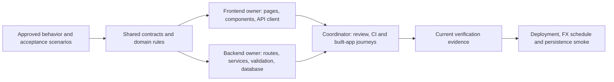

# ComCentral delivery plan after the PayScope audit

Prepared 2026-10-14. This extends the existing ComCentral plan and preserves its unfinished backend work. Planning is complete; the new implementation tasks below have not been executed. Product scope remains [requirements.md](requirements.md). Audit evidence is in [payscope-comparison.md](payscope-comparison.md), run results in [validation.md](validation.md), and the executable checklist in [tasks/todo.md](../tasks/todo.md).

## Outcome and scope

Deliver a usable, deployed HR application whose employee, salary, CSV and reporting workflows preserve data and have current verification evidence. Learn from PayScope's documentation, feature organization, UI and operational patterns while retaining ComCentral's salary audit, stale-write protection, import workflow and dated FX behavior.

Keep Next.js App Router, TypeScript, Material UI, PostgreSQL/Prisma and Better Auth. Keep decimal strings at API boundaries, archive/restore, immutable salary history, native-currency reporting and explicit FX failure states. Do not replace these with PayScope's hard delete, browser token storage, approximate tenure or static FX.

The user-approved registration model is public HR registration with immediate access to one shared workspace, no approval/email-verification gate, and a 5-128-character password policy. Preserve it in this plan. This model does not establish organization membership for a future confidential multi-company service; that different product would need an explicit access-model decision.

The three work categories are:

- **Required:** repair demonstrated defects, complete approved acceptance criteria, verify existing behavior and finish deployment/delivery.
- **Recommended:** mobile cards, richer accessible charts, focused component simplification and operational improvements. These are planned improvements, not completed work.
- **Optional/conditional:** a public landing page, debounced search, measured query/export optimizations and future access features. Their activation conditions are recorded below; they do not silently change first-release requirements.

## Current baseline

Registration, employee management, salary changes/history, CSV import/export, analytics and FX feature code exist. Registration loads locally, password visibility controls exist, and the approved password policy is aligned across the form, HTTP validation and auth configuration.

The latest recorded full unit run has **124 passes and one salary-dialog timeout**. Its five tests pass in isolation. Typecheck, lint, a production build and five updated registration browser fixtures passed; those fixtures intercepted API calls. Earlier real-database/browser registration checks precede the password follow-up. These are different snapshots, not one fully green release. The current application is not recorded as deployed.

Earlier backend notes record a 10,000-row seed on disposable CI databases. That does not replace pending local/deployed workload measurements, seed concurrency review or dedicated demo-environment proof. Do not repeat completed migration/registration implementation merely because an old checklist is unchecked.

## Architecture and ownership

Frontend owns src/components, src/lib/api-client.ts, dashboard/login/register pages and global styles. Backend owns src/server, src/app/api, src/shared/validation.ts, Prisma and migrations. Coordinator owns contracts, root configuration, documentation, CI, integration and Git. A new public route or shared error shape must be coordinated before parallel edits. Additional reviewers may inspect independent areas; no nested delegation or overlapping implementation ownership.

Keep thin route handlers and domain/service boundaries. Extract frontend hooks where a component mixes substantial file/network/state logic. Add repositories or workspace packages only when there is an actual repeated boundary to solve. A larger folder tree is not a delivery requirement.

## Audit coverage and disposition

Every comparison area has a disposition below. A reference-only issue becomes a lesson or regression check; it is not automatically a ComCentral defect.

| Audit area | ComCentral decision | Task / release treatment |
|---|---|---|
| Scope, architecture and AI documentation | Connect requirements, decisions, owners and evidence; correct stale status | C01, C02 |
| Registration/login/password controls | Preserve the implemented flow; verify the five-character policy against a real isolated backend | V01 |
| Account/session security | Keep revocable cookies and durable throttling; prove expiry, logout and boundary failures | S01 |
| Employee create/edit/list/filter/sort/pagination | Keep implementation; verify persisted filtering, stable pages and stale edits | B02, F06 |
| Detail page, archive/restore and history | Preserve evidence; verify archived/stale operations and navigation | B02, F06 |
| Salary changes and conflict recovery | Retain atomic history and explicit reload; investigate the full-suite timeout | F01, B02 |
| Money precision and database constraints | Retain decimal strings and database/runtime constraints; prevent chart/export precision drift | B02, F04, P02 |
| CSV template, import preview and atomic commit | Keep importer; verify duplicate races, changed input and full rollback | B01 |
| CSV data and field mapping | Guide and validated synthetic samples exist; never treat them as customer data | D04; [CSV guide](csv-data-guide.md) |
| CSV export, filters and formula protection | Preserve behavior; measure memory and stream if the workload warrants it | B02, P01, P02 |
| Headcount, totals, percentiles and grouping | Preserve full-filter/native-currency calculations; add persisted proof and visual exploration | B04, F03, F04 |
| Salary bands and tenure | Preserve calendar-year rules and explicit buckets; add accessible visuals | B04, F04, F05 |
| Outliers | Keep like-for-like cohorts, minimum size and zero-IQR policy; explain the rule in UI | B04, F06 |
| Daily FX and failure states | Add checksum read verification, persisted failure coverage, then live provider/cron evidence | B03, D02 |
| Demo-data realism | Keep deterministic supported data; improve realism only if it helps the demo without changing domain scope | B05, P01 |
| Seed production guard and race | Guard the target and perform count/marker preconditions inside the protected transaction | B05 |
| Public landing page | Optional presentation addition; preserve dashboard URLs and redirects | F09, decision before route changes |
| Mobile employee cards | Recommended improvement using the same data/actions as the desktop table | F02 |
| Charts and table alternatives | Keep exact values accessible and filter/currency/date context visible | F03-F05 |
| Debounced search | Optional; preserve URL/back navigation and avoid stale responses | F07 |
| Large CSV component and feature hooks | Extract specific responsibilities without a broad rewrite | F08 |
| Drawer/dialog/keyboard accessibility | Verify our focus and pending-mutation behavior; avoid PayScope's identified gaps | F06 |
| Request IDs and structured redacted logs | Add correlation without exposing salary records or credentials | B06 |
| Readiness, configuration and production start | Verify the built app, bounded DB readiness and actionable configuration failure | B07, V02 |
| Security headers and browser policy | Add and verify a Next/MUI-compatible CSP; verify deployed cookies/headers | S02, D01 |
| Expensive report/import/export protection | Define resource/rate limits compatible with approved imports and the real deployment | S03 |
| Unit, component, integration and E2E coverage | Close specific invariant gaps; require actual test discovery and a reviewed integrated result | F01, V01, B01-B04, V02 |
| CI, toolchain and dependency management | Check clean install/build/start and dependency compatibility; retain the lockfile and intentional version decisions | V02 |
| SQL aggregation and streaming efficiency | Measure first; preserve calculation/export behavior if optimization is justified | P01-P03 |
| Deployment, persistence and daily jobs | Follow the runbook, then record the deployed commit and smoke results | D01, D02 |
| Monitoring, backup and recovery | Define alerts and recovery expectations; demonstrate a restore into an isolated target | D03, D05 |
| Demo, README and final evidence | Publish truthful instructions and a video from the verified application | D04 |
| Viewer role and aggregate privacy | Future scope requiring API authorization/privacy design, beyond hidden buttons | U01 |
| Multiple organizations and membership | Future product decision, outside the current single-workspace release | U02 |
| Recovery, MFA and permission administration | Future account-management scope; do not claim enterprise identity completeness | U03 |

## Delivery sequence and dependencies

| Milestone | Work | Exit condition |
|---|---|---|
| M0: trustworthy baseline | C01, F01, V01 | Scope/status agree; timeout cause addressed; current registration has integrated evidence |
| M1: safe data workflows | B01-B05 | Import failures are atomic; lifecycle/analytics/FX invariants hold; seeding is guarded |
| M2: frontend usability | F02-F06; F07/F08 when selected | Mobile/desktop workflows use the real contract with accessible recovery and exact-data alternatives |
| M3: operational foundation | B06, B07, S01-S03 | Failures are diagnosable; production start/readiness and session/browser boundaries are verified |
| M4: workload evidence | P01, then P02/P03 if justified | Measured latency/memory/error rates and explicit acceptance targets; optimizations preserve results |
| M5: release candidate and delivery | V02, D01-D05 | Reviewed build deployed; FX/persistence verified; monitoring/recovery and delivery evidence recorded |
| Later product work | F09, U01-U03 | A concrete product decision exists before implementation |

M1, M2 and much of M3 can run in parallel after baseline coordination. Frontend need not wait for every additional database test before implementing a UI slice against the stable contract. Each slice is implemented first and checked with focused tests/browser evidence; unrelated test expansion does not block all visible progress. Full required release checks still apply before delivery.

Start frontend with F01, then F02, F03, F04, F05 and F06. Start backend with B05 if a demo target is about to be written; otherwise B01, B02, B03 and B04, followed by B06/B07. Coordinate S02/S03 and contract changes. P01 depends on B05 and relevant data behavior, not optional landing/search work. D02 depends on D01 and B03. V02 runs against the final selected release contents, not repeatedly against documentation edits.

## Acceptance and completion rules

Each checklist task has an owner, dependencies, likely files, up to three acceptance statements, verification and a small/medium scope. If it grows beyond roughly five files or adds an independent behavior, split it before implementation. Do not invent a performance SLA before measuring a baseline; record proposed targets and rationale before declaring workload readiness.

For code changes, run focused meaningful checks, then npm test, npm run typecheck, npm run lint and npm run build at the appropriate integrated checkpoint. Database checks use an isolated TEST_DATABASE_URL that passes target guards. Real browser checks use the built app and designated test target; fixture/intercepted checks remain separately labelled. A command with zero collected tests is not coverage.

Record date, commit or working-tree limitation, command, discovered/passed/failed counts and uncertainty in validation.md. A feature can be implemented but awaiting integration or deployment proof. Preserve assertions; diagnose a timeout before changing timing policy. Do not seed or benchmark the application/production database.

## AI workflow and handoffs

Each agent receives its task ID, user outcome, allowed paths, contract/domain rules, dependencies, acceptance cases and verification commands. It returns changed paths, decisions, executed checks, results and unresolved issues. The coordinator verifies claims and resolves conflicting reviews.

Use architecture.md for dated significant decisions and rejected alternatives, and ai-use.md for AI contributions, corrections and evidence. requirements.md owns approved scope; api-contract.md/contracts.ts own interfaces; tasks/todo.md owns progress; validation.md owns current results. Link these records instead of maintaining competing completion lists in agent rules.

Authorized work can proceed without routine per-step confirmation. Viewer/tenant access, a changed password policy or moving the dashboard route remain product decisions. Hosting/account inputs and costs are resolved when the concrete deployment is ready. No deployment or account action is performed by this planning update.
