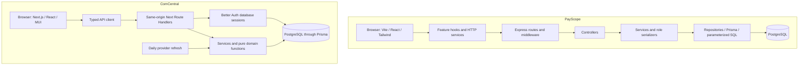

# PayScope and ComCentral: implementation and production-readiness review

Reviewed 2026-10-14. PayScope is pinned to [`f6da3bb170eee144fddf312529e83533bfe6fba5`](https://github.com/meganathan-tech24/PayScope/tree/f6da3bb170eee144fddf312529e83533bfe6fba5). ComCentral is the shared working tree based on `cfb064654d74a4b9cf28ea37eb851329500cc091`, including uncommitted registration work. This report compares existing implementation; recommendations below do not change the approved scope.

PayScope is ahead in product presentation, read-only role support, operational diagnostics and documented deployment experience. ComCentral is ahead in compensation record integrity, CSV migration, revocable cookie sessions, and dated exchange-rate handling. The framework or folder count does not establish production readiness. Both still have material delivery and operational gaps.

## What was reviewed

All eight Markdown documents in PayScope were collectively read in full:

| Document | What it establishes | Review result |
|---|---|---|
| [CLAUDE.md](https://github.com/meganathan-tech24/PayScope/blob/f6da3bb170eee144fddf312529e83533bfe6fba5/CLAUDE.md) | Stack, workflow, security, role and UI rules | Useful discipline, but its pending A-D checklist contradicts the implementation/spec |
| [AGENTS.md](https://github.com/meganathan-tech24/PayScope/blob/f6da3bb170eee144fddf312529e83533bfe6fba5/AGENTS.md) | Generated instructions to read installed Turborepo docs | Tool-specific guidance; it is not the product specification |
| [PROJECT_SPEC.md](https://github.com/meganathan-tech24/PayScope/blob/f6da3bb170eee144fddf312529e83533bfe6fba5/PROJECT_SPEC.md) | Full requirements, architecture, phases and acceptance criteria | Separates much of the scope well, but mixes completed work, future gates and unticked acceptance items |
| [README.md](https://github.com/meganathan-tech24/PayScope/blob/f6da3bb170eee144fddf312529e83533bfe6fba5/README.md) | Setup, capabilities, scripts, deployment and known limits | Checked against source; unchecked E2E/OpenAPI items remain unfinished |
| [docs/requirements.md](https://github.com/meganathan-tech24/PayScope/blob/f6da3bb170eee144fddf312529e83533bfe6fba5/docs/requirements.md) | Approved product boundaries | Salary history and live FX are intentionally excluded there |
| [docs/architecture.md](https://github.com/meganathan-tech24/PayScope/blob/f6da3bb170eee144fddf312529e83533bfe6fba5/docs/architecture.md) | System, request flow, deployment and data model | Broadly matches source; accurately describes the empty E2E scaffold |
| [docs/design-notes.md](https://github.com/meganathan-tech24/PayScope/blob/f6da3bb170eee144fddf312529e83533bfe6fba5/docs/design-notes.md) | Trade-offs, versions, privacy corrections, measurements and deployment lessons | Strong decision record; timings and deployment checks are dated evidence, not a current SLA |
| [docs/ai-prompts.md](https://github.com/meganathan-tech24/PayScope/blob/f6da3bb170eee144fddf312529e83533bfe6fba5/docs/ai-prompts.md) | Human prompts, AI output, corrections and phase results | More detailed than our AI-use log and candid about gaps and failed assumptions |

Ten focused review assignments covered features/UI, backend architecture, auth, salary integrity, analytics/FX, CSV/seed, documentation, tests/CI, deployment/operations and accessibility. Reviewers used `gpt-5.6-sol` with high reasoning; the host allowed three concurrent reviewers plus the coordinator, so the work ran in batches. The coordinator checked conflicting findings against source, including a real PayScope database nonnegative-salary constraint that one reviewer initially missed.

Relevant application paths, schemas, migrations, tests and configuration were traced. This was not an assertion that every line of every repository file had been audited. Environment files were not read, the reference application was not installed or executed, and its test suite was not rerun. No reference source was copied into ComCentral.

## How PayScope used AI, and how ComCentral should improve

The useful lesson is the development process surrounding the AI. PayScope's author describes starting with a specification and standing rules, planning a bounded phase, recording decisions and corrections, and manually checking the running application. Its prompt log distinguishes instructions, generated work, human review and results. The author records real corrections: salary disclosure through Viewer statistics, unsuitable outlier cohorts, mobile overflow, a CSV download-header issue and a production build that could not start. These are author-reported checks, with implementation evidence reviewed here; they were not all reproduced during this review. See the [AI development history](https://github.com/meganathan-tech24/PayScope/blob/f6da3bb170eee144fddf312529e83533bfe6fba5/docs/ai-prompts.md) and [design decisions](https://github.com/meganathan-tech24/PayScope/blob/f6da3bb170eee144fddf312529e83533bfe6fba5/docs/design-notes.md).

ComCentral already has a written scope, typed integration contract, ownership boundaries and deterministic tests. The main process improvement is to connect them: every feature should have a visible requirement, implementation owner, acceptance scenarios and current verification evidence. More agents or more Markdown files will not supply that connection automatically.

| Practice | What to adopt for ComCentral | Evidence required |
|---|---|---|
| Begin with the user outcome | Describe the complete journey and failure recovery before splitting frontend/backend tasks | A short feature brief with acceptance scenarios |
| Bound each AI assignment | Specify allowed files, existing patterns, API dependencies and what must not change | A reviewable diff within the assigned scope |
| Agree the integration contract first | Coordinate changes to `src/shared/contracts.ts`; state money units, validation, error states and session behavior | Frontend and backend exercise the same request/response contract |
| Implement a complete slice | Finish UI, API wiring, persistence and recovery together; use parallel workers only on independent ownership areas | A real journey through the integrated app |
| Separate generation from review | Give a reviewer the requirement and diff; require file/line evidence and challenge assumptions | Findings checked by the coordinator, including rejected false positives |
| Verify the deployed shape | Run the production build and start it, rather than relying only on the development server | Browser and startup evidence from the built artifact |
| Record decisions and corrections | Explain why a design was selected, alternatives rejected and what evidence changed the decision | Concise entries in `architecture.md` and `ai-use.md` |
| Define completion precisely | Distinguish implemented, locally verified, database verified, browser verified and deployed | One current evidence table, with date and commit or working-tree limitation |

PayScope's phase-by-phase approval convention is its author's preference. ComCentral can proceed autonomously inside the user's approved scope; a routine implementation step does not need a new permission gate. New product boundaries and restricted operations still need their applicable decision or approval.

An effective assignment for our salary-change work would be:

> Implement the approved salary-change journey using the existing decimal-string contract and version field. Keep the opening version while the user edits. On a stale-version response, preserve the draft and require an explicit reload followed by fresh review. Disable every dialog-close route while saving. The backend must commit the salary and history together. Show the changed files and evidence for success, stale data and rollback. Do not alter unrelated backend work or the agreed contract without coordination.

This specifies behavior that can be disproved by a test or a browser check. A broad instruction such as "make the app production grade" does not identify a completion condition.

Our registration issue illustrates the same principle: the existence of a `/register` source file and passing component tests did not establish that the server on port 3000 served that page. It was an older production process. Checking the actual URL identified that mismatch. Likewise, frontend password validation, HTTP validation and the auth library's policy had to agree; changing one layer would leave registration broken.

Ten agents were useful for this comparison because documentation, CSV, security, UI, analytics and delivery could be reviewed independently. They should not all edit the same application concurrently. Continue with frontend and backend owners plus one integration coordinator; use additional agents for bounded reviews. Workers should return findings with evidence, uncertainty and a clear handoff. The coordinator must resolve contradictions rather than combine every finding as fact.

## Documentation structure: what to reuse and improve

PayScope's larger specification is useful for its feature and phase detail; its decision history is particularly valuable. ComCentral already separates much of the same information into smaller documents. Consolidate status and strengthen traceability before creating more overlapping specifications.

| Purpose | PayScope location | ComCentral location | Improvement for ours |
|---|---|---|---|
| Product scope and exclusions | `PROJECT_SPEC.md`, `docs/requirements.md` | [requirements.md](requirements.md) | Keep the one-page brief; link detailed acceptance scenarios from the delivery plan |
| Agent rules and ownership | `CLAUDE.md`; tool-specific `AGENTS.md` | [AGENTS.md](../AGENTS.md) | Keep durable rules here; avoid duplicating changing completion checklists |
| Architecture and decisions | `docs/architecture.md`, `docs/design-notes.md` | [architecture.md](architecture.md) | Add dated reasoning and rejected alternatives when a significant decision changes |
| API behavior | Specification and shared schema/type packages | [api-contract.md](api-contract.md), [contracts.ts](../src/shared/contracts.ts) | Keep route, error, normalization and money rules consistent with actual behavior |
| Domain mathematics | Specification and design notes | [analytics-rules.md](analytics-rules.md) | Preserve explicit cohort, rounding, currency and missing-data rules |
| Ordered work | Specification phases and change requests | [implementation-plan.md](implementation-plan.md), backend task files | Name dependencies and one owner; completed work links to evidence |
| AI contribution | `docs/ai-prompts.md` | [ai-use.md](ai-use.md) | Record task, AI changes, human/coordinator corrections, checks and unresolved limits per meaningful slice |
| Execution evidence | Distributed between README, spec and decision log | [validation.md](validation.md) | Use this as the canonical current result; label earlier runs as historical |
| Setup and delivery | README and design notes | [README.md](../README.md), [deployment.md](deployment.md) | Validate setup on a clean checkout and record the deployed commit, smoke result and rollback procedure |

Three cautions apply when learning from their documents. A detailed instruction is not proof that the code follows it. A checked feature is not proof that every associated acceptance item is complete. A successful command is not proof that it ran any tests: their E2E task is the concrete example below. Also, version statements in agent files can become stale; use the installed lockfile and authoritative release documentation for an actual dependency change.

## Feature comparison

| Capability | PayScope implementation | ComCentral implementation | Assessment |
|---|---|---|---|
| Public landing page | Hero, benefits, workflow, role explanation, calls to action | Login/registration lead into the HR workspace | PayScope presents the product better |
| Registration | Name/email/password, HR or Viewer selection; defaults to Viewer | Name/work email/password/confirmation; immediate shared HR access | Different approved access models; ours now has confirmation and show/hide controls |
| Login/logout | JWT login, browser token discard on logout | Better Auth database session and server-side logout | ComCentral has stronger revocation semantics |
| Account recovery/MFA | No completed recovery/MFA flow found in reviewed auth surface | Not implemented in current scope | Neither is a complete enterprise identity product |
| Read-only role | Viewer cannot write or receive individual salaries; salary sorting rejected | One HR access level | PayScope has a capability deliberately excluded from our first release |
| Employee directory | Search, country/department/title filters, sorting, pagination, URL state | Those workflows plus employment type and active/archived status | Comparable core; ours has broader HR filters |
| Search interaction | Debounced search | Explicit filter/search workflow | PayScope offers a smoother search interaction |
| Mobile directory | Dedicated employee cards plus desktop table | Responsive navigation with a horizontally scrollable employee table | PayScope is easier to scan on a phone |
| Employee details | List and edit workflow | Dedicated employee detail and salary history page | ComCentral has deeper operational context |
| Employee lifecycle | Create/edit/hard delete | Create/edit/archive/restore | ComCentral preserves evidence |
| Salary updates | Salary edited with the employee object | Dedicated change requiring reason, actor, timestamp and version | ComCentral is substantially stronger for compensation operations |
| Stale-write handling | No optimistic version predicate in employee update | Version compare-and-swap; stale changes return 409 and require reload | ComCentral prevents silent overwrites |
| Money representation | Exact bounded integer minor units | Exact decimal strings across API, PostgreSQL Decimal storage | Both are valid representations; ours is easier to inspect in spreadsheets |
| CSV export | Filter/sort-aware streaming; role-aware columns; raw minor-unit salary | Filter-aware, formula-protected export with decimal salary | PayScope streams efficiently; ours is more directly spreadsheet-readable |
| CSV import | No importer | Template, preview, row errors, duplicate checks, unchanged-file hash, atomic commit | ComCentral directly supports migration from spreadsheets |
| Pay statistics | Count, min, max, mean, median, P25/P75 by groups | Same plus annual base-pay total and explicit per-currency results | ComCentral covers annual commitments more completely |
| Charts | Recharts, narrative summaries, patterns/legends, expandable data tables | Cards, tables, chips and distribution bars | PayScope offers richer visual exploration |
| Tenure | Day difference divided by 365.25 | Completed calendar years with a leap-day rule | Ours matches anniversary-based tenure; theirs is approximate near boundaries |
| Outliers | Country/currency/title/employment-type groups, minimum eight | Same cohort dimensions, minimum ten, explicit insufficient/zero-IQR states | Ours makes non-flagging decisions more explicit; thresholds are product choices |
| USD reporting | Static illustrative rates, labelled approximate | Daily provider fetch, stored dated snapshots, freshness/failure states | ComCentral has the stronger FX lifecycle; live provider/deployment verification remains pending |
| Analytics privacy | Suppresses groups under five, removes Viewer min/max, uses rounded bands | All analytics are authenticated HR data | PayScope better supports safe read-only exploration, with documented residual inference limits |
| Demo data | Weighted countries, realistic names/job bands, tenure/type effects and deliberate outliers | Deterministic generic synthetic names and varied supported currencies/departments | PayScope's demo dataset is more realistic |
| Seed behavior | Transactional replacement of all employees, production guard with override | Marker-based refusal of unmarked/inconsistent existing data, no deletion | Ours preserves existing records better; its prechecks still need concurrency/production hardening |
| Logging/diagnostics | Request IDs, structured redacted Pino, asynchronous database log persistence, DB health | Sanitized error logging; no comparable request tracing/health endpoint found | PayScope has stronger operational diagnostics |
| Deployment | Public frontend responds; repository documents Vercel + Render + PostgreSQL | Local app verified; deployment pending | PayScope has a delivery lead, but current API/database health was not verified here |

Implementation evidence: PayScope [frontend routes](https://github.com/meganathan-tech24/PayScope/blob/f6da3bb170eee144fddf312529e83533bfe6fba5/apps/web/src/app/router/routes.tsx), [employee page](https://github.com/meganathan-tech24/PayScope/blob/f6da3bb170eee144fddf312529e83533bfe6fba5/apps/web/src/pages/EmployeesPage.tsx), [dashboard](https://github.com/meganathan-tech24/PayScope/blob/f6da3bb170eee144fddf312529e83533bfe6fba5/apps/web/src/pages/DashboardPage.tsx), [employee repository](https://github.com/meganathan-tech24/PayScope/blob/f6da3bb170eee144fddf312529e83533bfe6fba5/apps/api/src/modules/employees/employees.repository.ts), [analytics repository](https://github.com/meganathan-tech24/PayScope/blob/f6da3bb170eee144fddf312529e83533bfe6fba5/apps/api/src/modules/insights/insights.repository.ts); ComCentral [components](../src/components), [employee service](../src/server/services/employees.ts), [import service](../src/server/services/imports.ts), [analytics](../src/server/domain/analytics.ts), [FX service](../src/server/services/fx.ts).

## Architecture and design patterns

| Pattern | PayScope | ComCentral | Practical consequence |
|---|---|---|---|
| Deployment boundary | pnpm/Turbo monorepo; web/API separately deployable | One Next.js application | Ours has fewer hosts and no cross-origin browser API setup; theirs allows independent release/scaling |
| Backend layering | Route → controller → service → repository | Route → service → domain/Prisma | Their conventions are more explicit; ours needs fewer pass-through layers |
| Frontend organization | Feature-local components/hooks/services/schemas/types | Domain components, centralized API client, thin route pages | Their larger frontend is easier to navigate by feature; ours can extract complex hooks without changing framework |
| Shared contract | Runtime schemas and types in workspace packages | `src/shared/contracts.ts`, server validation, frontend input checks | Ours must guard against policy drift where frontend checks are repeated |
| Server state | TanStack Query, section-specific insight queries | TanStack Query, consolidated insight response | Their sections recover independently; ours uses one filtered population/reporting context |
| Authentication | Custom JWT middleware and browser bearer token | Better Auth persistent session cookie | Ours avoids browser-readable token storage and supports revocation |
| Authorization | Role guards plus allowlisted output shapes | One authenticated HR boundary | Their role privacy applies across list/detail/export/analytics, not merely hidden buttons |
| Data consistency | Ordinary CRUD, database uniqueness/checks | Optimistic versions, transactions, immutable history triggers | Ours protects salary-change evidence and concurrent edits |
| Analytics execution | Aggregations, percentiles and cohorts in SQL | Bounded-domain calculations with Decimal in Node | Ours is straightforward to test; theirs transfers less data and is better positioned for larger datasets |
| Error handling | Common envelope, typed errors, request IDs and central logs | Typed API errors, sanitized route wrapper and actionable UI states | Adopt request correlation and richer observability in ours |
| Configuration | Validated startup config, built API smoke, graceful shutdown | Lazy server configuration and Next deployment conventions | Ours needs a deployed readiness/configuration smoke plan |

Keep Next.js, MUI, Prisma and Better Auth. A wholesale move to Express/Turborepo/Tailwind would add migration work without resolving the identified product or operational gaps. Borrow useful patterns: feature-local hooks, a consistent status ledger, request correlation, chart alternatives, and a measured performance budget.

## Security and data correctness

- **Session advantage:** ComCentral stores session credentials in HttpOnly cookies, uses SameSite=Lax and Secure in production, checks mutation origins and uses database-backed auth throttling. PayScope stores JWTs in localStorage; logout does not invalidate a copied token before expiry. See [PayScope token storage](https://github.com/meganathan-tech24/PayScope/blob/f6da3bb170eee144fddf312529e83533bfe6fba5/apps/web/src/features/auth/services/token-storage.ts), [ComCentral auth](../src/server/auth.ts) and [HTTP boundary](../src/server/http.ts).
- **Access model:** PayScope lets the public choose HR Manager. ComCentral deliberately grants every new HR account access to the same workspace. Neither public-registration model establishes organization membership for confidential multi-company use. ComCentral's immediate access and five-character minimum are explicit user decisions, not accidental implementation errors.
- **Browser headers:** PayScope's Express Helmet middleware protects its API origin; it does not automatically protect its Vercel HTML origin. The public login GET returned 200 and HSTS on 2026-10-14, but no CSP, X-Frame-Options, nosniff or Referrer-Policy. ComCentral configures the latter three plus Permissions-Policy, but no CSP. Production cookie/header behavior needs deployment verification.
- **Salary evidence:** ComCentral's salary change and history record commit together, and history cannot be updated/deleted. Direct privileged database writes can still bypass the service-level requirement to create history; the application is not a tamper-proof ledger against database administrators.
- **Database constraints:** PayScope does have `CHECK (salary >= 0)` in its [initial SQL migration](https://github.com/meganathan-tech24/PayScope/blob/f6da3bb170eee144fddf312529e83533bfe6fba5/apps/api/prisma/migrations/20260929173438_init/migration.sql). Its application upper bound and ComCentral's stricter precision/range checks should not be compared by reading Prisma models alone.
- **FX integrity hardening:** ComCentral validates stored rate shape, positive values and USD convention, and database triggers protect immutable snapshots. It stores a canonical checksum but does not recompute it when reading. If checksum verification is part of the integrity promise, add a read-time comparison and a persisted-data regression test. See [FX service](../src/server/services/fx.ts) and [canonicalization](../src/server/domain/fx.ts).
- **Seed race:** ComCentral checks marker/employee counts before opening the insert transaction. A concurrent employee creation can invalidate the exact-count precondition. Move those reads into the serializable transaction and add a production-target refusal/explicit override. This is a backend follow-up; the review did not modify or run the seed.
- **Analytics choices:** PayScope's day/365.25 tenure can leave an employee in the younger bucket on an exact anniversary. It also applies Tukey fences when IQR is zero; ComCentral deliberately suppresses those cohorts. The latter is a policy difference, not proof that every zero-IQR flag is mathematically invalid.

## Frontend detail and accessibility

PayScope's strongest reusable UI patterns are feature-local query/mutation hooks, dedicated mobile employee cards, chart summaries and expandable table alternatives. Its chart data remains available without interpreting color or hovering over a graph. Borrow those interaction patterns while keeping ComCentral's MUI theme and existing domain components; adopting Tailwind is not necessary.

The review also found specific limits in PayScope's UI:

- The shared [Modal](https://github.com/meganathan-tech24/PayScope/blob/f6da3bb170eee144fddf312529e83533bfe6fba5/apps/web/src/components/ui/Modal.tsx) always calls `onClose` for Escape, backdrop and the close button. The employee mutation dialogs pass that callback without a pending-state guard. Disabling the form's Cancel button therefore does not prevent dismissal during a save/delete. ComCentral's salary dialog guards closure while saving.
- The mobile [AppShell](https://github.com/meganathan-tech24/PayScope/blob/f6da3bb170eee144fddf312529e83533bfe6fba5/apps/web/src/components/layout/AppShell.tsx) supplies a backdrop and Escape handling, but no explicit focus movement, focus containment or focus restoration for the drawer. Its shared Modal does implement these behaviors; the drawer is the narrower gap. This is a source finding, not a reproduced assistive-technology test.
- PayScope's reviewed login/registration fields lack password visibility controls. ComCentral now has independent, keyboard-accessible controls for login, registration and confirmation.

ComCentral's employee table scrolls within its container. That is a supported responsive approach; it is not by itself evidence of page overflow. Mobile cards would improve readability. Our larger CSV-import component also combines file-reading, preview state, mutations and result tables. Extracting a file/preview hook and focused tables would clarify those responsibilities; a repository-wide frontend rewrite is unnecessary.

## Testing, CI and evidence quality

PayScope has a substantially broader component and database-integration test inventory, including privacy-shaped responses, streaming export, deterministic seeding, logging failures and production startup. Its design notes record 532 unit and 182 integration tests at the last documented stage. Those are historical author-recorded results, not tests rerun in this review.

Its E2E gate is a concrete gap: the root command dispatches `turbo run test:e2e`, but no workspace defines that script; the E2E directories contain only `.gitkeep`, and there is no Playwright configuration. The CI step therefore supplies no browser regression coverage. The AI-use log itself describes the command as a clean no-op. See [scripts](https://github.com/meganathan-tech24/PayScope/blob/f6da3bb170eee144fddf312529e83533bfe6fba5/tests/package.json), [workflow](https://github.com/meganathan-tech24/PayScope/blob/f6da3bb170eee144fddf312529e83533bfe6fba5/.github/workflows/ci.yml), and [AI-use evidence](https://github.com/meganathan-tech24/PayScope/blob/f6da3bb170eee144fddf312529e83533bfe6fba5/docs/ai-prompts.md).

PayScope's destructive integration setup relies on a database name ending `_test`, allows any host, then migrates and truncates that target. ComCentral additionally compares against application database identities, and real browser writes require a matching local test app/database. This reduces accidental application-data targeting; remote test execution should still be an explicit choice. See [PayScope target guard](https://github.com/meganathan-tech24/PayScope/blob/f6da3bb170eee144fddf312529e83533bfe6fba5/tests/api/setup/test-database.ts), [ComCentral integration guard](../tests/integration/test-database.ts), and [browser guard](../tests/e2e/test-target.ts).

ComCentral's workflow defines separate app/integration PostgreSQL services and actual browser journeys. The backend session records 14 passing isolated-database cases and 15 browser journeys, including live registration, login/logout and salary-audit behavior. This frontend session separately passed the updated registration/password checks, TypeScript, lint and a 17-page production build. Latest counts and snapshot limitations are in [validation.md](validation.md); a changing uncommitted tree is not a published, green CI commit.

Our remaining coverage is meaningful: persisted CSV rollback/revalidation races, analytics/FX persistence, session expiry, provider failures, 10,000-row workloads and deployed behavior. Raw test counts alone cannot establish that these invariants are covered.

## Production operations and performance

PayScope has a DB-aware health route, startup configuration validation, graceful SIGTERM handling, a real production-start smoke test, request IDs, structured redacted logs and a fallback when database logging fails. These are good patterns for ComCentral. Its API rate limits remain per-process, logging has no demonstrated retention/alerting strategy, and its notes acknowledge missing monitoring.

ComCentral's deployment runbook separates preview/production databases, uses a pooled runtime connection and direct migrations, and avoids schema rollback on an app rollback. It still lacks comparable readiness checks, request correlation, external alerting and evidence of backup/restore drills. Auth throttling alone does not limit expensive report/import/export routes.

Performance must be measured before claiming scale:

- PayScope streams CSV in 500-row batches and pushes analytics into SQL. Its published timings are local, mostly warm, single-machine measurements; this review did not reproduce them.
- ComCentral's export and analytics materialize all matching records in Node. A 10,000-row per-import cap does not cap the accumulated database. Measure memory and latency at the intended workload, then stream exports or move selected aggregates into SQL where the measurements justify it.
- Our benchmark script currently measures sequential cold/warm requests. A production confidence report also needs concurrency, percentile latency, error rates and cold-start behavior.
- Neither repository alone proves configured managed backups, recovery time/point targets, restore drills, monitoring or operational ownership.

The public PayScope login was reachable during this review; its API/database and authenticated live behavior were not checked. ComCentral remains locally verified and undeployed. Do not label either as fully production-ready from Markdown or a successful build alone.

## Improvements to prioritize in ComCentral

| Priority | Work | Owner / reason |
|---|---|---|
| Verification closure | Resolve the salary-dialog timeout in the full unit suite, then record a passing reviewed snapshot | Frontend/coordinator; focused tests pass, but the latest full run is 124 passed and 1 timeout |
| First delivery | Deploy a reviewed commit, apply migrations safely, obtain a real FX snapshot, enable/observe cron, verify persistence and authenticated workflows | Backend/coordinator; turns local implementation into demonstrable delivery |
| First UI improvement | Mobile employee cards and clearer chart-based pay/headcount/tenure exploration, retaining accessible tables | Frontend; directly addresses PayScope's strongest usability advantages |
| Operational baseline | Request IDs, structured redacted logs, DB readiness, FX-job freshness monitoring and error alerts | Backend/coordinator; makes failures diagnosable |
| Data hardening | Transactional seed prechecks/target guard, checksum read validation or clarified integrity contract | Backend; addresses specific review findings |
| Workload evidence | Safely seed a separate 10,000-employee demo database; measure report/export/load behavior and optimize measured bottlenecks | Backend/coordinator |
| Browser hardening | Next/MUI-compatible CSP and deployed cookie/header verification | Shared integration work |
| Maintainability | Extract complex feature hooks where they clarify components; one canonical status/evidence table | Frontend/coordinator; avoid an unnecessary framework rewrite |
| Product polish | Public landing page and a short demo video after deployed functionality is verified | Frontend/delivery |
| Future scope decision | Viewer role, membership/tenant boundaries, recovery/MFA and permission administration | Requires a product decision; these are outside current approved scope |

No new feature above was implemented merely because PayScope has it. The requested password updates were completed; backend review findings are recorded for the separate backend session.

## CSV data

Use ComCentral's `/imports` → **Download template**, fill it from authorized HR data, then validate and confirm. Ready-made 10-row and 10,000-row synthetic CSVs were generated and validated without database writes. PayScope contains no ready-made CSV dataset; its exported salaries are integer minor units and require conversion before our importer can use them. See the complete [CSV data guide](csv-data-guide.md) for file locations, mapping, supported values and import steps.
